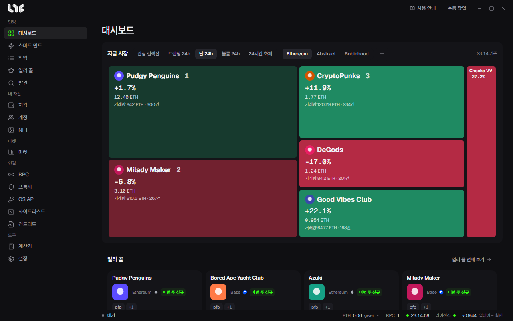

# 대시보드

앱의 첫 화면입니다. 지금 시장과 얼리 콜을 봅니다.

## 지금 시장

타일 크기가 거래 규모를 뜻합니다. 초록은 상승, 빨강은 하락입니다. 타일을 누르면 마켓의 컬렉션 상세로 갑니다.

| 탭 | 보여 주는 것 |
| --- | --- |
| 관심 컬렉션 | 마켓에서 별표한 컬렉션 |
| 트렌딩 24h | 24시간 판매 건수 상위 |
| 탑 24h | 24시간 거래량 상위 |
| 볼륨 24h | 24시간 거래량, 7일 평균 대비 증가율 상위 |
| 24시간 화제 | 24시간 플로어 상승률 상위(판매 3건 이상) |

오른쪽에서 체인을 고릅니다. **+**로 다른 체인을 엽니다.

## 얼리 콜

운영자가 대시보드 픽으로 고른 민팅 전 프로젝트가 나옵니다. **얼리 콜 전체 보기**로 [얼리 콜](early-calls.md)을 엽니다.

## 위쪽과 아래쪽

- 위쪽 **사용 안내**: 이 가이드를 엽니다.
- 위쪽 **수동 작업**: 작업 만들기 창을 바로 엽니다.
- 아래 상태줄: 실행 상태, 가스, RPC 수, PC 시각, 라이선스 상태, 버전을 보여 줍니다. 가스나 RPC에 마우스를 올리면 자세히 나옵니다.
