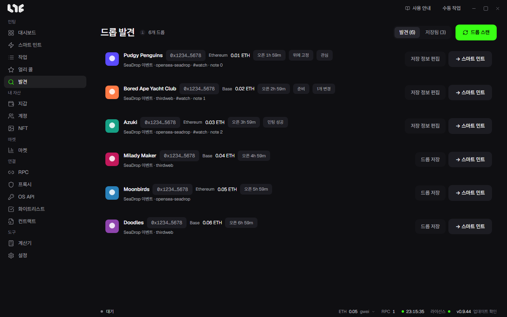

# 드롭 발견

지원 체인의 SeaDrop 설정 이벤트와 최근 SeaDrop 배포를 스캔해 새 드롭을 찾습니다. 컨트랙트 기준으로 중복을 지웁니다. **드롭 스캔**을 누르기 전에는 스캔하지 않으므로 평소 RPC를 쓰지 않습니다.

## 쓰는 법

1. **드롭 스캔**을 누릅니다.
2. 목록에서 드롭을 봅니다. 체인, 가격, 오픈까지 남은 시간, 출처가 나옵니다.
3. **→ 스마트 민트**를 누르면 그 드롭이 [스마트 민트](../tasks/smart-mint.md)에 채워집니다.

행에서 컨트랙트를 복사할 수 있습니다.

## 저장

**드롭 저장**으로 넣으면 발견 목록이 지나가도 남습니다. **저장됨**에서 봅니다.

**저장 정보 편집**에서 아래를 정합니다.

- **위에 고정**
- 상태: **관심, 준비, 민팅 성공** 등
- 태그(쉼표로 구분)와 개인 메모

저장한 드롭의 가격, 시작, 끝, 페이즈, 플랫폼, 이름이 바뀌면 변경 수가 표시됩니다. 확인하면 표시를 지웁니다. **저장 해제**로 뺍니다.

스캔으로 찾은 드롭은 아직 검증되지 않은 후보입니다. 공식 링크와 맞는지 확인하고 쓰세요.
