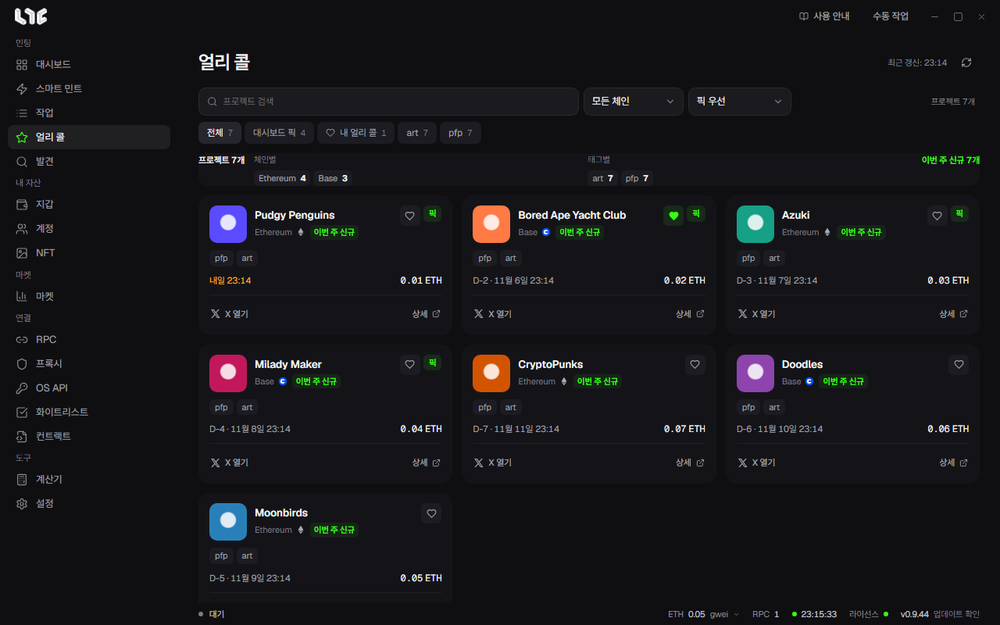

# 얼리 콜

운영자가 고른 민팅 전 프로젝트 목록입니다. 왼쪽 메뉴 **얼리 콜**로 들어갑니다.

## 찾아보기

- **프로젝트 검색**, 체인, 태그로 거릅니다.
- 정렬: 픽 먼저, 최근 등록, 민팅 일정 순.
- 탭: **전체, 대시보드 픽, 내 얼리 콜**.
- 위쪽 통계는 지금 필터의 프로젝트를 체인별, 태그별로 셉니다.

## 카드

프로젝트 이름, 한 줄 소개, 체인, 태그, 민팅 일정과 남은 날(D-3처럼)이 나옵니다. **상세**를 누르면 프로젝트 소개, 민팅 가격, 링크, 운영자 갱신 기록이 나옵니다.

별을 누르면 **내 얼리 콜**에 넣습니다. 이 PC에 저장됩니다.

## 태그

새 프로젝트, 급상승, WL 모집 중, 민팅 임박, 팀 공개, 콜라보, 무료 민팅, 화제 같은 태그를 운영자가 붙입니다.

얼리 콜을 본다고 작업이 시작되지는 않습니다. 민팅이 열리면 [스마트 민트](../tasks/smart-mint.md)로 작업을 만드세요.
