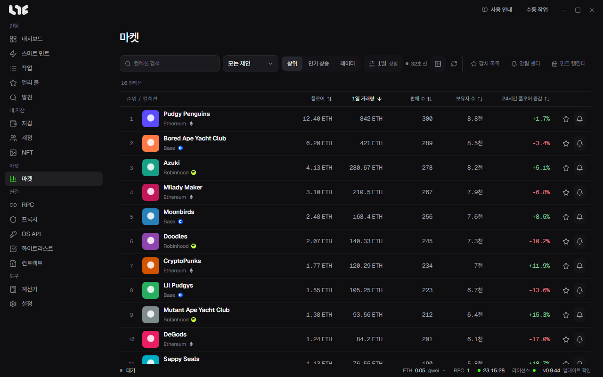

# 마켓

컬렉션 시세를 실시간으로 보고, 관심 컬렉션을 모으고, 알림을 거는 화면입니다.

시세는 Nogada 마켓 허브에서 실시간으로 받습니다. OpenSea API 키가 없어도 볼 수 있습니다. 연결 상태는 **설정 → 연동 → 마켓 허브**에 나옵니다.

툴바 오른쪽의 **감시 목록, 알림 센터, 민트 캘린더**로 화면을 옮깁니다.

## 둘러보기

- **컬렉션 검색**: 이름으로 찾습니다.
- **체인**: 특정 체인만 봅니다.
- **상위, 인기 상승, 레이더**: 순위를 보는 세 방식입니다. 인기 상승은 고른 기간에 뜨는 컬렉션, 레이더는 둘을 합친 것입니다.
- **기간 및 정렬**: 탐색 기준과 조회 기간을 고릅니다. 정렬 기준은 한 번에 하나만 적용됩니다.
- **카드 보기, 표 보기**를 바꿉니다.

표는 순위와 컬렉션, 플로어, 거래량, 판매 수, 보유자 수, 24시간 플로어 증감을 보여 줍니다. 열 머리글을 누르면 정렬됩니다.

행의 별은 **관심 등록**, 종은 **알림 만들기**입니다. 이름을 누르면 컬렉션 상세로 갑니다.

## 컬렉션 상세

위쪽에 시세 요약이 나옵니다. 플로어, 최고 오퍼, 24시간 거래량과 판매 수, 평균 판매가, 총 수량, 보유자 수, 리스팅, 보유자 비율, 오퍼 / 플로어입니다.

### 차트

- **기간**: 1시간, 1일, 7일, 30일. 캔들 간격은 따로 고를 수 있습니다.
- **차트 지표**: 플로어, 호가, 리스팅, 오퍼, 거래량, SMA 20, EMA 50, 볼린저 밴드, RSI 14, 내 평균.
- **희귀도 필터**: 전설+에픽, 희귀 이상 등으로 판매 점을 거릅니다. 판매 점을 누르면 그 토큰 카드가 열립니다. 저장된 순위가 있으면 OpenSea 한도를 쓰지 않고 먼저 보여 줍니다.
- **차트 형태**: 판매 점, 캔들, 종가 라인.
- 그리기 도구: 십자선, 추세선, 가격선, 가격과 시간 측정.
- 휠로 확대, 드래그로 이동, 더블클릭이나 Home으로 초기화, 방향키와 +/− 를 지원합니다.
- **차트 이미지 복사**로 이미지를 복사합니다.

컬렉션을 처음 열면 가격 기록을 모으는 동안 잠시 기다립니다. 남은 시간이 나옵니다.

### 오른쪽 패널

- **활동**: 판매, 리스팅, 오퍼, 전송, 민팅을 칩으로 걸러 봅니다. **과거 기록 보기**로 이전 기록을 봅니다.
- **오더북**: 가격대별 누적 오퍼와 리스팅입니다.
- **보유자**: 보유자 수, 상위 10명 보유 비중, 상위 지갑입니다.
- **특성**: 특성별 플로어와 공급량, 24시간 거래입니다. 일부 체인은 지원하지 않습니다.

## 감시 목록

별표한 컬렉션만 모읍니다. 대시보드의 **관심 컬렉션**과 같은 목록입니다.

## 알림 센터

**컬렉션, 지갑, 기록** 탭이 있습니다.

### 컬렉션 알림

상세 화면을 열어 두지 않아도 변화를 알려 줍니다. **새 알림**에서 아래를 정합니다.

- **컬렉션 식별자**와 체인
- **지표**: 플로어 가격, 플로어 변화율, 거래량 변화율, 판매 수 변화율, 리스팅 수 변화율, 최고 오퍼 / 플로어, 상위 10명 보유 비중, RSI
- **조건**과 **기준값**. 플로어 가격이면 **가격 통화**도 씁니다
- **알림 간격**과 **한 번, 반복**
- 채널: **Windows**, **Telegram**

### 지갑 알림

**새 지갑 알림**에서 EVM 주소의 OpenSea 활동을 따라갑니다. 민팅, 받음, 구매, 판매 가운데 고릅니다.

### Telegram 연결

Telegram으로 받으려면 알림 센터의 Telegram 연결 카드에서 연결 코드를 만들고, 같은 라이선스로 로그인한 봇 채팅에 명령을 보냅니다. 코드는 5분 동안 유효합니다. 마켓 알림만 연결합니다.

## 지갑으로 산 NFT를 보려면

내가 가진 NFT는 [보유 NFT](../tools/nfts.md)에서, 손익은 [손익](../tools/pnl.md)에서 봅니다.
