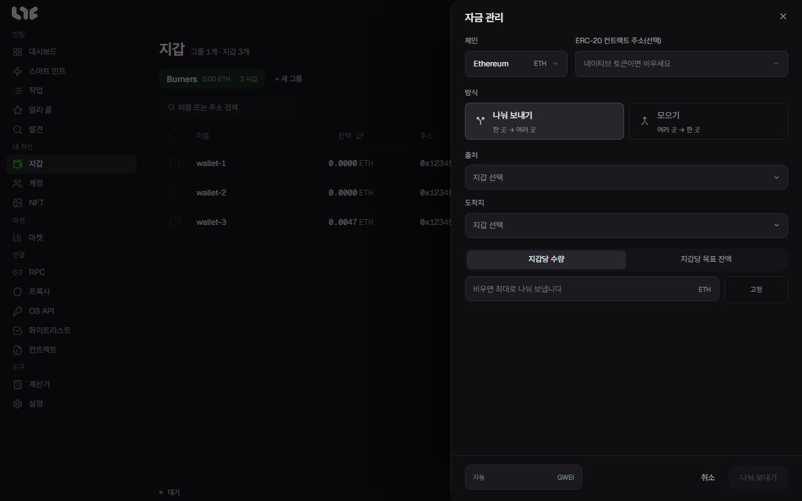

# 자금 나눠 보내기와 모으기

**지갑 → 자금 관리**는 지갑 사이에서 코인을 한꺼번에 옮기는 창입니다. 민팅 전에 가스비를 나눠 줄 때, 민팅 뒤에 남은 돈을 한 지갑으로 모을 때 씁니다.

## 창의 칸

| 칸 | 넣는 것 |
|---|---|
| 체인 | 돈을 옮길 체인입니다. |
| ERC-20 컨트랙트 주소(선택) | 토큰을 옮길 때만 토큰 컨트랙트를 넣습니다. 비우면 그 체인의 기본 코인(ETH 등)입니다. |
| 방식 | **나눠 보내기**(한 곳 → 여러 곳) 또는 **모으기**(여러 곳 → 한 곳). |
| 출처 | 돈을 내보낼 지갑입니다. |
| 도착지 | 돈을 받을 지갑입니다. 목록에 없는 주소로 보낼 때는 직접 입력할 수 있습니다. |
| 금액 | 아래 두 가지 가운데 하나로 정합니다. |
| 왼쪽 아래 gwei | 이 이동에 쓸 가스입니다. 비우면 자동입니다. `30`처럼 하나를 쓰면 최대 수수료와 우선 수수료가 둘 다 그 값이고, `30/2`처럼 쓰면 앞이 최대 수수료, 뒤가 우선 수수료입니다. |

## 금액 정하는 두 가지

- **지갑당 수량**: 도착지마다 같은 양을 보냅니다. 칸을 비우면 출처가 보낼 수 있는 만큼을 나눠 보냅니다.
- **지갑당 목표 잔액**: 도착지마다 잔액이 이 값이 되도록 모자란 만큼만 채웁니다. 이미 그 이상 있는 지갑은 건너뜁니다. 모으기에서는 반대로, 보내는 지갑마다 이 값만 남기고 나머지를 보냅니다.

금액 칸 오른쪽의 **고정** 버튼을 누르면 `0.02 - 0.03`처럼 범위를 넣을 수 있습니다. 그러면 지갑마다 그 범위 안의 무작위 금액을 보냅니다.

## 나눠 보내기의 실제 동작

나눠 보내기는 먼저 나눠 보내기 컨트랙트를 거쳐 거래 하나로 모든 도착지에 보냅니다. 이 거래가 실패하면 앱이 **따로 보낼까요?**라고 묻고, 받아들이면 같은 출처 지갑에서 도착지마다 거래를 하나씩 보냅니다.

## 지갑 하나에서 한 곳으로

한 지갑에서 한 주소로만 보낼 때는 지갑 표의 행에 있는 보내기 버튼이 더 빠릅니다. → [지갑](wallet-groups.md)

## 쓰기 전에

- 보내기 전에 출처와 도착지가 맞는지 한 번 더 봅니다. 체인에 올라간 거래는 되돌릴 수 없습니다.
- 출처 지갑에는 보낼 금액에 더해 가스비가 남아 있어야 합니다.
- 각 지갑에 얼마가 필요한지는 [계산기](../app/calculator.md)의 **필요 잔액**을 참고하세요.
