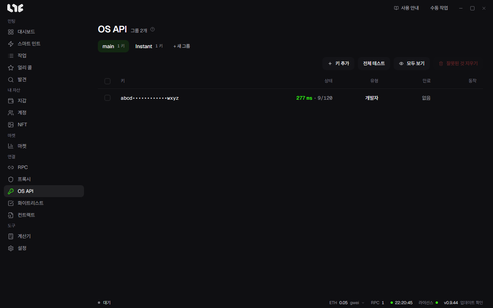

# OpenSea API 키

**OS API** 메뉴에 OpenSea API 키를 넣어 둡니다. 민팅은 키 없이도 되지만, 앱에서 OpenSea로 팔려면 키가 있어야 합니다.

## 키 받기

두 가지가 있습니다.

- **Developer 키**: OpenSea에서 무료로 받습니다. opensea.io에서 **Settings → Developer**로 가서 이메일을 인증하고, **Get access**를 눌러 짧은 양식을 채운 뒤 **Create key**를 누릅니다. OpenSea 계정 하나에 3개까지 만들 수 있습니다. Instant 키보다 훨씬 많은 요청을 받아 줍니다.
- **Instant 키**: [계정과 소셜 작업](../social/accounts-and-social.md)의 Instant 키 작업으로 만듭니다. 7일 동안 쓰고, 받아 주는 요청이 적습니다. 만들 때는 늘 프록시를 거칩니다([프록시](proxy-groups.md) 참고).

## 키 넣기

1. **+ 새 그룹**으로 그룹을 만듭니다. 작업에서 어느 그룹의 키를 쓸지 고를 수 있습니다.
2. **키 추가**를 누르고 한 줄에 키 하나씩 붙여넣습니다.
3. **확인 후 N개 추가**를 누릅니다. 앱은 키마다 OpenSea에 물어보고 받아 주는 키만 저장합니다.

키는 이 PC에 암호화되어 저장됩니다.

## 표 읽기

| 칸 | 뜻 |
|---|---|
| 키 | 앞뒤 몇 글자만 보입니다. **모두 보기**를 누르면 전체가 보입니다. |
| 상태 | 마지막 확인 때의 응답 시간과, OpenSea가 알려 준 남은 요청 수 / 한도입니다. |
| 유형 | **개발자**, **Instant** 같은 키 종류입니다. |
| 만료 | 키에 만료가 있으면 그 시각입니다. |

- **전체 테스트**: 그룹의 키를 모두 다시 확인합니다.
- **잘못된 것 지우기**: 그룹에서 만료되었거나 OpenSea가 거절한 키를 지웁니다.

**Instant** 그룹에는 Instant 키 작업이 만든 수명이 짧은 키가 들어갑니다. 키를 만드는 작업은 [계정과 소셜 작업](../social/accounts-and-social.md)의 모듈에서 고릅니다.

## 키가 있으면 되는 것

| 기능 | 키 없이 |
|---|---|
| 보유 NFT의 **선택 올리기**, **리스팅 취소**, **오퍼 수락** | 안 됩니다. 버튼이 꺼져 있고, 마우스를 올리면 OS API 화면에서 키를 추가하라고 나옵니다. |
| 보유 NFT 표의 **리스팅**, **최고 오퍼** 칸 | 값 대신 **OpenSea API 키 필요**가 나옵니다. |
| 작업의 민팅 뒤 동작 중 **NFT 올리기**, **오퍼 수락** | 안 됩니다. 칸 옆에 **OpenSea API 키 필요**라고 나옵니다. |
| 스마트 민트와 작업의 OpenSea 방식 중 **OpenSea API**, **듀얼 모드** | 고를 수 없습니다. 칸 이름 옆에 **OpenSea API 키 필요**라고 나옵니다. |
| 마켓의 지갑 알림 | 알림 센터에 **지갑** 탭이 나오지 않고 지갑 알림도 돌지 않습니다. 만들어 둔 지갑 알림은 지워지지 않고, 키를 다시 넣으면 돌아옵니다. |
| 민트 캘린더의 내 화이트리스트 연결 | 안 됩니다. 연결하려 하면 OS API 페이지에서 키를 먼저 추가하라고 나옵니다. |
| 서명 드롭의 **일반 모드**, **익명 모드** | 됩니다. |
| 마켓 시세와 차트 | 됩니다. Nogada 서버에서 받습니다. |

## 지갑이 많으면 키도 여러 개

**상태** 칸에는 OpenSea가 그 키에 앞으로 몇 번의 요청을 더 허락하는지가 나옵니다. 작업 그룹 하나가 많은 지갑의 요청을 한꺼번에 보내면 키 하나는 중간에 바닥날 수 있으니, 지갑이 많다면 키를 여러 개 넣어 두세요. 스마트 민트의 안내도 같은 것을 권합니다.

한도는 키마다 따로입니다. 같은 IP에서 써도 키끼리 한도를 나눠 쓰지 않으니, 키를 쓸 때는 프록시가 필요 없습니다.

## 저희 시험에서 본 값

감을 잡으시라고 적어 두는, 2026년 11월 저희가 직접 해 본 대략의 값입니다. OpenSea는 한도를 바꾸기도 하고, 드롭과 시점에 따라 결과가 다를 수 있습니다.

| 해 본 것 | 결과 |
|---|---|
| Developer 키 하나로 지갑 10개의 민팅 데이터를 한꺼번에 요청 | 10개 모두 답을 받음 |
| 같은 키로 지갑 30개를 한꺼번에 | 26개는 답을 받고, 4개는 너무 빨리 묻는다고 거절됨 |
| Developer 키가 다시 차는 속도 | 한 번에 약 120번까지 받고, 그 뒤로는 1초에 약 2번씩 다시 참 |
| Instant 키 하나 | 답 약 5번, 그 뒤 시간당 5번 안팎 |

API 모드는 지갑마다 한 번씩 묻습니다. 위 값으로 계산하면 지갑 100개에 Developer 키 약 4개가 필요합니다. 실제 오픈에서 쏴 본 값이 아니라 위 값으로 계산한 것이고, 키 시험은 아직 단계가 열리지 않은 드롭에 대고 했습니다. 민팅 직전에 지갑 100개의 NFT 화면을 열어도 키 하나를 다 쓸 수 있습니다.
