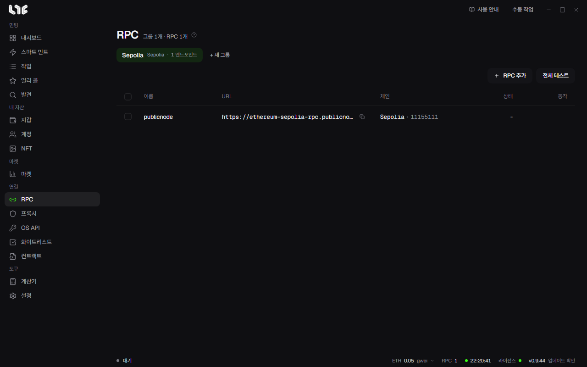

# RPC와 체인

RPC는 앱이 체인의 상태를 읽고 거래를 보내는 노드 주소입니다. 작업이 보내는 거래는 모두 RPC를 거쳐 나가므로, RPC가 느리거나 막히면 그만큼 늦게 보내거나 못 보냅니다.



## RPC를 넣지 않으면

넣지 않아도 앱은 돌아갑니다. 그 체인의 RPC를 하나도 저장하지 않았다면 체인마다 정해진 공개 RPC로 보내고, 작업 창 아래에 **RPC 없음, 공개 RPC 사용**이라고 알려 줍니다. 공개 RPC는 여러 사람이 함께 쓰기 때문에 요청이 몰리면 막히거나 느려집니다. 경쟁이 있는 민팅이라면 유료 RPC를 넣으세요. 앱의 도움말은 Alchemy, Ankr, DRPC, QuickNode를 추천합니다.

## RPC 넣기

1. **RPC** 메뉴에서 **+ 새 그룹**으로 그룹을 만듭니다.
2. **RPC 추가**를 누르고 한 줄에 하나씩 붙여넣습니다. `이름,URL` 또는 URL만 써도 됩니다.

```
eth-alchemy,https://eth-mainnet.g.alchemy.com/v2/내키
https://base-mainnet.example.com/abc
```

3. **N개 추가**를 누르면 앱이 각 주소의 체인을 알아내 **체인** 칸에 이름과 체인 ID를 적습니다.
4. **전체 테스트**를 눌러 그룹의 모든 RPC를 확인합니다. 행마다 있는 버튼으로 하나만 다시 확인할 수도 있습니다. 결과는 **상태** 칸에 나옵니다.

아래 상태줄의 **RPC** 칸에 마우스를 올리면 저장한 RPC 전체의 상태를 한 번에 볼 수 있습니다.

## 작업이 RPC를 쓰는 방식

작업 만들기 창에서 지갑을 여러 개 고르면 지갑마다 작업이 하나씩 만들어집니다. RPC는 이렇게 나뉩니다.

- **RPC 엔드포인트** 칸에서 고른 RPC가 있으면 그것을, 비워 두면 그 체인에 저장한 RPC 전부를 씁니다.
- 보통은 작업마다 RPC를 하나씩 차례로 나눠 줍니다. 지갑 1은 RPC 1, 지갑 2는 RPC 2, 이런 식입니다.
- **설정 → 발사 엔진 → 전파**의 **여러 RPC로 전파**를 켜면 모든 작업이 RPC 전부를 받습니다. 서명한 같은 거래를 그 RPC들에 동시에 보내므로 논스가 겹치지 않고 전파가 빨라집니다. **연사를 여러 RPC로 전파**는 연사 작업에 같은 방식을 씁니다.
- 작업이 RPC를 여러 개 갖고 있을 때 보내기 전 확인이나 준비에서 RPC 오류가 나면 다음 RPC로 넘어갑니다. 가진 RPC가 모두 잔액이나 크레딧이 떨어졌다고 답하면 작업은 그 이유로 멈춥니다.

RPC 메뉴에 저장한 Alchemy 주소는 NFT 손익과 보유 NFT 읽기에도 쓰입니다. 체인별로 따로 정하려면 **설정 → 연동 → PnL Alchemy URL**에 넣습니다.

## 체인 설정

체인마다의 설정은 **설정 → 발사 엔진** 맨 아래 체인 목록에 있습니다.

- **켜기/끄기**: 쓰지 않는 체인을 숨깁니다.
- **공개 대체 RPC**: 그 체인에 저장한 RPC가 없을 때 쓰는 공개 RPC를 바꿉니다. 비우면 앱의 기본값을 씁니다. 그 체인에 RPC를 하나라도 저장했다면 이 공개 RPC는 아예 쓰지 않습니다.
- **최소 팁**: 그 체인에서 자동 가스가 쓸 수 있는 가장 낮은 우선 수수료(gwei)입니다. 비우면 따로 정하지 않습니다.

### 사용자 체인 추가

목록에 없는 EVM 체인은 **사용자 체인 추가**로 넣습니다. 이름, RPC URL, 기호(가스 코인 이름), 익스플로러(선택)를 넣고, 체인 ID는 직접 쓰거나 **감지**를 눌러 RPC에서 읽어 옵니다. 저장하기 전에 체인 ID를 한 번 더 보세요. 나중에 고칠 수 없는 유일한 값이라, 틀리면 그 체인을 지우고 새로 넣어야 합니다. 앱은 가스 코인의 소수 자릿수를 18로 다루므로, 18이 아닌 체인은 잔액과 금액이 틀리게 보일 수 있습니다.

## 지원 체인

| 체인 | 가스 코인 | 체인 ID |
|---|---|---|
| Abstract | ETH | 2741 |
| Apechain | APE | 33139 |
| Arbitrum | ETH | 42161 |
| Arc | USDC | 5042 |
| Avalanche | AVAX | 43114 |
| Base | ETH | 8453 |
| Bittensor | TAO | 964 |
| BSC | BNB | 56 |
| Ethereum | ETH | 1 |
| HyperEVM | HYPE | 999 |
| Ink | ETH | 57073 |
| Linea | ETH | 59144 |
| MegaETH | ETH | 4326 |
| Monad | MON | 143 |
| opBNB | BNB | 204 |
| Optimism | ETH | 10 |
| Polygon | POL | 137 |
| Robinhood | ETH | 4663 |
| Ronin | RON | 2020 |
| Shape | ETH | 360 |
| Stable | USDT0 | 988 |
| Zora | ETH | 7777777 |
| Sepolia(시험넷) | ETH | 11155111 |
