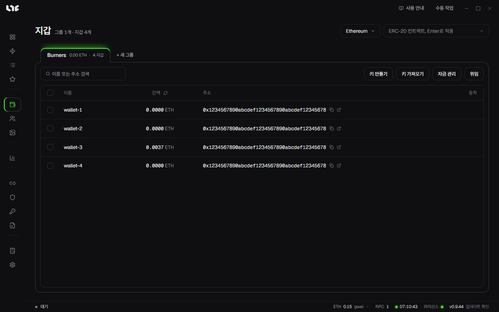

# 지갑

작업은 지갑 그룹 단위로 지갑을 고릅니다. 그래서 먼저 그룹을 만들고 그 안에 지갑을 넣습니다.



## 그룹 만들기

1. **지갑** 메뉴에서 **+ 새 그룹**을 누릅니다.
2. 그룹 이름을 넣고 **만들기**를 누릅니다. 목적, 체인, 용도별로 나누면 나중에 작업을 만들 때 고르기 쉽습니다.

그룹은 목록 위에 탭으로 나란히 놓이고, 탭에는 그룹의 잔액 합계와 지갑 수가 나옵니다. 탭에 마우스를 올리면 이름 바꾸기와 삭제 버튼이 나옵니다. 그룹을 지우면 안의 지갑도 함께 지워집니다.

## 지갑 넣기

목록 오른쪽 위의 **키 만들기**와 **키 가져오기**로 넣습니다.

**키 가져오기**: 이미 있는 지갑을 넣습니다. 한 줄에 하나씩, `이름,개인키` 또는 개인키만 붙여넣습니다. 이름은 빼도 됩니다. 창 위에 읽을 수 있는 줄 수가 나오고, **N개 가져오기**를 누르면 들어갑니다.

```
main-1,0x개인키...
main-2,0x개인키...
0x개인키...
```

**키 만들기**: 새 지갑을 만듭니다. **개수**를 넣고 **N개 만들기**를 누르면 새 개인키와 주소가 그룹에 생깁니다. 만든 뒤에는 꼭 개인키를 따로 보관하세요.

개인키는 이 PC에 Windows 계정으로 암호화되어 저장되고 서버로 보내지 않습니다.

## 표 읽기

| 칸 | 뜻 |
|---|---|
| 이름 | 지갑 이름입니다. 이름이 없으면 주소 끝자리가 보입니다. |
| 잔액 | 오른쪽 위에서 고른 체인의 잔액입니다. 칸 제목 옆 아이콘으로 새로고칩니다. |
| 주소 | 복사 버튼과 익스플로러 열기 버튼이 붙어 있습니다. |
| 동작 | 행에 마우스를 올리면 편집, 보내기, 삭제가 나옵니다. |

오른쪽 위의 체인 선택을 바꾸면 그 체인의 잔액을 읽습니다. 옆 칸에 ERC-20 토큰 컨트랙트를 넣고 Enter를 누르면 그 토큰의 잔액으로 바뀝니다.

검색 칸에는 이름이나 주소 일부를 넣습니다.

## 지갑 하나 다루기

- **편집**(연필): 이름을 바꾸고, 주소와 개인키를 확인하거나 복사합니다. 개인키는 눈 버튼을 눌러야 보입니다.
- **보내기**(종이비행기): 이 지갑에서 한 곳으로 코인을 보냅니다. 체인, 받는 사람, 수량을 넣습니다. **최대 보내기**를 켜면 가스비를 뺀 전부를 보냅니다. 왼쪽 아래 칸에 gwei를 넣으면 그 가스로, 비우면 자동으로 보냅니다.
- **삭제**(휴지통): 지갑을 지웁니다. 되돌릴 수 없으니 개인키를 따로 갖고 있는지 먼저 확인하세요.

## 여러 지갑 한꺼번에

체크 칸으로 지갑을 고르면 아래에 막대가 나옵니다.

- **일괄 이름 변경**
- **주소 복사**: 고른 지갑의 주소를 한 줄에 하나씩 복사합니다.
- **개인키 복사**: 확인 창에서 **키 복사**(키만) 또는 **이름,키 복사**(한 줄에 `이름,키`)를 고릅니다. 클립보드는 다른 프로그램도 읽을 수 있으니 붙여넣은 뒤 클립보드를 지우세요.
- **삭제**

## 위임 칸

**위임** 버튼을 누르면 잔액 칸이 위임 칸으로 바뀝니다. 각 지갑이 EIP-7702로 어떤 컨트랙트에 위임돼 있는지 보여 주고, 필터와 다시 검사 버튼이 붙습니다. 번들 민팅을 쓸 때 봅니다. → [번들과 컨트랙트](../tasks/bundles.md)

## 다음 단계

지갑에 가스비를 넣으려면 [자금 나눠 보내기와 모으기](funding.md)로 갑니다.
