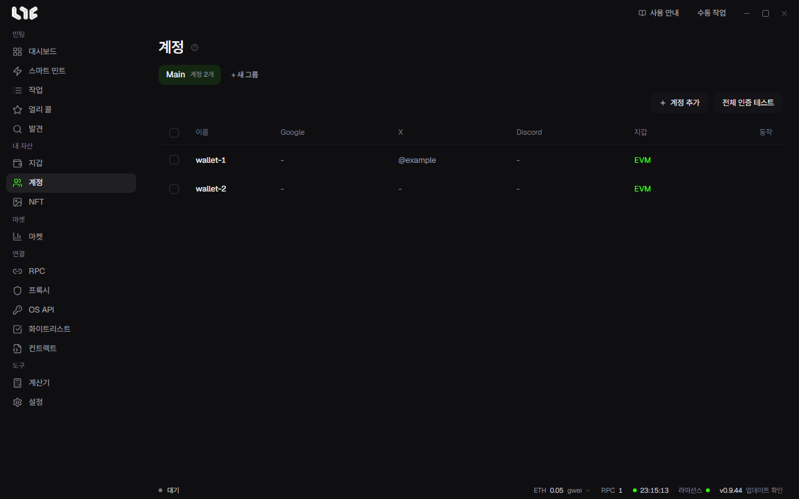

# 소셜 계정

소셜 작업에 쓰는 계정을 모아 둡니다. 보통 지갑 하나에 이메일, X, Discord, 프록시를 하나씩 붙여 관리합니다. 온체인 민팅만 한다면 이 화면은 필요 없습니다.

## 계정에 저장하는 것

| 칸 | 쓰임 |
| --- | --- |
| 표시 이름 | 자유 이름표 |
| 개인키 / EVM 지갑 | 주소 제출과 사이트 서명 |
| Gmail | 제출할 주소, Google 폼 로그인 |
| 앱 비밀번호 | 메일 확인용. 선택 |
| X 쿠키(auth_token) | X 동작과 X 로그인 |
| X 핸들 | `{xhandle}` 자리에 들어갑니다. 쿠키를 확인하면 채워집니다 |
| Discord 토큰 | Discord 동작 |
| Discord 사용자 이름 | `{discord}` 자리에 들어갑니다. 토큰을 확인하면 채워집니다 |
| 프록시 | 프록시 메뉴의 프록시를 고릅니다. 선택 |

## 계정 넣기

1. **+ 새 그룹**을 누르고 **지갑에서 가져오기**로 지갑 그룹을 고릅니다. 지갑마다 계정이 생깁니다.
2. 행의 편집을 눌러 소셜 정보를 붙입니다.
3. 여러 계정에 한 번에 넣으려면 계정을 고르고 **일괄 연결**을 누릅니다.

**계정 추가**로 하나씩 넣을 수도 있습니다.

## Google 연결

작성자가 이메일 로그인을 요구하는 Google 폼에 필요합니다.

1. 계정 편집 창에서 **Google 연결**을 누릅니다.
2. 작은 브라우저가 뜨면 평소처럼 로그인합니다.
3. 로그인되면 창을 닫습니다. 확인을 마치면 Gmail 칸이 채워집니다.

## X auth_token 얻기

구매한 계정이라면 대개 함께 옵니다. 직접 얻으려면 아래처럼 합니다.

1. 브라우저에서 X에 로그인합니다.
2. F12로 개발자 도구를 엽니다.
3. **Application** 탭에서 **Cookies → https://x.com**을 고릅니다.
4. `auth_token` 행의 값을 복사해 계정의 X 쿠키 칸에 넣습니다.

## Discord 토큰 얻기

1. 브라우저에서 Discord 웹에 로그인합니다.
2. F12로 개발자 도구를 열고 **Network** 탭을 고릅니다.
3. 필터에 `/api`를 넣고 아무 채널이나 누릅니다.
4. 요청 하나를 눌러 **Headers → Request Headers**에서 `authorization` 값을 복사합니다.
5. 계정의 Discord 토큰 칸에 넣습니다.

토큰은 점으로 나뉜 세 덩어리입니다. 전부 복사하세요. 비밀번호를 바꾸거나 모든 기기에서 로그아웃하면 토큰이 바뀝니다.

## 인증 테스트

행의 테스트나 **전체 인증 테스트**로 저장한 인증이 살아 있는지 확인합니다. 큰 작업을 돌리기 전에 한 번 돌려 보세요.

## 저장 위치

계정은 `%LOCALAPPDATA%\nogada\data\accounts.dat`에 암호화해 저장합니다. 계정마다 `%LOCALAPPDATA%\nogada\browser-profiles\` 아래에 브라우저 프로필이 따로 생깁니다. 브라우저 프로필에는 쿠키가 들어 있으며 백업에 포함되지 않습니다.
