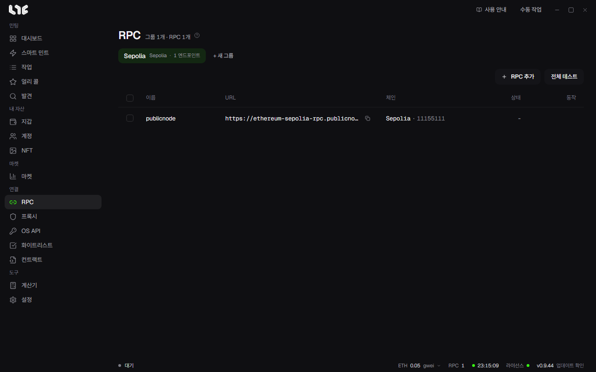

# RPC

모든 온체인 작업은 RPC를 지납니다. 좋은 RPC 목록이 안정성을 가장 크게 좌우합니다.

## RPC 넣기

1. **+ 새 그룹**으로 그룹을 만듭니다. 체인별로 묶으면 편합니다.
2. **RPC 추가**를 누르고 한 줄에 하나씩 붙여넣습니다. `이름,URL`이나 URL만 넣습니다.
3. 앱이 체인을 확인하고 지연을 재서 목록에 넣습니다.

줄 왼쪽의 핑과 **전체 테스트**로 언제든 다시 잴 수 있습니다.

유료 RPC URL에는 API 키가 들어 있습니다. 앱은 URL을 `%LOCALAPPDATA%\nogada\data\rpc.dat`에 암호화해 저장합니다. Discord나 채팅에 붙여넣지 마세요.

## 작업은 어떤 RPC로 보내나요

작업에서 RPC를 고르지 않으면 그 체인의 저장된 RPC를 모두 쓰고, 없으면 내장 공개 RPC를 씁니다.

**설정 → 발사 엔진 → 여러 RPC로 전파**가 동작을 가릅니다.

- **켜짐**: 같은 서명 거래를 작업에서 고른 모든 RPC에 동시에 보냅니다. 내용이 같으므로 nonce 충돌이 없습니다.
- **꺼짐**: 작업마다 RPC 하나를 돌아가며 맡깁니다.

## 얼마나 필요한가요

| 쓰임 | 권장 |
| --- | --- |
| 지갑 3~5개로 가볍게 | 무료 또는 유료 1~2개 |
| 지갑 20개 이상 | 유료 3~5개, 많을수록 좋음 |
| 연사 | 여러 제공사의 유료 RPC |

제공사는 [RPC 제공사](../resources/nodes.md)를 보세요.

## 공개 RPC 바꾸기

**설정 → 발사 엔진**의 체인 목록에서 체인마다 공개 RPC 주소를 바꿀 수 있습니다. 내장 공개 RPC가 나빠졌는데 내 RPC를 넣고 싶지 않을 때 씁니다. 작업에서 고른 저장 RPC가 항상 먼저입니다.
