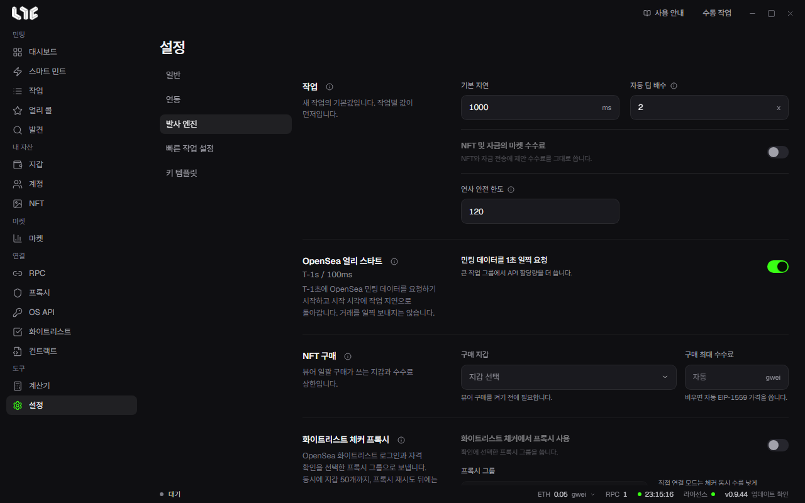

# 설정

설정은 **일반, 연동, 발사 엔진, 빠른 작업 설정, 키 템플릿** 다섯 탭입니다.

## 일반

- **언어**: 영어, 한국어, 중국어 간체 가운데 고릅니다.
- **업데이트**: 설치된 버전을 보고 새 버전을 확인합니다. **시작할 때 강제 업데이트**를 켜면 라이선스 확인 뒤 새 빌드를 바로 적용합니다. 끄면 알림만 보여 줍니다. [앱 업데이트](../reference/updates.md)
- **백업 및 복원**: 비밀번호로 암호화한 백업을 만들고 되돌립니다. [백업, 복원, 이전](../reference/backup-restore.md)
- **데이터 내보내기**: 데이터 하나를 암호화 없는 CSV로 내보냅니다. [로컬 데이터와 내보내기](../reference/data-storage.md)
- **앱 로그**: 로그 폴더를 열거나 민감한 값을 가린 묶음을 지원팀에 보냅니다.
- **로그아웃**: 실행 중인 작업을 멈추고 라이선스 화면으로 돌아갑니다. [라이선스](../getting-started/license.md)
- **모든 데이터 지우기**: 이 PC의 지갑, 계정, RPC, 프록시, API 키, 라이선스 활성화, 작업, 브라우저 프로필을 영구 삭제합니다. VPS를 비울 때 씁니다. `.exe`를 지워도 이것들은 지워지지 않습니다.

## 연동

- **캡차 풀이 API 키**: CapMonster, CapSolver, 2captcha, AnySolver를 지원합니다. 캡차가 있는 소셜 모듈에만 필요합니다.
- **마켓 허브**: Nogada 서버 연결 상태입니다. 마켓과 NFT 시세는 여기서 실시간으로 받으며 OpenSea 키가 필요 없습니다. 서명은 언제나 이 PC에서 합니다.
- **PnL Alchemy URL**: 체인마다 Alchemy URL 하나입니다. 비우면 RPC 메뉴의 Alchemy 주소를 씁니다. Stable은 Etherscan 키를 씁니다. **테스트**는 저장하지 않고 URL만 확인합니다.
- **Etherscan API 키**: 선택입니다. 비워도 공용 키가 작동합니다. 내 키를 넣으면 ABI 조회 한도가 늡니다.
- **Discord 웹훅**: 작업이 성공하거나 실패하면 Discord로 짧게 알립니다. Discord 채널 설정의 **연동 → 웹후크**에서 URL을 복사해 넣습니다.
- **캡처 브라우저 확장**: [캡처 확장](../tools/extension.md)을 보세요.

## 발사 엔진

**작업**

- **기본 지연**: 새 작업의 재시도 간격(ms)입니다. 작업에서 정한 값이 먼저입니다.
- **자동 팁 배수**: 우선 수수료가 자동일 때 RPC 제안값에 곱합니다. 보통 거래는 1배, 경쟁 민팅은 3~5배를 씁니다. 0.1 gwei가 아래 한계입니다.
- **NFT 및 자금의 마켓 수수료**: NFT와 자금 전송에 제안 수수료를 그대로 씁니다.
- **연사 안전 한도**: 연사가 도는 최대 시간입니다. 연사를 끄는 것을 잊어도 끝없이 돌지 않게 합니다. 비우면 한도가 없습니다.

**OpenSea 얼리 스타트**: T-1초부터 민팅 데이터를 요청합니다. [OpenSea API 키](opensea-api.md)

**NFT 구매**: 뷰어 일괄 구매가 쓰는 지갑과 수수료 상한입니다. [뷰어](../tools/viewer.md)

**화이트리스트 체커 프록시**: OpenSea 화이트리스트 로그인과 자격 확인을 프록시 그룹으로 보냅니다. 동시에 지갑 50개까지입니다.

**전파**

- **여러 RPC로 전파**: 같은 서명 거래를 작업에서 고른 모든 RPC로 보냅니다. [RPC](rpc.md)
- **연사를 여러 RPC로 전파**: 연사 거래도 그렇게 보냅니다.

**Flashbots**: 이더리움 메인넷 작업에서 고르는 비공개 경로의 전체 설정입니다.

- **번들 창**: 번들이 유효한 블록 수입니다.
- **우선 수수료, 최대 수수료**: Flashbots가 켜진 작업의 자동 값을 대신합니다.
- **평판 키**: 빌더가 평판을 재는 데 쓰는 키입니다. 자금은 없습니다. 초기화하면 쌓인 평판이 사라집니다.

**체인**: 쓰지 않는 체인을 숨기고, 공개 RPC 주소와 체인별 최소 팁을 정합니다. **사용자 체인 추가**로 EVM 체인을 넣습니다. [사용자 체인 추가](../reference/custom-chains.md)

## 빠른 작업 설정

**빠른 작업 버튼**이 쓰는 기본값입니다. 지갑과 체인별 RPC를 정해 두면 작업을 만들 때 고르지 않아도 됩니다. 지갑을 고르지 않으면 빠른 작업 버튼이 꺼집니다. RPC를 정하지 않은 체인은 저장된 그 체인의 RPC 전부를, 그다음 공개 기본값을 씁니다.

## 키 템플릿

소셜 작업에 쓰는 답변 풀을 만듭니다. [답변 템플릿과 소셜 모듈](../social/templates-modules.md)
