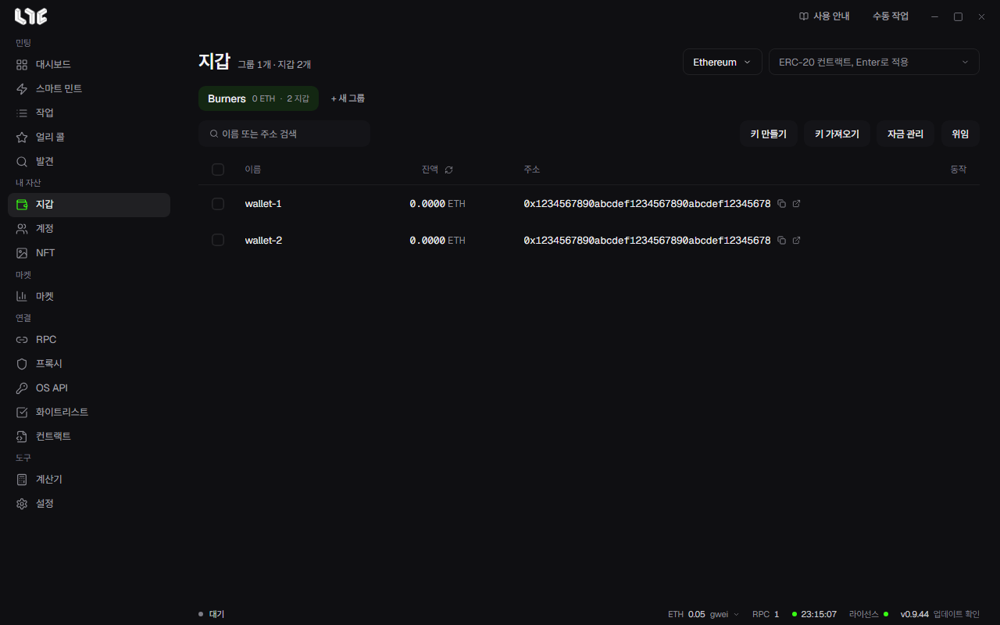

# 지갑

온체인 작업에 쓰는 지갑을 모두 여기에 둡니다. 지갑은 그룹으로 묶습니다.

## 그룹

**+ 새 그룹**으로 만들고 목적, 체인, 용도별로 나눕니다. 이름을 바꾸거나 순서를 옮길 수 있습니다.

그룹을 지우면 그 안의 지갑도 함께 지워집니다. 먼저 확인 창이 뜹니다.

## 지갑 넣기

- **키 만들기**: 개수를 정해 새 지갑을 만듭니다. 키는 이 PC에서 만들어집니다.
- **키 가져오기**: 한 줄에 하나씩 넣습니다. `이름,개인키`나 개인키만 넣어도 됩니다.

행에서 이름을 바꾸거나 지갑을 지울 수 있습니다.

## 잔액 보기

오른쪽 위에서 체인을 고르면 네이티브 잔액을 읽습니다. **ERC-20 컨트랙트** 칸에 주소를 넣고 Enter를 누르면 그 토큰 잔액을 봅니다. 읽기에 실패한 칸은 `0`이 아니라 `-`로 나옵니다. RPC가 답하지 않은 것과 지갑이 빈 것을 구별하기 위해서입니다.

## 한 지갑에서 보내기

행의 보내기 버튼을 누르면 **자금 보내기** 창이 열립니다. 받는 주소와 수량을 넣습니다. **최대 보내기**는 가스를 뺀 전액을 보냅니다.

## 자금 관리: 나눠 보내기와 모으기

지갑을 고르고 **자금 관리**를 누릅니다.

- **나눠 보내기**(한 곳 → 여러 곳): 출처 지갑 하나에서 여러 지갑으로 보냅니다. 체인에 나눠 보내기 컨트랙트가 있으면 거래 한 번으로 끝나고, 없으면 지갑마다 보냅니다.
- **모으기**(여러 곳 → 한 곳): 여러 지갑의 자금을 한 지갑이나 외부 주소로 모읍니다.

수량은 두 가지로 정합니다.

- **지갑당 수량**: 고정 금액이나 무작위 범위입니다. 무작위로 하면 받는 지갑마다 금액이 달라집니다.
- **지갑당 목표 잔액**: 받는 지갑을 그 잔액까지 채우거나, 보내는 지갑에 그만큼 남기고 뺍니다.

**ERC-20 컨트랙트 주소**를 넣으면 토큰을 옮깁니다. 비우면 네이티브 토큰입니다. 가스는 네이티브 토큰으로 냅니다.

## WETH 풀기와 위임

- **WETH 풀기**: 선택한 지갑의 WETH를 ETH로 되돌립니다. 가스를 낼 ETH가 없는 지갑은 건너뜁니다.
- **위임**: 지갑의 EIP-7702 위임 상태를 검사하고 해제합니다. 일부 민팅 컨트랙트는 위임된 지갑을 거절합니다. [컨트랙트](../tools/contracts.md)를 보세요.

## 키는 어떻게 보관되나요

지갑은 `%LOCALAPPDATA%\nogada\data\wallets.dat`에 저장됩니다. 이 파일은 Windows DPAPI로 이 PC와 이 사용자에 묶여 암호화됩니다.

> **주의**: 지운 지갑은 앱이 되살릴 수 없습니다. 중요한 지갑을 지우기 전에 [백업](../reference/backup-restore.md)을 받거나 키를 내보내 안전하게 보관하세요. 백업은 지우기 전에 만들었고 비밀번호를 기억할 때만 쓸모가 있습니다.
