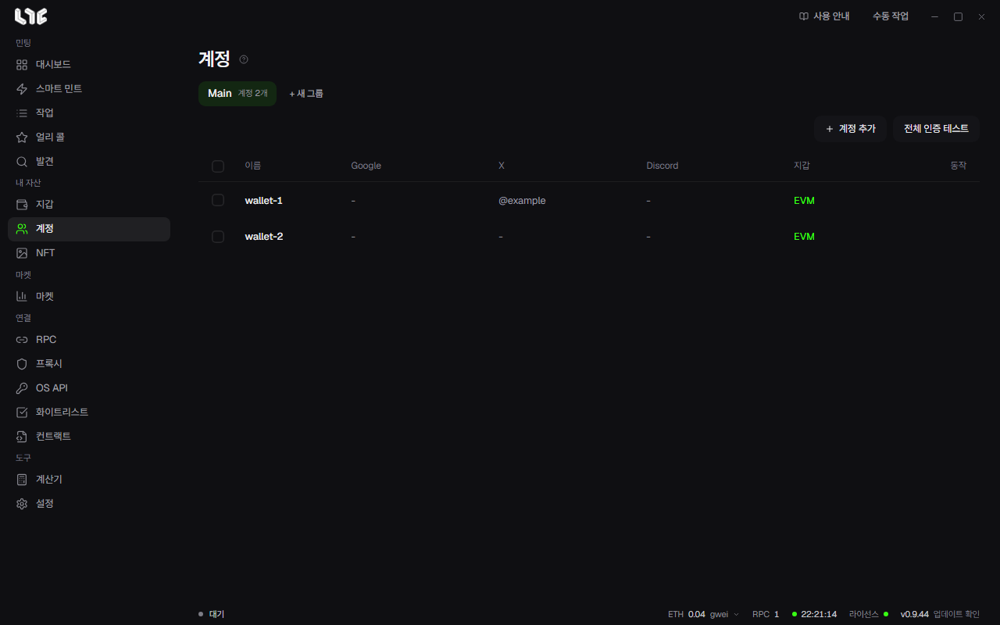

# 계정과 소셜 작업

Google 폼, X 팔로우, Discord 가입 같은 화이트리스트 신청 일도 민팅을 여러 지갑으로 돌리듯 여러 계정으로 돌릴 수 있습니다. 작업은 **작업 → 소셜** 탭에 있고, 작업이 쓰는 신원은 **계정** 메뉴에 있습니다.

## 소셜 작업으로 하는 일

**작업 → 소셜** 탭에서 그룹을 만들고 **새 소셜 작업**을 누릅니다. 작업 종류는 이렇습니다.

| 종류 | 할 수 있는 일 |
|---|---|
| Google 폼 | 폼 주소를 넣고 **읽기**를 누르면 질문을 불러옵니다. 질문마다 모든 계정이 같은 답을 내거나, 계정마다 무작위로 고르거나, 내 답변에 `{wallet}` 같은 값을 넣습니다. Google 이메일 칸은 계정의 Gmail로 채웁니다. 로그인이 필요한 폼은 Google 연결이 된 계정만 제출합니다. |
| X 동작 | 팔로우, 언팔로우, 좋아요, 리트윗, 답글, 인용 글, 트윗 |
| Discord | 서버 가입(가입 뒤 메시지 포함), 메시지의 버튼 누르기와 반응 달기, 서버 나가기 |
| Alphabot | 계정 연결, Alphabot과 Rumble 추첨 보기 |

어느 종류든 작업 이름, 계정 그룹, 프록시 그룹(선택), 계정 사이 지연(초, 범위)도 넣습니다. 글 칸에 `{wallet}`, `{gmail}`, `{xhandle}`처럼 쓰면 계정마다 자기 값으로 바뀝니다.

실패한 작업이 있으면 소셜 탭 아래 막대의 **실패한 것 다시 시도**로 그것만 다시 돌립니다.

캡차가 있는 작업은 **설정 → 연동 → 캡차 풀이 API 키**에 CapMonster, CapSolver, 2captcha, AnySolver 가운데 하나의 키가 있어야 합니다. Discord 작업의 캡차는 AnySolver 키를 씁니다.

## 계정

계정은 지갑 하나와 거기에 딸린 Gmail, X, Discord, 프록시를 묶은 것입니다. 토큰과 쿠키까지 모두 이 PC에 암호화되어 저장됩니다. 계정을 지우면 그 묶음이 통째로 지워지고, 지갑 메뉴에 따로 넣지 않은 지갑은 개인키를 되찾을 수 없습니다.

### 계정 하나 넣기

계정 그룹이 없으면 **+ 새 그룹**으로 만들고 **계정 추가**를 누릅니다.

| 칸 | 넣는 것 |
|---|---|
| 표시 이름, 개인키 | 꼭 넣습니다. 개인키가 계정의 지갑입니다. |
| 프록시 | 이 계정이 쓸 프록시입니다. |
| Gmail, 앱 비밀번호 | Gmail 주소와 Google 앱 비밀번호(16자)입니다. **Google 연결**을 누르면 이 계정 전용 Chrome 프로필이 열리고, 거기서 Google에 로그인해 두면 로그인이 필요한 폼에 씁니다. 계정을 먼저 저장해야 누를 수 있습니다. |
| X 핸들, X 쿠키 | X 사용자 이름(@ 없이)과 auth_token 쿠키 값입니다. 쿠키가 있으면 쿠키를 먼저 씁니다. |
| Discord 사용자 이름, Discord 토큰 | 토큰이 있으면 토큰을 먼저 씁니다. |

### 한꺼번에 넣기

- **지갑 그룹에서**: **+ 새 그룹**으로 계정 그룹을 만들 때 **지갑에서 가져오기**로 지갑 그룹을 고르면 그 안의 지갑이 모두 계정이 됩니다. Gmail, X, Discord, 프록시 칸은 비어서 시작하니 나중에 편집에서 채웁니다.
- **글로**: 일괄 가져오기는 한 줄에 한 계정씩, `name,key,gmail,apppass,xhandles,discordusername` 순서로 쉼표나 탭으로 나눠 받습니다. 뒤쪽 칸은 비워도 됩니다.

### 인증 확인

**전체 인증 테스트**는 제공사의 속도 제한에 걸리지 않도록 행을 하나씩 돌며 Gmail 앱 비밀번호, X 쿠키, Discord 토큰이 아직 살아 있는지 봅니다. 행에 있는 버튼은 그 행만 확인합니다.

## 모듈

**작업 → 모듈** 탭은 라이선스 서버에서 받은 작업 모듈 목록입니다. **온체인**과 **소셜**로 나뉘고, 검색하거나 쓰지 않는 모듈을 숨길 수 있습니다. 새로 올라온 모듈은 새로고침 버튼으로 앱을 다시 켜지 않고 받습니다.

## 답변 템플릿

계정마다 다른 답을 주려면 **설정 → 키 템플릿**에서 답변 묶음을 만듭니다. 이름을 정하고 한 줄에 답 하나씩 씁니다. 소셜 작업의 글 칸에 `{colors}`처럼 이름을 중괄호로 감싸 쓰면 계정마다 묶음의 한 줄을 받습니다.

예: 빨강, 파랑, 초록 세 줄짜리 묶음 `colors`를 계정 다섯 개가 쓸 때

- **순서**: 계정 1~5가 빨강, 파랑, 초록, 빨강, 파랑을 받습니다. 줄이 바닥나면 맨 위부터 다시 줍니다.
- **무작위**: 줄을 먼저 섞은 뒤 같은 식으로 나눠 줍니다. 섞는 순서는 계정 그룹과 묶음 이름으로 정해지므로, 같은 그룹이면 작업을 다시 만들어도 같은 답을 받습니다.
