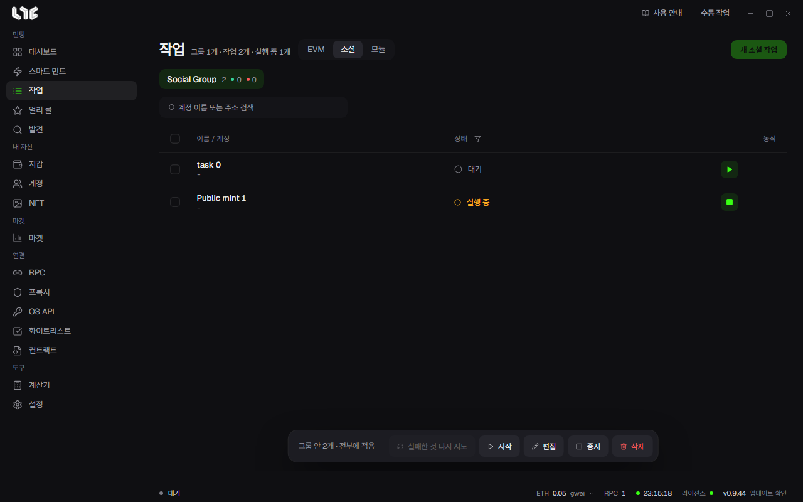

# 소셜 작업

소셜 작업은 체인을 건드리지 않는 일을 여러 계정으로 처리합니다. Google 폼, X와 Discord 동작, 가입 절차, 화이트리스트 신청, 정해진 퀘스트 제출이 여기에 듭니다.

## 필요한 것

- **계정**: 지갑 주소, Gmail, X 핸들과 쿠키, Discord 정보, 프록시를 담습니다. [소셜 계정](../setup/accounts.md)
- **캡차 풀이**: hCaptcha, Turnstile, reCAPTCHA v2/v3가 있는 모듈에만 필요합니다. **설정 → 연동**에 키를 넣습니다.
- **브라우저 세션**: 로그인이 필요한 Google 폼이나 브라우저 엔진 모듈에만 필요합니다.

## Google 폼

**작업 → 소셜 → 새 소셜 작업**은 Google 폼, X 동작, Discord, Alphabot을 만듭니다.

1. 소셜 그룹을 열거나 만듭니다.
2. **새 소셜 작업**을 누르고 **Google 폼**을 고릅니다.
3. Google Forms URL을 넣고 **읽기**를 누릅니다. 먼저 익명으로 읽고, 막히면 계정 그룹의 연결된 Google 계정으로 읽습니다.
4. 계정 그룹을 고릅니다. 계정마다 작업이 하나씩 생깁니다.
5. 질문마다 답을 정합니다. 계정 값, 고정 값, 무작위 선택, 자동 채움을 쓸 수 있습니다.
6. 저장합니다.

지원하지 않는 질문 유형(선형 배율, 격자, 날짜, 시간, 파일 업로드)은 제출할 때 건너뜁니다. 필수 질문이 아니면 나머지는 받아 줄 수 있습니다.

## X 동작

팔로우, 언팔로우, 좋아요, 리트윗, 답글, 인용, 트윗 같은 동작을 고릅니다. 계정마다 저장된 X 쿠키를 씁니다. **전체 인증 테스트**로 쿠키가 살아 있는지 먼저 보세요.

## Discord 동작

서버 가입, 서버 나가기, 메시지 버튼 누르기와 반응 달기를 계정마다 합니다. 캡차는 설정의 AnySolver 키를 씁니다. 서버 나가기는 2.5초 간격으로 처리합니다.

## Alphabot

계정 지갑으로 로그인한 뒤, 저장된 Discord와 X 세션을 연결합니다.

## 소셜 모듈

운영자가 올린 사이트 전용 흐름입니다. **작업 → 모듈**에서 시작합니다. 창이 그 모듈로 잠긴 채 열리고, 모듈이 정한 칸만 채우면 됩니다.

1. **작업 → 모듈**을 엽니다.
2. 소셜 모듈을 고릅니다.
3. 계정 그룹을 고릅니다.
4. 모듈의 칸을 채웁니다.
5. 캡차가 있으면 풀이 서비스를 고릅니다. 고르지 않으면 넘어가지 못합니다.
6. 저장합니다.

모듈은 일반 요청을 쓰는 `http` 엔진과 실제 브라우저가 필요한 사이트용 `browser` 엔진으로 돕니다. 어느 쪽인지는 모듈 작성자가 정합니다.

## 계정은 서로 섞이지 않습니다

작업 하나는 계정 하나만 씁니다. 그 계정의 지갑, 핸들, Gmail, 프록시, 브라우저 프로필을 씁니다. 필요한 값이 없는 작업은 다른 계정으로 대신하지 않고, 행 로그에 까닭을 남기고 건너뛰거나 실패합니다.

## 캡차 처리

캡차 칸은 모듈이 정합니다. 실행할 때 설정의 서비스와 키로 풀어 그 토큰을 요청에 넣습니다. 풀이 서비스가 없으면 창이 막거나 행이 설정 오류로 실패합니다.

자세한 내용은 [답변 템플릿과 소셜 모듈](templates-modules.md)에 있습니다.
