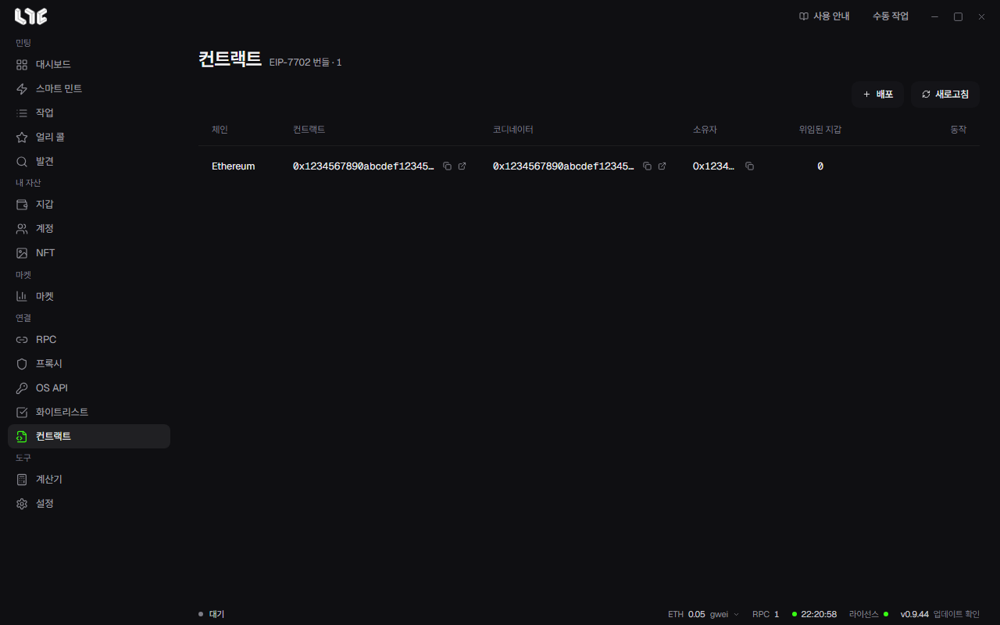

# 번들과 컨트랙트

번들은 여러 지갑의 민팅을 거래 하나로 묶어 보내는 방식입니다. 지갑마다 거래를 따로 보내는 대신, 지갑들을 EIP-7702로 실행자 컨트랙트에 위임해 두고 코디네이터 컨트랙트를 거치는 거래 하나로 한 번에 민팅합니다.

번들을 쓰려면 순서대로 세 가지를 합니다.

1. 체인에 번들러 컨트랙트를 배포합니다.
2. 지갑을 그 실행자에 위임합니다.
3. 번들 작업을 만듭니다.

## 1. 번들러 컨트랙트 배포

**컨트랙트** 메뉴에서 **배포**를 누릅니다.

| 칸 | 넣는 것 |
|---|---|
| 체인 | 번들을 쓸 체인입니다. |
| 소유자 지갑 | 배포하고 컨트랙트를 소유할 지갑입니다. 배포 가스를 이 지갑이 냅니다. |
| RPC 그룹 | 배포 거래를 보낼 RPC입니다. 그 체인의 RPC가 없으면 RPC 화면에서 먼저 넣으라고 나옵니다. |
| 최대 수수료, 우선 수수료 | 비우면 자동입니다. |

배포가 끝나면 코디네이터와 실행자가 표에 한 줄로 생깁니다. 표에는 체인, 컨트랙트, 코디네이터, 소유자, 위임된 지갑 수가 나옵니다.

행의 동작 버튼:

- 익스플로러에서 열기, 소유자 주소 복사
- **지갑 위임**, **지갑 위임 해제**
- **컨트랙트 삭제**: 앱 안의 기록만 지웁니다. 체인에 있는 컨트랙트와 위임은 그대로 남습니다.

## 2. 지갑 위임

행의 **지갑 위임**을 누르면 **위임 설정** 창이 열립니다.

- 위임할 지갑을 고릅니다.
- **가스 지불 지갑**: 위임 거래의 가스를 낼 지갑 하나입니다.
- **위임 대상**: 그 줄의 실행자 컨트랙트 주소로 정해져 있습니다.

위임한 지갑은 그때부터 실행자 컨트랙트의 코드를 지니게 됩니다. 이 힘은 직접 배포한 실행자에게만 주고, 거둘 때는 **지갑 위임 해제**를 씁니다.

어느 지갑이 어디에 위임돼 있는지는 **지갑** 화면의 **위임** 버튼으로 볼 수 있습니다.

## 3. 번들 작업 만들기

**작업** 화면에서 **새 번들**을 누르거나, 같은 체인의 작업 여러 개를 고른 뒤 아래 막대의 **번들**을 누릅니다.

첫 단계 **번들 만들기**에서는 일반 작업처럼 체인, 컨트랙트, 함수, 금액, 인자를 넣고 **번들러 컨트랙트**와 지갑을 고릅니다. **지갑 호환성** 칸은 고른 지갑이 그 실행자에 위임돼 있는지 보여 줍니다. **계속**을 누르면 번들 설정으로 넘어갑니다.

| 칸 | 뜻 |
|---|---|
| 민팅 결제 | 민팅 가격을 누가 낼지입니다. **컨트랙트 소유자 지불** 또는 **지갑마다 지불**. |
| 호출 가스 한도 | 지갑 하나의 민팅 호출에 줄 가스 한도입니다. |
| 바깥 가스 한도 | 묶음 거래 전체의 가스 한도입니다. |
| 성공당 빌더 팁 | 민팅이 성공할 때마다 블록 빌더에게 줄 팁입니다. |
| 최대 수수료, 우선 수수료 | 비우면 자동입니다. |
| 타임스탬프 | 보낼 시각입니다. 고른 작업들의 타임스탬프가 서로 다르면 번들에 쓸 시각을 넣으라고 합니다. |
| 연사, 지연 | 켜면 번들 거래를 정한 간격으로 반복해 보냅니다. |
| RPC 엔드포인트 | 번들 거래를 보낼 RPC입니다. |

번들에 넣는 작업은 모두 같은 체인이어야 합니다. 그 체인에 배포하고 위임까지 마친 컨트랙트가 없으면 먼저 하라는 안내가 나옵니다.

발사할 때 아직 민팅 준비가 끝나지 않은 지갑이 있으면, 첫 거래를 먼저 보내고 그 지갑들은 준비되는 대로 두 번째 거래로 보냅니다.
