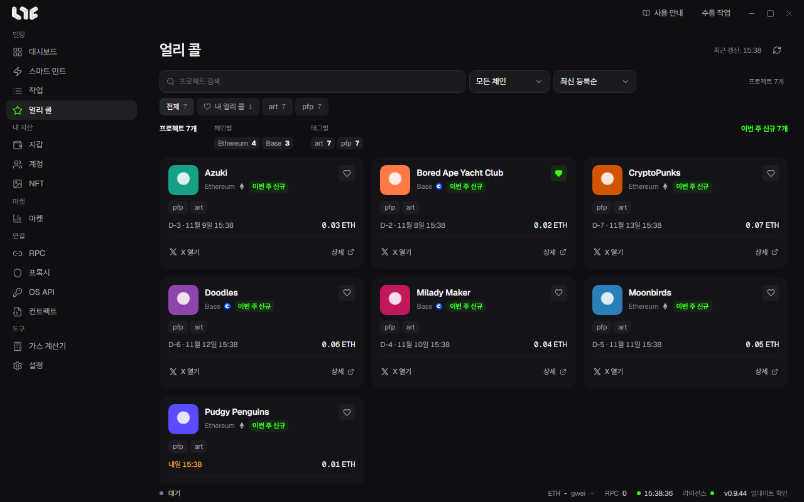

# 얼리 콜

얼리 콜은 Nogada 운영자가 등록한 프로젝트 목록입니다. 오른쪽 위에 마지막으로 받은 시각이 나오고, 옆의 버튼으로 다시 불러옵니다.

## 거르고 정렬하기

- 검색 칸: 프로젝트 이름으로 찾습니다.
- **모든 체인**: 체인별로 거릅니다.
- 정렬: **최신 등록순**, **민팅 임박순**, **이름 오름차순**.
- 칩: **전체**, **내 얼리 콜**(하트를 누른 프로젝트), 태그별.

칩 아래 줄에는 지금 걸러진 프로젝트의 수, 체인별 수, 태그별 수, 이번 주에 새로 올라온 수가 나옵니다.

## 카드 읽기

| 표시 | 뜻 |
|---|---|
| 이번 주 신규 | 이번 주에 등록된 프로젝트입니다. |
| 날짜와 D-N | 민팅 일시입니다. 오늘이나 내일이면 **내일 22:09**처럼 보입니다. |
| 가격 | 알려진 민팅 가격입니다. |
| 하트 | 누르면 내 얼리 콜에 넣거나 뺍니다. |
| X 열기, 상세 | 프로젝트의 X를 열거나 자세한 정보를 엽니다. |
