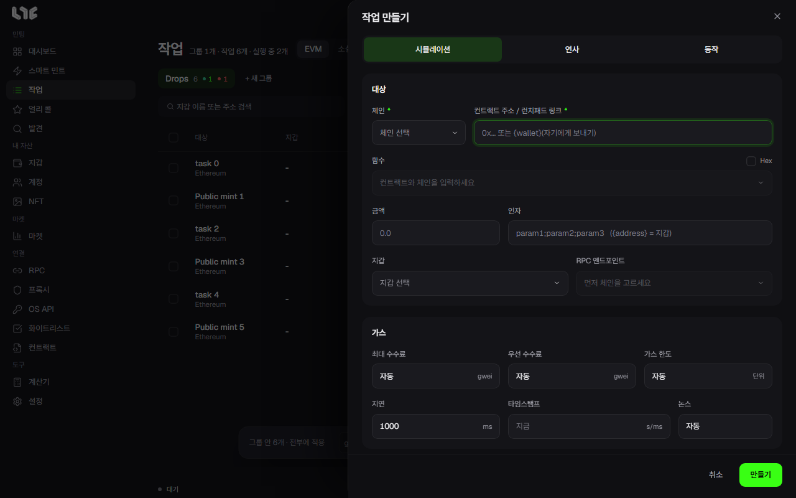

# 작업 만들기

**작업 → EVM → 새 작업**을 누르면 **작업 만들기** 창이 열립니다. 칸마다 무엇을 하는지 정리했습니다.

## 컨트랙트 주소 / 런치패드 링크

| 넣는 것 | 일어나는 일 |
| --- | --- |
| 컨트랙트 주소 | ABI를 찾아 함수 목록을 보여 줍니다 |
| OpenSea 드롭 링크 | 드롭, 페이즈, 가격을 찾아 채웁니다. [OpenSea 드롭](opensea.md) |
| Transient, Blever, Scatter, Verse, MintBay, Ronin Market 링크 | 민팅 정보를 찾아 채웁니다 |

ABI를 찾지 못하면 ABI를 직접 붙여넣거나 Hex로 바꿉니다.

## 함수와 Hex

- **함수**: 상태를 바꾸는 함수만 나옵니다. 함수를 고르고 인자를 채웁니다. 지갑마다 값을 달리해야 할 때 좋습니다.
- **Hex**: 호출 데이터를 그대로 보냅니다. 내용이 언제나 같은 거래에 좋습니다.

## 인자

함수의 입력을 순서대로 세미콜론으로 나눠 씁니다. 예: `2;0xabc…;[1,2,3]`. 개수가 함수와 같아야 합니다.

### 자리표시자

| 글자 | 뜻 |
| --- | --- |
| `{address}` | 작업 지갑의 전체 주소(`0x…`). 주소 인자에 보통 이것을 씁니다 |
| `{wallet}` / `{self}` | 서명 지갑을 `0x` 없는 소문자 40자로. 인자와 Hex 안에서 쓰고, 컨트랙트 칸에 넣으면 자기에게 보내기가 됩니다 |
| `{id}` / `{idN}` / `{idA-B}` | 쓸 수 있는 토큰 ID를 찾습니다. `{id777}`은 0~777, `{id100-777}`은 그 범위입니다 |
| `{n}` / `{nN}` / `{nA-B}` | 호출이 성공하는 숫자를 시뮬레이션으로 찾습니다. `{n777}`은 1~777입니다 |

`{id…}`나 `{n…}`을 넣으면 작업이 시뮬레이션으로 고정되고 연사를 쓸 수 없습니다.

## 금액

거래마다 보내는 네이티브 토큰의 **총액**입니다. 개당 가격이 아닙니다. 무료이거나 받을 수 없는 호출은 0이나 빈칸으로 둡니다. 일반 유료 민팅은 민팅 가격 × 수량을 넣습니다. 지원되는 런치패드는 앱이 채워 줍니다.

## 지갑과 RPC

지갑 그룹과 지갑을 고릅니다. 지갑 하나가 작업 하나입니다. **잔액 있는 것만**을 켜면 잔액이 있는 지갑만 보입니다.

RPC는 고르지 않아도 됩니다. 기본으로 그 체인의 RPC를 모두 씁니다. [RPC](../setup/rpc.md)를 보세요.

## 가스

비우면 자동입니다. 자세한 내용은 [가스](gas.md)에 있습니다.

- **가스 한도**: 대개 비워 둡니다. 직접 넣으면 호출 하나가 줄지만 너무 낮으면 실패합니다.
- **최대 수수료**: 낼 수 있는 최대 gwei입니다.
- **우선 수수료**: 포함을 위해 내는 팁입니다. 최대 수수료보다 클 수 없습니다.

## 시간

- **지연**: 재시도 간격(ms)입니다.
- **타임스탬프**: 유닉스 시각입니다. 그때까지 기다렸다가 시작합니다. 연사에서는 `시작-끝`으로 쓸 수 있습니다.
- **논스**: 대개 비워 둡니다. 지갑의 특정 nonce를 노릴 때만 씁니다.

타임스탬프는 [계산기](../tools/calculator.md)에서 바꿀 수 있습니다.

## 방식

창 위쪽의 **시뮬레이션**, **연사**를 켜고 끕니다. 둘 다 끄면 즉시 보냅니다. [작업 방식](modes.md)을 보세요.

## Flashbots

이더리움 메인넷에서만 씁니다. 켜면 같은 서명 거래를 번들로도 제출합니다. 비공개 전용으로 하면 공개 멤풀을 건너뜁니다. 연사에서는 번들 전용 경로가 되어, 놓친 번들은 가스를 쓰지 않고 nonce도 소모하지 않습니다. **설정 → 발사 엔진**의 값이 쓰입니다.

## 동작: 민팅 뒤 할 일

창 위쪽의 **동작**을 켜면 민팅이 확인된 뒤 할 일을 정합니다. 연사에는 쓸 수 없습니다.

| 동작 | 정하는 것 |
| --- | --- |
| NFT 보내기 | 도착지, 전송 수수료. **NFT 전송 뒤 남은 ETH 전액 빼기**로 남은 ETH도 보낼 수 있습니다 |
| NFT 올리기 | OpenSea 가격과 기간. OpenSea API 키가 필요합니다 |
| 오퍼 수락 | 최소 WETH 오퍼. OpenSea API 키가 필요합니다 |

화이트리스트 시장에서 산 지갑을 쓸 때, 민팅 즉시 NFT와 ETH를 내 지갑으로 빼면 안전합니다.

## 만드는 순서

1. 컨트랙트나 링크를 넣습니다.
2. 함수를 고르거나 Hex로 바꿉니다.
3. 인자와 금액을 채웁니다.
4. 지갑과 RPC를 고릅니다.
5. 가스와 시간을 정합니다. 가스는 대개 자동으로 두세요.
6. 방식을 고릅니다.
7. **만들기**를 누른 뒤 시작합니다. 작업은 대기 상태로 만들어집니다.
