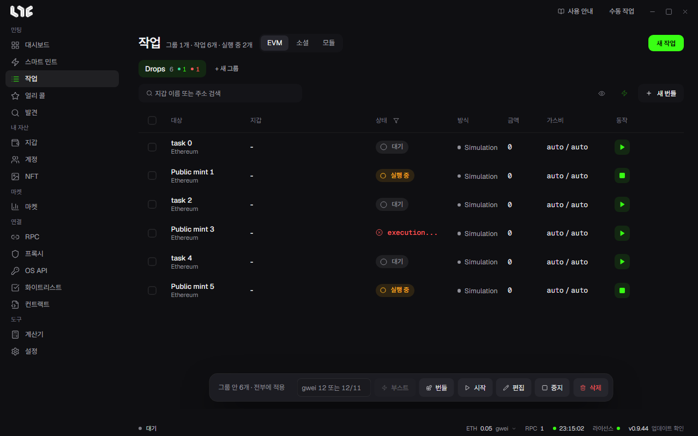

# 작업과 모듈

**작업** 화면이 앱의 중심입니다. 그룹이 작업을 묶고, 각 행이 실제로 시작, 중지, 재시도, 기록되는 단위입니다.

## 탭

| 탭 | 행이 뜻하는 것 |
| --- | --- |
| EVM | 지갑 하나가 거래 설정 하나를 실행합니다 |
| 소셜 | 계정 하나가 소셜 설정 하나를 실행합니다 |
| 모듈 | 운영자가 올린 작업 틀을 고릅니다 |

## 그룹과 행

- **+ 새 그룹**으로 컬렉션, 마켓, 흐름별로 묶습니다.
- 행은 지갑마다 하나씩 생깁니다.
- 상태는 대기, 실행 중, 중지, 성공, 실패 등으로 표시됩니다.
- 행의 **작업 더 보기**에서 복제, 로그 보기, 삭제를 합니다. 로그는 그 작업과 관련된 `logs/nogada.log` 줄을 보여 줍니다.
- 실행 중인 작업은 편집할 수 없습니다. 먼저 멈추세요.

아래 막대의 **시작, 중지, 편집, 삭제, 번들, 부스트**는 고른 행에, 고른 행이 없으면 그룹 전체에 적용됩니다. 편집은 멈춘 작업에만 적용됩니다.

## 작업을 만드는 세 가지 길

- [스마트 민트](smart-mint.md): 링크만 넣습니다. 대부분은 이 길이면 됩니다.
- [작업 만들기](onchain.md): **새 작업**으로 칸을 직접 채웁니다. 함수 호출이나 Hex를 그대로 보낼 때 씁니다.
- **빠른 작업**: 설정에서 정한 지갑과 RPC로 바로 만듭니다.

어느 길이든 작업을 만들기만 해서는 발사되지 않습니다. 시작을 눌러야 합니다.

## 모듈

모듈은 운영자가 서버에 올린 작업 틀입니다. 직접 만들 작업을 미리 채워 둔 것입니다.

| 모듈 | 만드는 것 |
| --- | --- |
| 온체인 | 컨트랙트, 체인, 함수나 Hex, 가스, 금액이 채워진 작업 |
| 소셜 | 정해진 HTTP 또는 브라우저 흐름을 쓰는 소셜 작업 |

**작업 → 모듈**에서 고릅니다. 대개 지갑, RPC, 수수료 같은 내 설정만 바꾸면 됩니다. 컨트랙트, 함수나 Hex, 금액은 운영자가 따로 말하지 않는 한 바꾸지 마세요.

새 모듈이 올라왔는데 보이지 않으면 **모듈 새로고침**을 누르세요. 앱을 다시 켜지 않아도 됩니다.
