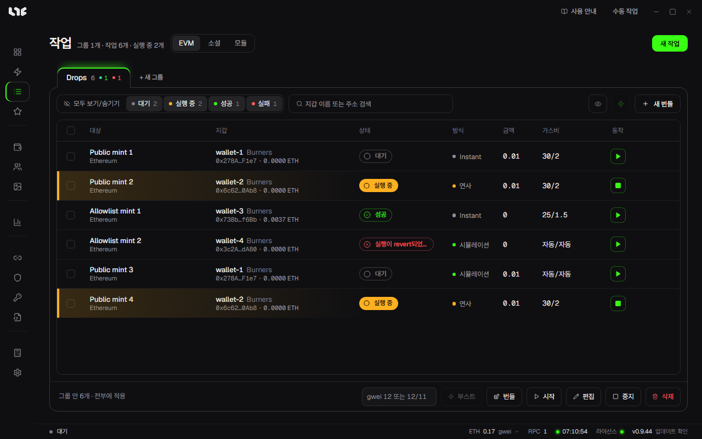

# 작업 실행과 부스트

만든 작업은 **작업** 메뉴에 그룹별로 모입니다. 여기서 시작하고, 멈추고, 결과를 보고, 보낸 거래의 가스를 올립니다.

## 화면 위쪽

- **EVM / 소셜 / 모듈** 탭: 민팅 작업은 EVM 탭에 있습니다. 소셜과 모듈은 [계정과 소셜 작업](../social/accounts-and-social.md)에서 다룹니다.
- 제목 옆 숫자: 그룹 수, 작업 수, 지금 실행 중인 작업 수입니다.
- **그룹 탭**: 목록 위에 그룹이 탭으로 나란히 놓입니다. 누르면 그 그룹을 엽니다. 탭의 숫자는 작업 수, 초록 점은 성공 수, 빨간 점은 실패 수입니다. Shift를 누른 채 누르면 여러 그룹을 고를 수 있고, 끌어서 순서를 바꿉니다.
- 그룹을 여러 개 고르면 **+ 새 그룹** 자리가 **N개 삭제**로 바뀌어, 고른 그룹을 안의 작업과 함께 한 번에 지웁니다.
- 그룹이 한 줄에 다 들어가지 않으면 줄 끝에 **그룹 더 보기** 버튼이 생기고, 누르면 밀려난 그룹을 고를 수 있습니다.
- **새 작업**: [작업 직접 만들기](task-form.md) 창을 엽니다.

목록 위의 상태 탭(**대기**, **실행 중**, **성공**, **실패**)은 그 상태의 작업 수를 보여 주고, 누를 때마다 그 상태를 보이거나 숨깁니다. 여러 개를 함께 켤 수 있고, **모두 보기/숨기기**는 넷을 한 번에 켜거나 끕니다.

검색 칸 오른쪽의 버튼 세 개:

| 버튼 | 하는 일 |
|---|---|
| 눈 | 지갑 칸과 가스비 칸을 숨기거나 보입니다. |
| 번개 | **빠른 작업**을 엽니다. 아래 설명을 보세요. |
| 새 번들 | 여러 지갑을 거래 하나로 묶는 번들 작업을 만듭니다. → [번들과 컨트랙트](bundles.md) |

## 표 읽기

| 칸 | 뜻 |
|---|---|
| 대상 | 작업 이름과 체인입니다. |
| 지갑 | 이 작업이 쓰는 지갑입니다. |
| 상태 | 대기, 실행 중, 성공, 실패와 그 이유입니다. 실행 중인 줄은 왼쪽에 주황 막대가 붙습니다. |
| 방식 | 시뮬레이션, 연사 같은 발사 방식입니다. |
| 금액 | 거래마다 보내는 코인 양입니다. |
| 가스비 | 최대 수수료 / 우선 수수료입니다. auto는 자동입니다. |
| 동작 | ▶ 시작, ■ 중지입니다. 행에 마우스를 올리면 편집, 삭제, **⋯**가 나옵니다. |

**⋯** 메뉴에는 **복제**(같은 설정으로 새 작업 창 열기), **로그 보기**, **삭제**가 있습니다. 돌고 있는 작업은 편집할 수 없으니 먼저 멈춥니다.

## 시작과 중지

- 행의 ▶를 누르면 그 작업만 시작합니다.
- 아래 막대의 **시작**은 여러 작업을 한 번에 시작합니다.
- 작업에 타임스탬프가 있으면 시작해도 그 시각까지 기다렸다가 보냅니다.
- **중지**를 누르면 멈춥니다. 이미 네트워크에 보낸 거래는 거둬들일 수 없습니다.

작업은 앱 안에서 돕니다. 앱을 닫으면 기다리던 작업도 함께 멈춥니다.

## 아래 막대

아래 막대는 지금 보이는 작업 전체 또는 고른 작업에만 적용됩니다.

- 아무것도 고르지 않으면 **그룹 안 N개 · 전부에 적용**이라고 나오고, 그룹의 보이는 작업 모두가 대상입니다.
- 체크 칸으로 고르면 **N개 선택**으로 바뀌고 고른 작업만 대상입니다.

| 버튼 | 하는 일 |
|---|---|
| gwei 칸 + 부스트 | 가스를 바꿉니다. 아래 "부스트"를 보세요. |
| 번들 | 고른 작업들을 번들 하나로 묶습니다. |
| 시작 / 중지 | 대상 작업을 시작하거나 멈춥니다. |
| 편집 | 대상 작업을 한꺼번에 고칩니다. 비워 둔 칸은 각 작업의 지금 값을 그대로 둡니다. |
| 삭제 | 대상 작업을 지웁니다. |

## 부스트

이미 보낸 거래가 가스가 낮아 들어가지 않을 때 씁니다. 아래 막대의 gwei 칸에 `12`처럼 하나만 쓰면 최대 수수료와 우선 수수료가 둘 다 12, `12/11`처럼 쓰면 최대 수수료 12, 우선 수수료 11입니다. 그다음 **부스트**를 누릅니다.

작업마다 이렇게 처리됩니다.

| 작업 상태 | 부스트가 하는 일 |
|---|---|
| 보낸 거래가 아직 대기 중 | 같은 논스로 새 가스를 단 거래를 보내 바꿉니다. 작업의 가스 설정도 새 값으로 바뀝니다. |
| 아직 보내기 전이거나 대기 중인 거래가 없음 | 작업의 가스 설정만 새 값으로 바꿉니다. 다음에 보낼 때 그 값을 씁니다. |
| 이미 끝남 | 건너뜁니다. |

원래 거래가 먼저 확정되면 바꾸는 거래는 아무 일도 하지 않고, 돈이 두 번 나가지 않습니다. 앱은 가스를 스스로 올리지 않습니다. 가스를 올리는 것은 부스트를 누를 때뿐입니다.

## 로그 보기

행의 **⋯ → 로그 보기**는 그 작업의 기록을 엽니다. 위쪽에 지갑, 가스비, 금액, 방식이 요약되고, 필터 칸에 `FAIL`, `revert`, 지갑 이름 같은 말을 넣어 줄을 거를 수 있습니다. **전체 복사**로 기록을 복사해 문의할 때 붙여넣습니다.

같은 기록은 실행 파일 옆의 `logs/nogada.log`에도 남습니다.

## 빠른 작업

번개 버튼은 미리 정해 둔 지갑과 RPC로 작업 창을 엽니다. 창 제목이 **빠른 작업**이고, 지갑과 RPC를 고르는 칸 대신 설정한 값이 들어가며, 지연, 타임스탬프, 논스 칸도 없습니다. 각각 기본 지연, 바로 보내기, 논스 자동으로 들어갑니다.

- 쓸 지갑은 **설정 → 빠른 작업 설정 → 빠른 작업 지갑**에서 고릅니다. 하나도 고르지 않으면 번개 버튼이 꺼져 있습니다.
- 체인별 RPC는 같은 화면의 **빠른 작업 RPC(체인별)**에서 정합니다. 정하지 않은 체인은 그 체인에 저장한 RPC 전부를, 그것도 없으면 공개 기본값을 씁니다.

만든 빠른 작업도 다른 작업처럼 표에서 시작합니다.

## 실패했을 때

- 상태 칸의 이유와 로그를 먼저 봅니다.
- 잔액이 모자라면 코인을 넣고 다시 시작합니다.
- 페이즈가 아직 열리지 않아 실패했다면 시뮬레이션을 켜거나 타임스탬프를 열리는 시각으로 맞춥니다.
- 자주 보는 메시지는 [막혔을 때](../help/when-stuck.md)에 모아 두었습니다.
