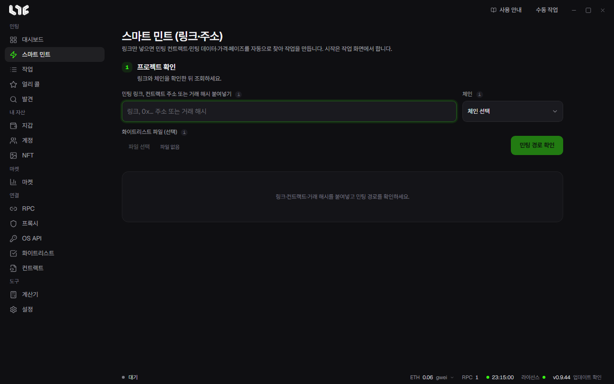

# 스마트 민트

링크 하나로 민팅 컨트랙트, 민팅 데이터, 가격, 페이즈를 찾아 작업을 만드는 화면입니다. Nogada만의 기능입니다. 조회하거나 페이즈를 골라도 발사되지 않습니다. 시작은 작업 화면에서 합니다.

## 넣을 수 있는 것

- 컨트랙트 주소
- 익스플로러 링크
- 마켓플레이스와 런치패드 링크
- 프로젝트 민팅 사이트 링크
- 민팅 거래 해시 또는 익스플로러 거래 링크

체인은 직접 고릅니다. 같은 주소가 여러 체인에 있을 수 있어서 앱이 저절로 바꾸지 않습니다.

## 순서

1. 체인을 고르고 입력을 붙여넣은 뒤 **민팅 경로 확인**을 누릅니다.
2. **페이즈**를 고릅니다. 프로젝트가 쓴 이름 그대로 나옵니다. 앱이 대신 고르지 않습니다.
3. **실행 설정**에서 지갑, 수량, 가스, 발사 방식, 프록시, 민팅 후 동작을 정합니다.
4. **최종 확인**에서 내용을 보고 작업을 만듭니다.
5. **작업** 화면에서 시작을 누릅니다.

## 화면에 나오는 것

- **민팅 함수**: 찾은 함수와 그 근거가 나옵니다. 후보가 여럿이면 목록에서 고릅니다.
- **가격**: 어디서 읽었는지 함께 나옵니다. 초록색 값은 참고값입니다. 컨트랙트에서 직접 민팅하는 드롭은 가격을 입력하고 다시 조회합니다.
- **미공개와 미확인**: 프로젝트가 오픈 때 공개하는 값은 짐작해 채우지 않고 미공개로 보여 줍니다. 오픈 뒤 다시 조회하면 채워집니다.
- **경로 조회 출처**: 어느 출처를 읽었고 무엇이 실패했는지 보여 줍니다.

## 화이트리스트 파일

머클 방식 페이즈라면 **화이트리스트 파일 (선택)**에 CSV나 OpenZeppelin JSON을 넣을 수 있습니다. 최대 4 MiB입니다. 앱이 현재 온체인 루트와 증명을 대조합니다.

## 발사 방식

| 방식 | 하는 일 |
| --- | --- |
| 즉시 1회 | 준비된 거래를 지갑마다 한 번 보냅니다 |
| 연사 (반복) | 정한 간격으로 반복합니다. 민팅이 확인되거나 한도에 닿거나 직접 멈추면 끝납니다 |
| 안전 (시뮬레이션 후) | 보내기 전에 시뮬레이션하고, 실패가 예상되는 지갑만 건너뜁니다 |

아직 열리지 않은 페이즈에 미리 시작해 둘 때는 연사를 권합니다. 방식은 직접 고르기 전까지 바뀌지 않습니다. 자세한 비교는 [작업 방식](modes.md)에 있습니다.

## 조회가 안 될 때

정상 링크라도 사이트 보호나 지역 제한으로 읽지 못할 수 있습니다. 아래 순서로 해 보세요.

1. 같은 프로젝트의 OpenSea 컬렉션 링크나 익스플로러 링크를 넣습니다.
2. 실제 민터나 NFT 컨트랙트 주소와 정확한 체인을 넣습니다.
3. 프로젝트 민팅 페이지 링크를 넣습니다. 사이트의 ABI로 함수 이름을 찾을 수 있습니다.
4. [작업 만들기](onchain.md)에서 ABI나 Hex로 직접 만듭니다.

오류 끝의 `(R-…)` 코드는 원인을 뜻합니다. 문의할 때 함께 보내 주세요.

## 사이트가 지갑마다 서명을 주는 드롭

앱이 만들 수 없는 서명을 요구하는 드롭은 그렇다고 알려 줍니다. 프로젝트 사이트에서 민팅하거나, 지원되는 사이트라면 민팅 사이트 링크를 스마트 민트에 넣으세요.
