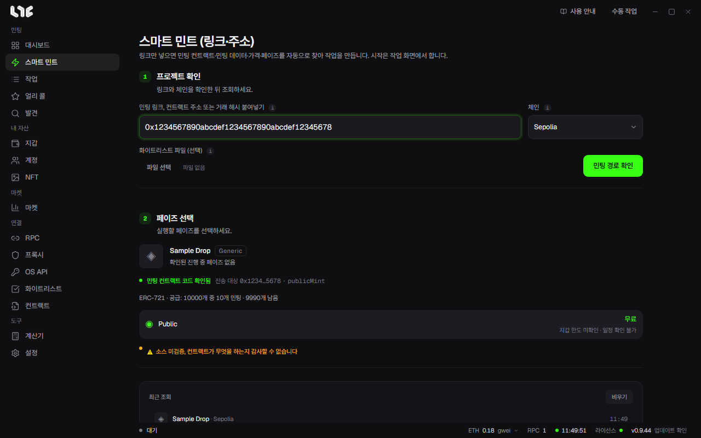
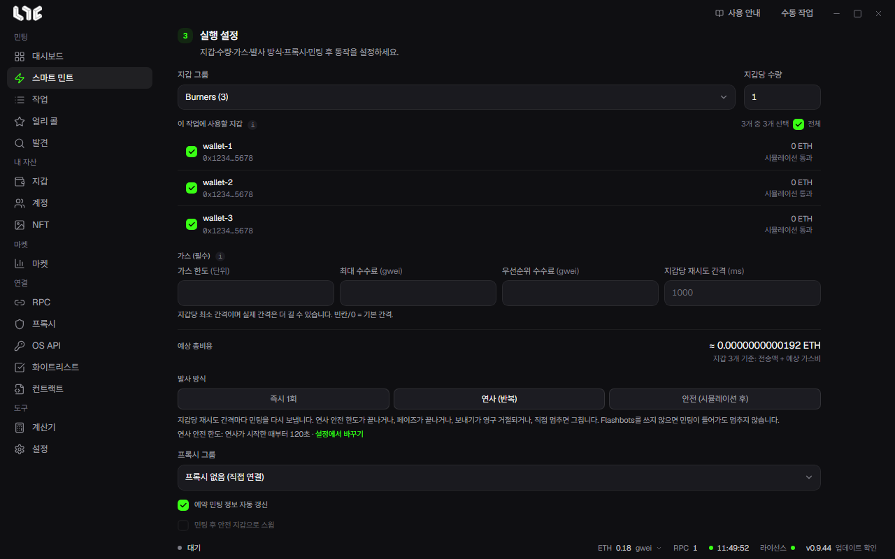
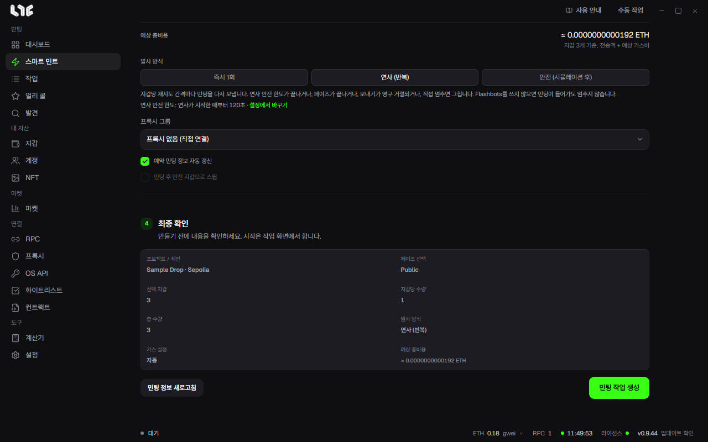

# 스마트 민트

스마트 민트는 링크 하나로 민팅 작업을 만드는 화면입니다. 민팅 컨트랙트, 호출할 데이터, 가격, 페이즈를 앱이 찾아 주고, 사용자는 지갑과 발사 방식만 고르면 됩니다. 작업을 만든 뒤 시작은 **작업** 화면에서 합니다.

화면은 네 단계로 위에서 아래로 진행됩니다.

## 1. 프로젝트 확인

**민팅 링크, 컨트랙트 주소 또는 거래 해시 붙여넣기** 칸에 다음 가운데 하나를 넣습니다.

- 프로젝트의 민팅 페이지, 런치패드, 마켓플레이스 링크
- 컨트랙트 주소, 익스플로러의 컨트랙트 링크
- 그 드롭에서 누군가 민팅한 거래의 해시나 익스플로러 거래 링크

**체인**은 직접 고릅니다. 같은 주소가 여러 체인에 있을 수 있어 앱이 마음대로 바꾸지 않습니다.

화이트리스트 명단 파일이 있다면 **화이트리스트 파일 (선택)**에 넣습니다. CSV나 OpenZeppelin JSON, 4 MiB까지 받고, 지금 체인에 올라간 머클 루트와 맞는지 대조합니다.

**민팅 경로 확인**을 누르면 링크 읽기, 컨트랙트 확인, 민팅 데이터 준비 순서로 진행 상황이 보입니다. 링크에 맞는 컨트랙트가 여러 개면 조회할 것을 고르라고 묻습니다. 거래 해시를 넣었다면 그 거래로 확인할 지갑을 고르는 칸이 나옵니다.

## 2. 페이즈 선택

찾은 프로젝트 이름과 플랫폼, 민팅 함수, 공급량, 페이즈 목록이 나옵니다. 페이즈마다 가격(무료이면 **무료**), 지갑당 한도, 시간이 보입니다. 민팅할 페이즈를 누릅니다.

이런 표시가 나올 수 있습니다.

- **소스 미검증**: 컨트랙트 코드가 공개 검증되지 않아 무엇을 하는지 앱이 읽을 수 없다는 뜻입니다. 민팅은 할 수 있지만, 믿을 수 있는 프로젝트인지 직접 확인하세요.
- **가격을 읽지 못했습니다**: 개당 민팅 가격을 직접 넣고 **이 가격으로 조회**를 누릅니다. 읽은 가격이 참고값일 때도 같은 칸이 나옵니다. 직접 넣은 가격은 발사까지 그대로 씁니다.
- **네이티브 수수료**: 토큰 가격과 함께 내는 수수료를 확인하지 못하면 개당 수수료를 넣으라고 합니다. 없으면 0을 넣습니다.
- **판매가 아직 열리지 않아**: 열리기 전이라 체인이 민팅 호출을 확인해 주지 않는 경우입니다. 앱이 자동으로 다시 조회해 열린 뒤 채웁니다.
- ERC-1155 드롭에는 **토큰 ID** 칸이 나옵니다. 비우면 링크의 ID를 씁니다. 0도 실제 ID입니다.

## 3. 실행 설정

| 칸 | 정하는 것 |
|---|---|
| 지갑 그룹 | 민팅에 쓸 지갑 그룹입니다. |
| 지갑당 수량 | 지갑 하나가 민팅할 개수입니다. 드롭에 지갑당 한도가 있으면 함께 보입니다. |
| 이 작업에 사용할 지갑 | 그룹 안에서 쓸 지갑을 체크합니다. 지갑마다 잔액과 확인 결과(예: 시뮬레이션 통과)가 옆에 나옵니다. |
| 가스 (비우면 자동) | 가스 한도, 최대 수수료, 우선순위 수수료입니다. 비우면 앱이 정하고, 값을 넣으면 그 값을 씁니다. |
| 예상 총비용 | 고른 지갑 전체의 전송액과 예상 가스비를 더한 값입니다. 실제 가스비는 발사 때 정해집니다. |
| 발사 방식 | 아래 표를 보세요. |
| 프록시 그룹 | 발사와 민팅 데이터 요청을 보낼 프록시입니다. 비우면 직접 연결합니다. |

### 발사 방식

| 방식 | 하는 일 |
|---|---|
| 즉시 1회 | 작업이 시작되면 지갑마다 준비된 거래를 한 번 보냅니다. |
| 연사 (반복) | 정한 간격으로 계속 보냅니다. 한도(시간 범위의 끝, 연사 안전 한도 같은 것)에 닿거나, 다시 해도 소용없는 오류가 오거나, 직접 멈추면 그칩니다. Flashbots를 쓰지 않으면 민팅이 한 번 들어갔다고 멈추지는 않습니다. |
| 안전 (시뮬레이션 후) | 보내기 전에 시뮬레이션해서 실패가 예상되는 지갑만 건너뜁니다. 성공을 보장하지는 않습니다. |

연사를 고르면 **지갑당 재시도 간격** 칸이 더 나옵니다. 지갑 하나가 다시 보내기까지의 최소 간격이고, 비우거나 0이면 기본 간격입니다.

발사 방식 아래에는 연사가 언제 그치는지와 지금의 **연사 안전 한도**(연사가 시작한 때부터 몇 초인지, 끄면 꺼짐)가 보입니다. 옆의 **설정에서 바꾸기**를 누르면 **설정 → 발사 엔진 → 작업 → 연사 안전 한도** 칸으로 갑니다.

페이즈가 나중에 열리면 연사 버튼 옆에 **추천**이 붙습니다. 미리 시작해 두고 열리는 순간 바로 보내려면 연사가 맞다는 뜻입니다. 직접 고르기 전까지 발사 방식은 바뀌지 않습니다.

### 서명이 필요한 드롭

OpenSea 화이트리스트처럼 지갑마다 서명된 민팅 데이터를 받아야 하는 드롭에는 **민팅 데이터 가져오기** 칸이 나옵니다.

- **기본 (프록시)**: 프록시 IP로 민팅 데이터를 받습니다. 등록한 OpenSea API 키는 IP가 막혔을 때나 데이터가 오지 않을 때만 대신 씁니다.
- **OpenSea API**: 내 OpenSea API 키로 지갑별 데이터를 받습니다. 프록시가 필요 없지만 키마다 요청 한도가 있습니다. 키가 없으면 고를 수 없습니다.

Highlight의 서명 드롭은 highlight.xyz에서 받은 지갑별 서명 민팅 데이터를 붙여넣는 칸이 나옵니다. 비우면 작업이 시작될 때 다시 가져옵니다.

### 체크 칸 두 개

- **예약 민팅 정보 자동 갱신**: 켜 두면 예약 작업이 시작 전에 가격, 페이즈, 민팅 데이터를 최신으로 맞춥니다. 준비는 발사 시각 전에 끝나므로 발사가 늦어지지 않습니다.
- **민팅 후 안전 지갑으로 스윕**: 민팅이 성공하면 받은 NFT와 남은 코인을 적어 둔 안전 지갑으로 바로 옮깁니다. 연사에는 쓸 수 없습니다.

ERC-20 토큰으로 내는 드롭이면 **미리 승인** 버튼이 나옵니다. 누르지 않아도 필요할 때 필요한 금액만 승인합니다.

## 4. 최종 확인

프로젝트와 체인, 페이즈, 고른 지갑 수, 지갑당 수량, 총 수량, 발사 방식, 가스 설정, 예상 총비용을 한 번에 보여 줍니다. 맞으면 **민팅 작업 생성**을 누릅니다. 정보를 다시 읽고 싶으면 **민팅 정보 새로고침**을 누릅니다.

작업이 만들어지면 **작업으로** 버튼이 나옵니다. 만든 작업은 페이즈가 열리는 시각을 시작 시각으로 갖습니다. 작업 화면에서 시작해 두면 그 시각에 보내고, 이미 열린 페이즈라면 바로 보냅니다. → [작업 실행과 부스트](running.md)

## 조회가 안 될 때

| 메시지 | 할 일 |
|---|---|
| R-RPC | 체인이나 프로젝트 서버에 닿지 못했습니다. [RPC](../prepare/rpc-and-chains.md) 상태를 보고 다시 시도합니다. |
| R-LINK | 링크를 읽지 못했습니다. URL을 확인하거나 민팅 컨트랙트 주소를 직접 넣습니다. |
| R-RESOLVE | 민팅 경로를 찾지 못했습니다. 다시 시도하거나 **ABI / Hex 사용**으로 [작업 직접 만들기](task-form.md)를 씁니다. |
| 이 체인의 RPC가 없습니다 | RPC 화면에서 그 체인의 RPC를 넣습니다. |
| 이 주소는 컨트랙트가 아닙니다 | 지갑 주소를 넣은 경우입니다. 민팅 컨트랙트 주소를 확인합니다. |

아래쪽 **최근 조회**에는 조회한 프로젝트가 남습니다. 누르면 다시 불러오고, **비우기**로 목록을 지웁니다.
