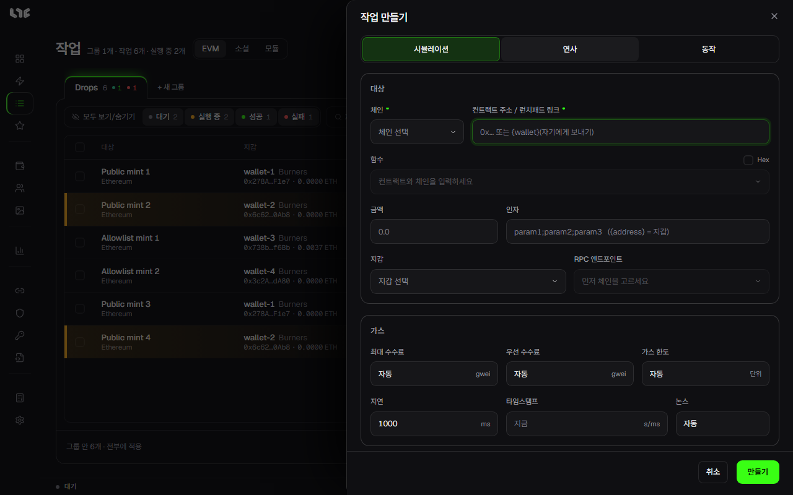
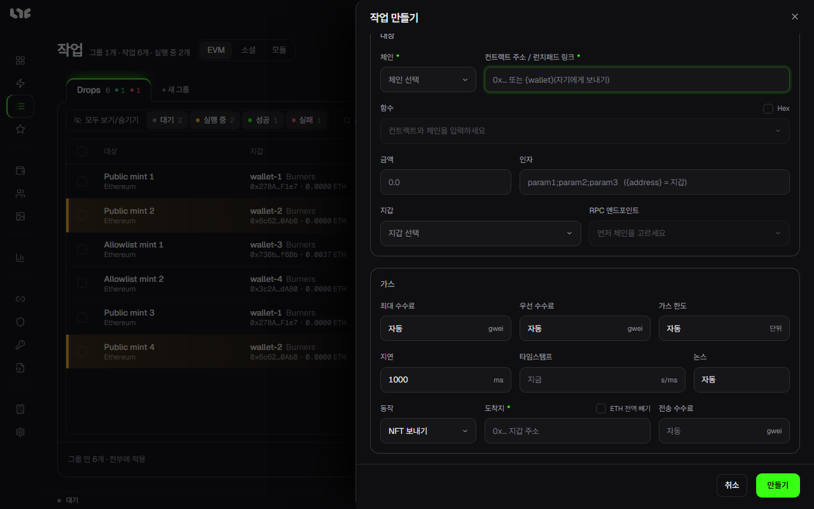

# 작업 직접 만들기

스마트 민트가 경로를 찾지 못했거나, 컨트랙트와 함수를 직접 정하고 싶을 때 쓰는 창입니다. **작업** 화면의 **새 작업**이나 위쪽 막대의 **수동 작업**으로 엽니다. 먼저 작업 그룹이 하나 있어야 합니다(**+ 새 그룹**).

## 언제, 어떻게 보낼지

창 맨 위의 세 버튼이 작업이 보내는 방식을 정합니다.

| 버튼 | 켜면 |
|---|---|
| 시뮬레이션 | 보내기 전에 같은 호출을 먼저 시험해 봅니다. 시험이 실패(revert)하면 **지연**만큼 쉬었다가 다시 시험하고, 통과한 순간 보냅니다. 민팅이 열리기를 기다렸다가 쏘는 데 맞습니다. |
| 연사 | 거래를 정한 간격으로 계속 보내다가 다음 중 하나가 일어나면 멈춥니다: 직접 멈춤, 시간 범위가 끝남, **최대 거래 수**에 닿음, **설정 → 발사 엔진 → 연사 안전 한도**가 다 됨, 다시 시도해도 소용없는 오류가 옴. |
| 동작 | 민팅이 끝난 뒤 할 일을 붙입니다. 아래 "민팅 뒤 동작"을 보세요. |

시뮬레이션과 연사는 함께 켤 수 없습니다. 둘 다 끄면 정한 시각에 한 번 보냅니다. 연사를 켜면 동작을 쓸 수 없고, 최대 수수료, 우선 수수료, 가스 한도는 자동 대신 숫자를 넣어야 합니다. 그 칸 이름 옆에 빨간 별이 붙습니다.

시각에 관한 칸:

| 칸 | 뜻 |
|---|---|
| 타임스탬프 | 보낼 시각입니다. 비우면 시작하자마자 보냅니다. 유닉스 시간을 초나 밀리초로 넣으면 칸 이름 옆에 얼마 뒤인지 보입니다. 연사에서는 `시작-끝`처럼 범위를 넣어 그 시간 동안만 보낼 수 있습니다. |
| 지연 | 다시 시도하거나 연사로 다음 거래를 보내기까지 쉬는 시간(ms)입니다. 새 작업에는 **설정 → 발사 엔진 → 기본 지연**이 들어갑니다. |
| 논스 | 보통은 비워 둡니다(자동). 꼭 어떤 논스로 보내야 할 때만 숫자를 씁니다. 연사를 켜면 이 칸이 **최대 거래 수**로 바뀌고, 비우면 제한이 없습니다. |

날짜와 시각을 유닉스 시간으로 바꾸려면 [가스 계산기](../app/calculator.md)의 **유닉스 시간 변환**을 씁니다. 발사 시각은 이 PC의 시계로 셉니다.

## 무엇을 부를지

| 칸 | 넣는 것 |
|---|---|
| 체인 | 민팅할 체인입니다. |
| 컨트랙트 주소 / 런치패드 링크 | 민팅 컨트랙트 주소, 또는 런치패드의 드롭 링크입니다. `{wallet}`이라고 쓰면 지갑마다 자기 주소로 보냅니다. |
| 함수 | 컨트랙트 코드가 검증돼 있으면 호출할 수 있는 함수 목록이 나옵니다. 고르면 인자 칸이 맞춰집니다. |
| Hex | 켜면 함수 대신 원본 호출 데이터(0x로 시작)를 직접 넣습니다. 코드가 검증되지 않은 컨트랙트에 씁니다. |
| 금액 | 거래마다 함께 나가는 코인의 양입니다. 무료 민팅은 0입니다. |
| 인자 | 함수 인자를 `;`로 나눠 씁니다. `{address}`라고 쓰면 그 자리에 각 지갑의 주소가 들어갑니다. |

### 런치패드 링크를 넣으면

컨트랙트 칸에 런치패드 드롭 링크를 넣으면 창이 그 런치패드에 맞게 바뀝니다. **민팅 페이즈**를 고르는 칸이 나오고, 페이즈를 고르면 타임스탬프가 그 페이즈의 시작 시각으로 채워집니다.

OpenSea 드롭이면 이런 칸이 나옵니다.

- **방식**: 지갑마다 서명된 민팅 데이터를 어떻게 받을지 고릅니다. 목록의 이름은 영어로 나옵니다.
  - **Normal Mode**(일반 모드): 지갑마다 OpenSea에 로그인해서 받습니다.
  - **Anonymous Mode**(익명 모드): 로그인 없이 작업의 프록시로 받습니다. 받지 못한 지갑에만 API 키를 씁니다.
  - **OpenSea API**: OS API의 키로 받습니다. 키가 있어야 고를 수 있습니다.
  - **Dual Mode**(듀얼 모드): 일반 모드와 OpenSea API로 동시에 요청하고 먼저 온 답을 씁니다. 키가 있어야 고를 수 있습니다.
  - 키가 하나도 없으면 칸 이름 옆에 **OpenSea API 키 필요**가 붙습니다.
- **API 레인**: OpenSea API와 듀얼 모드에서만 고를 수 있습니다.
- **OpenSea 라우팅**: 왼쪽 칸은 쓸 OS API 키 그룹(**전체**는 모든 키), 오른쪽 칸은 요청을 보낼 프록시 그룹입니다. 듀얼 모드에서는 칸 이름 옆에 **API를 프록시로 보내기** 스위치가 나와 API 요청도 프록시를 거치게 할 수 있습니다.
- **NFT 수량**: 지갑마다 민팅할 개수입니다. 지갑당 한도가 있으면 옆에 나옵니다.
- **NFT당 가격**: 개당 낼 수 있는 가장 높은 가격입니다. 발사 때 OpenSea가 알려 준 가격이 이보다 높으면 보내지 않고 멈춥니다.

## 어느 지갑이, 어느 RPC로

| 칸 | 넣는 것 |
|---|---|
| 지갑 | 쓸 지갑입니다. **잔액 있는 것만**을 켜면 잔액이 있는 지갑만 목록에 보입니다. 고른 지갑마다 작업이 하나씩 생겨 같은 그룹에 들어갑니다. |
| RPC 엔드포인트 | 이 작업이 쓸 RPC입니다. 나뉘는 방식은 [RPC와 체인](../prepare/rpc-and-chains.md)에 있습니다. |

## 가스

| 칸 | 뜻 |
|---|---|
| 최대 수수료 | 가스 단가의 상한(gwei)입니다. 비우면 자동입니다. |
| 우선 수수료 | 블록 생산자에게 주는 팁(gwei)입니다. 비우면 자동이고, **설정 → 발사 엔진**의 **자동 팁 배수**가 곱해집니다. |
| 가스 한도 | 거래 하나에 쓸 수 있는 가스의 상한입니다. 비우면 앱이 추정합니다. |
| Flashbots | 이더리움에서만 보입니다. 켜면 거래를 공개 대기열에 내지 않고 Flashbots 번들로만 제출합니다. |

Flashbots와 연사를 함께 켜면 지연 칸은 **이동 창**, 최대 거래 수 칸은 **성공 / 끝 / 중지**로 바뀝니다. 이때 연사는 성공하거나, 타임스탬프의 끝에 닿거나, 직접 멈추거나, 연사 안전 한도에 닿을 때까지 이어집니다. 번들 창 크기는 **설정 → 발사 엔진 → Flashbots**에서 정합니다.

## 민팅 뒤 동작

**동작**을 켜면 창 아래에 칸이 생깁니다. 민팅이 성공한 뒤 그 지갑에서 실행됩니다.

| 동작 | 칸 | 하는 일 |
|---|---|---|
| NFT 보내기 | 도착지, ETH 전액 빼기, 전송 수수료 | 받은 NFT를 도착지 주소로 보냅니다. **ETH 전액 빼기**를 켜면 NFT를 보낸 뒤 남은 코인도 모두 보냅니다. |
| NFT 올리기 | 올릴 가격, 만료 | 받은 NFT를 OpenSea에 그 가격으로 올립니다. 만료는 1시간부터 30일까지입니다. OpenSea API 키가 필요합니다. |
| 오퍼 수락 | 최소 오퍼, 가스비 | 받은 NFT에 들어온 가장 좋은 오퍼를 받아들입니다. 최소 오퍼를 비우면 어떤 오퍼든 받습니다. OpenSea API 키가 필요합니다. |

## 만들기

**만들기**를 누르면 작업이 그룹에 들어갑니다. 아직 보내지는 않습니다. 시작은 [작업 실행과 부스트](running.md)에서 합니다.

그 체인에 저장한 RPC가 없으면 아래에 **RPC 없음, 공개 RPC 사용**이 뜨고 버튼이 **확인**으로 바뀝니다. 공개 RPC로 만들어도 된다면 누르고, 아니면 RPC부터 넣습니다.
