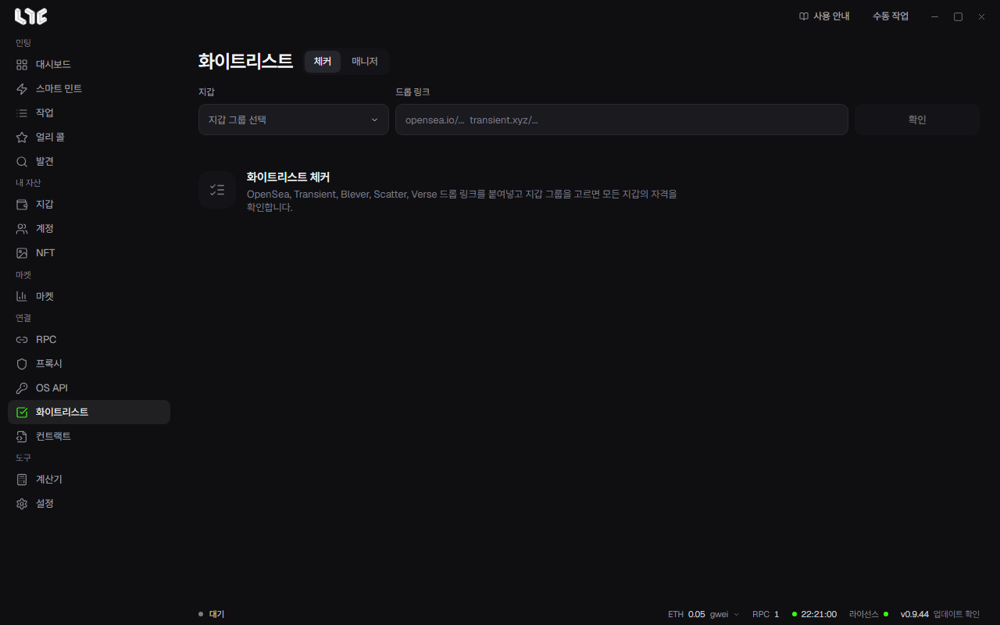

# 화이트리스트

프로젝트가 화이트리스트를 발표하면 드롭 링크를 **체커**에 붙여넣어 내 지갑 중 어느 것이 들어갔는지 봅니다. 두 번째 탭 **매니저**는 당첨된 프로젝트를 내가 적어 두는 목록입니다.

## 드롭 확인하기

1. **지갑**에서 지갑 그룹을 고릅니다.
2. **드롭 링크**에 OpenSea, Transient, Blever, Scatter, Verse의 드롭 링크를 붙여넣습니다.
3. **확인**을 누릅니다.
4. 페이즈마다 한 줄이 생기고, 지갑마다 자격이 있는지 표시됩니다. 그 줄의 버튼으로 다음 일을 합니다. 버튼에 마우스를 올리면 이름이 보입니다.

| 버튼 이름 | 하는 일 |
|---|---|
| 이 페이즈의 자격 지갑으로 민팅 작업 만들기 | 자격 있는 지갑만으로 작업을 만듭니다. |
| 이 페이즈 자격 지갑의 주소 복사 | 자격 있는 지갑의 주소를 복사합니다. |
| 이 페이즈 지갑의 개인키 복사 | 그 지갑들의 개인키를 복사합니다. |
| 이 페이즈 지갑에 자금 나눠 보내기 | 그 지갑들에 가스비를 나눠 보냅니다. |
| 자격 지갑을 매니저에 저장 | 자격 있는 지갑을 매니저의 한 항목으로 저장합니다. |

## 지갑을 많이 확인할 때

OpenSea 화이트리스트를 확인할 때는 지갑마다 OpenSea에 로그인해서 자격을 묻습니다. 프록시가 없으면 이 PC에서 직접, 몇 개씩만 동시에 확인합니다. **설정 → 발사 엔진 → 화이트리스트 체커 프록시**를 켜고 프록시 그룹을 고르면 프록시로 지갑 50개까지 한꺼번에 확인합니다. 프록시에서 거듭 실패한 요청은 이 PC에서 직접 다시 합니다.

## 매니저

매니저에는 당첨된 프로젝트와 그 지갑을 적어 둡니다. 체커의 **자격 지갑을 매니저에 저장**을 누르면 항목이 생기고, **+ 추가**로 직접 쓸 수도 있습니다.

| 칸 | 넣는 것 |
|---|---|
| 상태 | **화이트리스트**(당첨) 또는 **진행 중**(신청했고 결과를 기다림)입니다. |
| 프로젝트 이름 | 꼭 넣습니다. |
| X 링크 | 프로젝트의 X 주소입니다. 꼭 넣습니다. |
| 웹사이트 / OpenSea | 선택입니다. |
| 민팅 / 마감 날짜 | 민팅이나 신청 마감 날짜와 시각입니다. |
| 지갑당 수량 | 지갑마다 민팅할 수 있는 개수입니다. |
| 체인, 지갑 | 선택입니다. |

목록 위의 **전체**, **화이트리스트**, **진행 중** 버튼으로 상태별로 거르고, 검색 칸에서 프로젝트 이름을 찾습니다. 항목을 펼치면 지갑 목록이 보이고, 연필로 고치고 휴지통으로 지웁니다.
