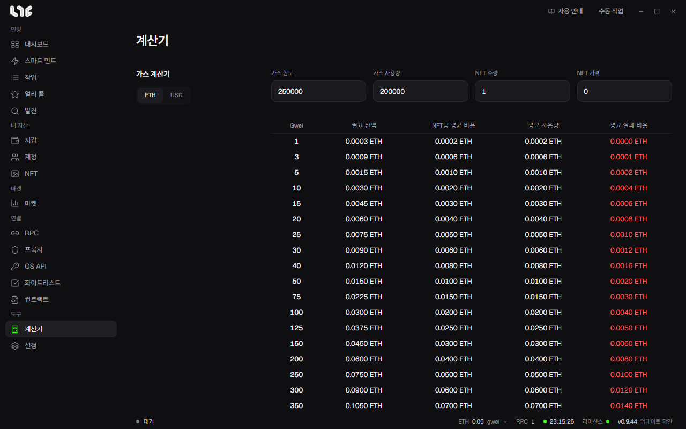

# 계산기

**계산기**에는 유닉스 시간 변환과 가스 계산기가 있습니다. 둘 다 이 PC에서만 돌아갑니다.

## 유닉스 시간 변환

한쪽을 쓰면 다른 쪽이 바뀝니다.

- **유닉스 타임스탬프**: 초 단위입니다. 밀리초를 넣으면 초로 바꿉니다.
- **현지 날짜와 시간**: PC의 시간대를 씁니다.

**지금으로 설정**으로 현재 시각을 넣습니다. 복사한 값을 작업의 **타임스탬프** 칸에 넣으세요.

## 가스 계산기

정해진 gwei 값마다 비용을 표로 보여 줍니다. 실시간 기본 수수료 추정기가 아닙니다.

| 입력 | 뜻 |
| --- | --- |
| 가스 한도 | 거래 하나에 잡아 둘 가스 한도 |
| 가스 사용량 | 성공한 민팅이 쓰는 가스 |
| NFT 수량 | 민팅할 NFT 수 |
| NFT 가격 | NFT 하나의 네이티브 토큰 가격 |

| 결과 | 계산 |
| --- | --- |
| 필요 잔액 | NFT 비용 + 1.2 × 한도 가스 비용 |
| NFT당 평균 비용 | 평균 사용량 ÷ NFT 수량 |
| 평균 사용량 | NFT 수량 × NFT 가격 + 성공 가스 비용 |
| 평균 실패 비용 | 그 gwei에서 실패한 거래가 쓰는 가스 비용의 추정 |

민팅 전에 지갑마다 넣을 금액을 잡을 때 쓰세요. **USD** 버튼으로 달러 표시로 바꿉니다.
