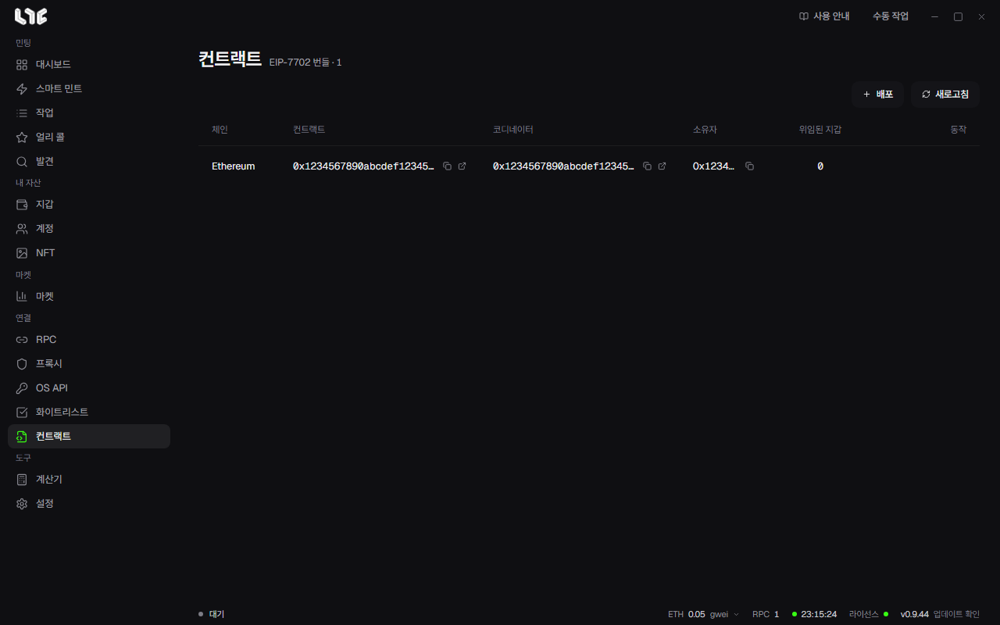

# 컨트랙트

**컨트랙트**는 EIP-7702 번들 작업 공간입니다. 코디네이터와 실행자 배포를 저장하고 지갑 위임을 돕습니다. 일반 컨트랙트 주소록은 아닙니다.

번들을 쓰면 여러 지갑의 거래를 한 묶음으로 보냅니다. 작업 화면의 **새 번들**로 만듭니다.

## 번들러 배포

**배포**를 누르고 아래를 고릅니다.

- 체인
- 응답하는 RPC가 하나 이상 있는 **RPC 그룹**
- 자금이 있는 **소유자 지갑**
- 최대 수수료와 우선 수수료. 비우면 자동입니다

앱이 코디네이터와 실행자를 배포하고 단계마다 알려 준 뒤 주소를 저장합니다. **새로고침**은 저장 기록을 체인 상태와 맞춥니다.

## 위임과 해제

준비된 실행자에 **지갑 위임**으로 EVM 지갑을 고르고 EIP-7702 위임을 설정합니다. **위임된 지갑** 수는 마지막 검사 결과입니다. **지갑 위임 해제**는 온체인에서 위임을 지웁니다.

위임은 지갑을 대신 실행할 코드를 정합니다. 서명하기 전에 체인, 실행자 주소, 지갑, 가스를 확인하세요. 믿을 수 있는, 배포된 실행자 컨트랙트에만 위임하세요.

> **주의**: 행을 지워도 이 PC의 기록만 지워집니다. 배포한 컨트랙트나 지갑 위임은 그대로입니다. 먼저 지갑 위임을 해제하고 온체인에서 확인한 뒤 지우세요.

## 배포가 안 될 때

**RPC** 메뉴에서 그 체인의 RPC를 넣거나 핑하고, 소유자 지갑 잔액을 확인한 뒤 다시 해 보세요. 사용자 체인도 목록에 나오지만, 실제 동작은 그 체인의 EIP-7702 지원에 달려 있습니다.
