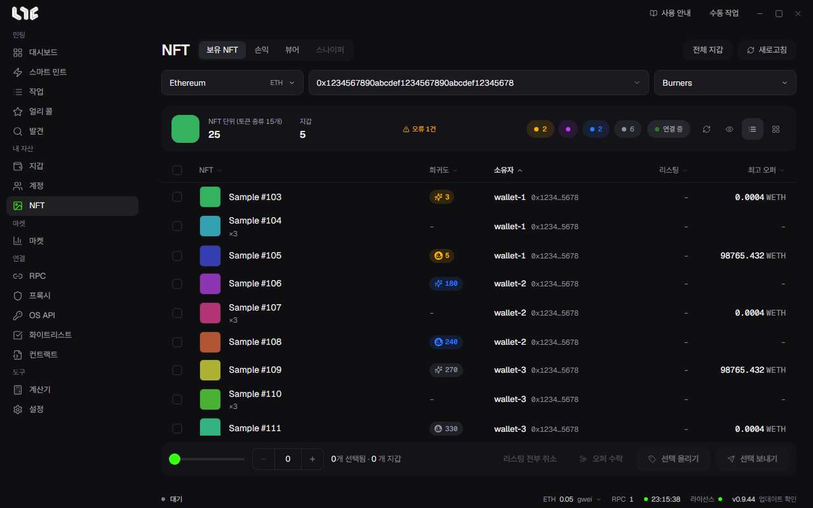

# 보유 NFT

**NFT** 메뉴에는 **보유 NFT, 손익, 뷰어** 탭이 있습니다. 보유 NFT 탭은 내 지갑들이 가진 NFT를 보여 주고, 그 자리에서 보내기, 리스팅, 오퍼 수락을 합니다.

## 불러오기

1. 체인을 고릅니다.
2. 지갑 그룹을 고릅니다. 여러 그룹을 함께 고를 수 있습니다.
3. 컬렉션을 고릅니다. 컬렉션 주소를 넣으면 그 컬렉션만 읽습니다.
4. 새로고침을 누릅니다.

모든 지갑을 한 번에 읽으려면 **전체 지갑**을 누르세요. 체인을 돌며 읽으므로 눌렀을 때만 읽습니다.

결과 머리에 NFT 단위와 토큰 종류가 나옵니다. 두 수가 다른 것은 ERC-1155 때문입니다. ERC-721 행은 토큰 하나이고, ERC-1155 행은 수량을 가집니다. 보낼 때 행마다 몇 개를 옮길지 정할 수 있습니다.

## 희귀도

순위 숫자의 색은 등급을 뜻합니다.

| 등급 | 범위 |
| --- | --- |
| 전설 | 상위 1% |
| 에픽 | 상위 10% |
| 희귀 | 상위 25% |
| 일반 | 나머지 |

등급은 순위 ÷ 공급량입니다. 같은 순위라도 공급량이 다르면 등급이 다릅니다. 위쪽 등급 칩으로 걸러 볼 수 있습니다. OpenSea 순위가 있으면 그 값을 쓰고, 없으면 Nogada가 계산한 순위를 씁니다.

## 보기와 선택

- **카드 보기**: 이미지 격자입니다.
- **목록 보기**: 리스팅 가격, 최고 오퍼, 희귀도, 소유 지갑을 표로 봅니다.

클릭으로 고르고, Shift+클릭으로 범위를 고릅니다. 지갑을 넘어 고를 수 있습니다. 아래 막대에 고른 수량과 지갑 수가 나옵니다.

- **메타데이터 새로고침**: 저장된 이름과 이미지를 지우고 다시 받습니다. 리빌 뒤에 쓰세요.
- **정보 숨기기**: 주소와 지갑 이름을 가립니다. 스크린샷에 씁니다.

## 보내기, 모으기, 나눠 보내기

**선택 보내기**를 누릅니다.

- **도착지에 나눠 보내기** 꺼짐: 고른 것을 한 곳으로 보냅니다. 여러 지갑에 민팅한 NFT를 모을 때 씁니다.
- **도착지에 나눠 보내기** 켜짐: 여러 곳으로 나눕니다.

내 지갑이나 **직접 입력 주소**로 보낼 수 있습니다. 같은 지갑에서 나가는 전송은 컬렉션과 체인이 지원하면 한 거래로 묶습니다. 결과는 항목마다 나오므로 일부만 실패해도 무엇이 안 갔는지 알 수 있습니다.

## 리스팅과 오퍼

OpenSea API 키가 필요합니다. 없으면 버튼이 꺼집니다. 서명은 언제나 이 PC에서 합니다.

- **선택 올리기**: 고른 NFT를 **리스팅 생성** 창에서 판매에 올립니다. 모두 같은 값으로 정하거나 **사다리**로 가격을 올려 가며 정할 수 있습니다. **수수료만큼 조정**을 켜면 받는 금액이 입력값과 같도록 가격을 올립니다.
- **오퍼 수락**: 고른 NFT마다 가장 좋은 유효 오퍼를 온체인으로 수락합니다. 가스가 듭니다.
- **리스팅 전부 취소**: 고른 NFT의 지갑이 이 체인에 올린 리스팅과 오퍼를 모두 취소합니다. 지갑마다 거래 1건이 나가고 가스가 듭니다.

## 왜 안 보이나요

ERC-1155는 지갑이 가진 토큰을 표준으로 나열할 수 없습니다. 지원되는 인덱서로 찾은 뒤 온체인으로 수량을 확인합니다. 체인에 인덱서가 없으면 빈 지갑으로 치지 않고 그렇다고 알려 줍니다. 읽기에 실패한 체인은 위쪽 상태 줄에 나오며, 마지막으로 읽은 NFT는 그대로 보입니다.
