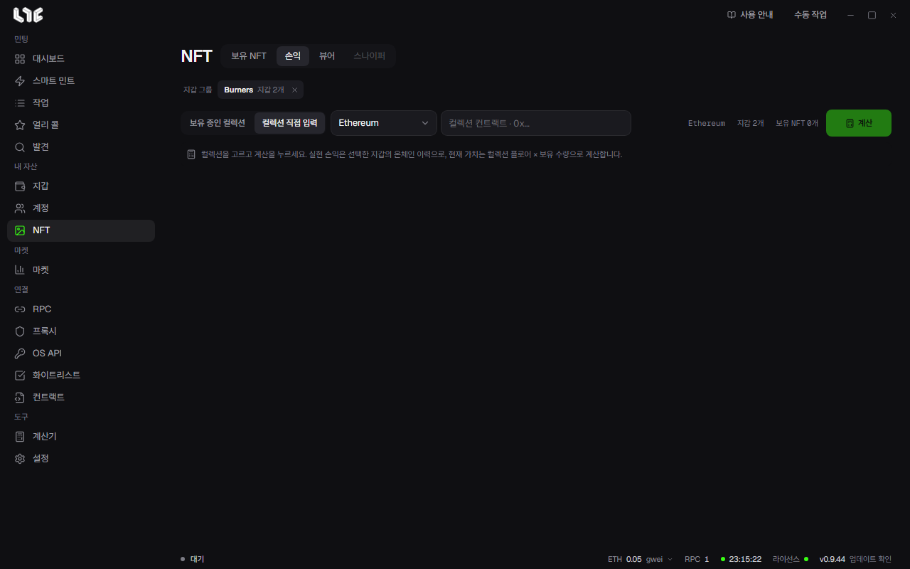

# 손익

**NFT → 손익**은 고른 지갑들의 컬렉션 손익을 계산합니다. 이제 보유하지 않는 지갑의 기록도 포함합니다.

## 계산하기

1. 컬렉션을 고릅니다. **보유 중인 컬렉션**에서 고르거나 **컬렉션 직접 입력**으로 컨트랙트를 넣습니다.
2. 체인과 지갑 그룹을 고릅니다.
3. **계산**을 누릅니다.

실현 손익은 선택한 지갑의 온체인 기록으로 계산합니다. 현재 가치는 컬렉션 플로어 × 보유 수량입니다.

활발한 컬렉션은 시간이 걸릴 수 있습니다. 계산을 취소해도 보유 NFT에는 영향이 없습니다.

## Alchemy가 필요합니다

손익은 Alchemy로 거래 기록을 읽습니다. **설정 → 연동 → PnL Alchemy URL**에 넣거나, **RPC** 메뉴에 그 체인의 Alchemy 주소를 넣으세요. Stable은 Etherscan 키를 씁니다. Alchemy 무료 요금제는 범위 제한이 있어 긴 기록에서 실패할 수 있습니다.

## 지원 체인

손익 계산은 체인 목록이 따로 있습니다. 앱의 체인에 있어도 손익은 안 될 수 있습니다. 화면의 체인 칸에 나오는 것이 지원 체인입니다.

## 결과 읽기

- **일부 기록이 빠지면** 그 값은 추정이거나 합계에서 빠집니다. 설명을 펼치면 건너뛴 내용이 나옵니다.
- **민팅 원가**는 지갑이 민팅 거래로 보낸 금액, **판매**는 마켓이 지불한 금액, **보유**는 플로어 × 수량입니다.
- 일부 결과는 복사하거나 내려받을 수 없습니다.

## 손익 카드

공유용 카드를 만듭니다. 포스터, 분할, 티켓, 터미널 스타일 가운데 고르고, 내 배경 이미지를 넣을 수 있습니다. PNG, JPG, WebP로 10MB까지, 슬롯 3개가 이 PC에 저장됩니다. 카드를 복사하거나 PNG로 저장합니다.
