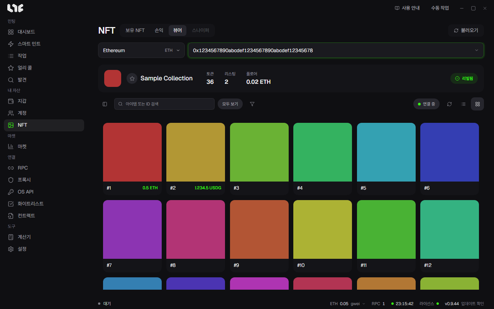

# 뷰어

**NFT → 뷰어**는 컬렉션 전체를 보는 화면입니다. 내 지갑이 가진 것에 한정되지 않습니다. 플로어에서 희귀한 것을 찾거나 리빌 전 드롭을 감시할 때 씁니다.

## 불러오기

컬렉션 컨트랙트를 붙여넣고 체인을 고른 뒤 **불러오기**를 누릅니다. 토큰, OpenSea 리스팅과 오퍼, 희귀도, 실시간 활동을 함께 보여 줍니다.

- 왼쪽 **필터**: 리스팅 여부, 희귀도 등급, 특성으로 거릅니다.
- 위쪽 검색: 아이템 이름이나 토큰 ID로 찾습니다.
- 카드와 표 보기를 바꾸고, 리스팅 가격, 희귀도, 최고 오퍼로 정렬합니다.
- 별을 눌러 **즐겨찾는 컬렉션**에 넣습니다.

**일부**가 표시되면 컬렉션이 너무 크거나 읽기가 끊겨 일부만 나온 것입니다. 다시 불러오세요. 실시간 갱신이 계속 채웁니다.

## 리빌 감시

리빌 전 컬렉션에서 **리빌 감시**를 누르면 온체인 이벤트와 메타데이터를 지켜보다가, 리빌되면 컬렉션을 다시 읽습니다.

## 일괄 구매

리스팅된 아이템을 고르고 구매를 누릅니다. 먼저 아래가 필요합니다.

- OpenSea API 키 하나 이상. [OpenSea API 키](../setup/opensea-api.md)
- **설정 → 발사 엔진 → NFT 구매**의 구매 지갑
- 그 지갑의 **구매 최대 수수료**(선택)

앱은 구매 직전에 리스팅을 다시 확인합니다. NFT 하나당 거래 하나를 보내며, 제출, 건너뜀, 실패를 따로 알려 줍니다.

> **주의**: 일괄 구매는 네이티브 통화 리스팅만 삽니다. ERC-20 리스팅은 보이지만 건너뜁니다. 보이는 리스팅은 언제든 바뀌거나 사라질 수 있으니 가격과 지갑을 확인하고 누르세요.
