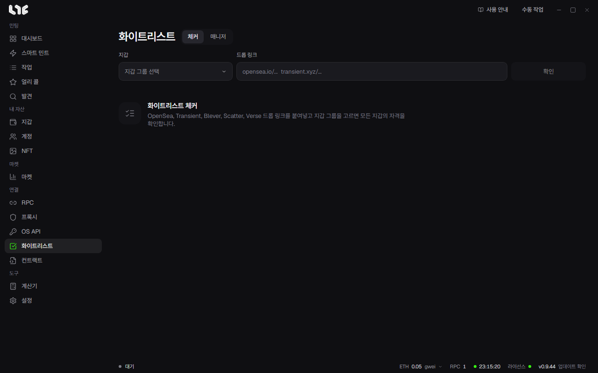

# 화이트리스트

**체커**는 지갑 그룹이 드롭에 자격이 있는지 확인하고, **매니저**는 쓸 만한 결과를 모아 둡니다.

## 드롭 확인하기

1. **화이트리스트 → 체커**를 엽니다.
2. 드롭 링크를 붙여넣습니다. OpenSea, Transient, Blever, Scatter, Verse 링크와 운영자가 올린 체커를 지원합니다.
3. 지갑 그룹을 하나 이상 고릅니다.
4. 확인을 누릅니다. 결과가 지갑마다 들어옵니다. 중지로 멈출 수 있습니다.

페이즈마다 결과 칸이 생깁니다. 체크 표시는 자격이 있다는 뜻이고, 옆의 숫자는 출처가 알려 준 지갑당 한도입니다.

결과는 확인한 순간의 값입니다. 목록이 아직 바뀌는 중이면 쓰기 전에 다시 확인하세요.

지갑이 많다면 **설정 → 발사 엔진 → 화이트리스트 체커 프록시**에서 프록시 그룹을 켜세요. 동시에 지갑 50개까지 확인합니다.

## 자격 있는 지갑으로 할 일

공개가 아닌 페이즈를 고르면 아래를 쓸 수 있습니다.

- **작업 만들기**: 자격 있는 지갑과 페이즈가 채워진 작업 창을 엽니다.
- **지갑에 자금 보내기**: 그 지갑들로 자금 관리를 엽니다.
- **내보내기**: 자격 있는 지갑의 개인키를 저장합니다.
- **화이트리스트 저장**: 결과를 매니저에 넣습니다.

공개 페이즈는 화이트리스트로 치지 않습니다. 운영자 체커는 자격만 알려 주고 민팅 데이터를 주지 않을 수 있습니다. 그때는 작업 만들기를 쓸 수 없습니다.

> **주의**: 내보낸 개인키 파일은 암호화되어 있지 않습니다. 파일을 가진 사람은 그 지갑을 쓸 수 있습니다. 안전하게 두고 필요 없으면 지우세요.

## 매니저

저장한 항목을 **화이트리스트**와 **진행 중**으로 나눕니다. 검색과 직접 추가를 할 수 있고, 페이즈마다 같은 작업 만들기, 자금, 내보내기를 씁니다. 같은 출처를 다시 저장하면 새 항목을 만들지 않고 최신 자격 지갑을 합칩니다.

매니저의 항목을 지워도 이 PC의 기록만 지워집니다. 출처의 자격은 바뀌지 않습니다.
