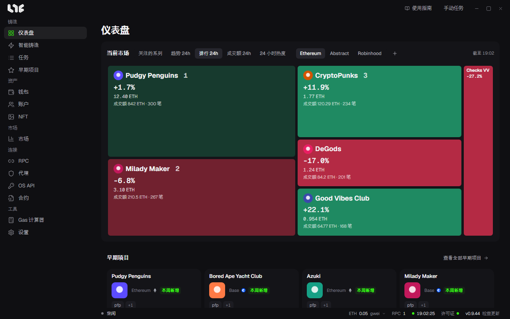

# Nogada 指南

Nogada 是在 Windows 电脑上运行的 NFT 铸造应用。它可以用多个钱包同时铸造同一个 Drop，把铸造到的 NFT 上架或转出，并在同一个应用里查看市场和盈亏。支持以太坊和 EVM 链。

## 用它可以做什么

| 你想做的事 | 使用 |
|---|---|
| 只粘贴铸造链接就创建任务 | [智能铸造](tasks/smart-mint.md) |
| 自己选择合约和函数创建任务 | [任务](tasks/task-form.md) |
| 准时发射、失败后重试、提高 Gas | [运行任务与加速](tasks/running.md) |
| 把多个钱包的铸造打包成一笔交易 | [捆绑与合约](tasks/bundles.md) |
| 上架、下架、转出 NFT，接受报价 | [NFT 菜单](after/nft-menu.md) |
| 系列价格、图表、提醒 | [市场](after/market.md) |
| 即将开始的铸造 | [铸造日历](after/mint-calendar.md)、[早期项目](tasks/early-calls.md) |

## 第一次使用

按下面的顺序阅读，就能顺利从打开应用走到创建第一个任务。

1. [下载与首次启动](getting-started/install.md)
2. [许可证](getting-started/license.md)
3. [跟着做完第一次铸造](getting-started/first-setup.md)
4. [智能铸造](tasks/smart-mint.md)

## 指南的结构

指南按使用应用的顺序编排。

- **开始使用**：安装、许可证、看懂界面、走到第一个任务的捷径。
- **铸造前的准备**：钱包、资金、RPC、代理、OpenSea API 密钥等需要事先准备的东西。
- **铸造**：创建和运行任务的所有方法。
- **NFT 与市场**：铸造之后使用的页面。
- **社交**、**工具与设置**、**帮助**：需要时再查阅。

## 先了解这些

- 私钥只保存在这台电脑上，并用 Windows 账户加密。交易签名也始终在这台电脑上完成。
- 任务在应用内运行。关闭应用后，定时任务也不会运行。
- 铸造能否成功取决于 Gas、竞争和项目情况，应用无法保证。
- 界面文字可以切换为英语、韩语或中文，在 **设置 → 常规 → 语言** 中选择。
