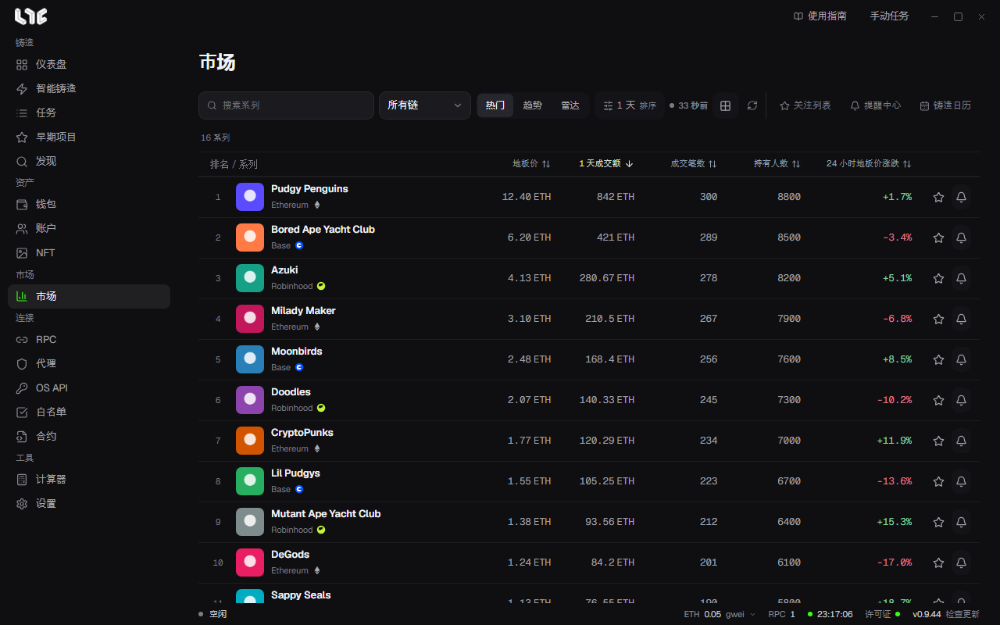
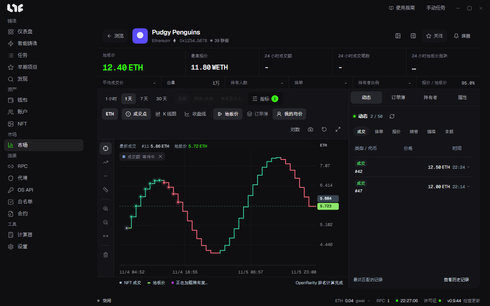

# 市场

**市场** 用来查看系列排行、各系列的图表和交易记录，以及价格提醒。价格来自 Nogada 服务器的市场中心，不需要 OpenSea API 密钥。交易签名始终在这台电脑上完成。

用市场页面右上方的 **关注列表**、**提醒中心**、**铸造日历** 按钮打开各个页面。

## 排行

用上方的标签选择列表类型。

| 按钮 | 列表 |
|---|---|
| 热门 | OpenSea 的热门系列，按所选标准排序。 |
| 趋势 | OpenSea 上正在走热的系列。可以选择统计期间。 |
| 雷达 | 把热门和趋势合在一起显示。 |

- 在搜索栏中查找系列，用 **所有链** 筛选链。
- 标签右侧的期间和排序按钮（一开始是 **1 天**）用于选择期间和排序标准。排序标准一次只生效一个。点击表格的列标题也会按该列排序。
- 旁边的圆点和时间表示最近一次获取列表的时间。格子按钮切换卡片视图，箭头按钮刷新。

表格的列是地板价、1 天成交额、成交笔数、持有人数和 24 小时地板价涨跌。行末的星标是 **关注**，铃铛是 **创建提醒**。点击行会打开该系列。

## 关注列表

加了星标的系列会汇集到 **关注列表**。最多可放 10 个系列，想再加时先移除一个。有搜索、链筛选和刷新，仪表盘的 **关注的系列** 标签也使用这个列表。

## 系列页面

上方显示名称、链和合约，以及各项数据。

- 大格：地板价、最高报价、24 小时成交额、24 小时成交笔数、24 小时地板价涨跌
- 小格：平均成交价、总量、持有人数、挂单、持有者比例、报价 / 地板价

### 图表

- 期间：**1 小时**、**1 天**、**7 天**、**30 天**
- 稀有度筛选：全部、**传说+史诗**、**稀有及以上**。读取稀有度期间不可用。
- **指标**：SMA 20、EMA 50、布林带、RSI 14、成交量。成交 K 线不够时会提示还需要多少。
- 形状：**成交点**、**K 线图**、**收盘线**
- 叠加：**地板价**、**订单簿**（挂单和报价）、**我的均价**（在 NFT 菜单中计算过盈亏时）
- 右上方：**对数** 价格轴、复制图表图片、重置视图、放大
- 左侧工具：十字线、趋势线、价格线、价格与时间测量、放大、缩小、清除绘制

滚轮缩放，拖动平移。双击或按 Home 键回到初始视图。点击图表上的成交点会打开该代币的卡片。

### 右侧面板

| 标签 | 内容 |
|---|---|
| 动态 | 成交、挂单、报价、转移、铸造记录。实时更新，**查看历史记录** 可以加载更多。 |
| 订单簿 | 各价位的订单数。 |
| 持有者 | 主要持有者和前 10 位持有占比。 |
| 属性 | 各属性的地板价、供应量、24 小时成交和数量占比。 |

## 提醒中心

在 **提醒中心** 为系列或钱包的变化创建提醒。不用打开详情页面，只要应用开着就会提醒。提醒由应用判断后发送，所以关闭应用后不会收到。提醒以 Windows 通知的形式到达。

提醒中心的标签是 **系列**、**钱包**、**历史**。系列和钱包标签旁的数字是已建的提醒数。

### 系列提醒

点击 **新建提醒** 并填写。系列提醒最多可设在 10 个系列上。

| 栏位 | 填写内容 |
|---|---|
| 系列标识 | OpenSea 的系列 slug（例如 `pudgypenguins`）。从排行表的铃铛打开时会自动填好。 |
| 链 | 该系列所在的链。 |
| 指标 | 地板价、地板价变化 %、成交额变化 %、成交笔数变化 %、挂单数变化 %、最高报价 / 地板价 %、前 10 位持有占比 %、RSI |
| 条件 | **小于或等于** 或 **大于或等于** |
| 阈值 | 触发提醒的值。百分比指标填百分数。 |
| 价格币种 | 只在地板价时使用。填写该系列地板价旁显示的币种。 |
| 提醒间隔 | 选择提醒 **仅一次** 就结束，还是在条件持续时 **重复**。 |

### 钱包提醒

在 **钱包** 标签点击 **新建钱包提醒**，监视某个 EVM 地址的 OpenSea 账户事件。

- 钱包提醒只有在 OS API 中有你自己的 OpenSea API 密钥时才能使用。没有密钥时不显示 **钱包** 标签，钱包提醒也不运行。已建的钱包提醒不会被删除，重新添加密钥后会恢复。
- 最多可设在 5 个钱包上。想再加钱包时，先删除其他钱包的提醒。
- 栏位有 **钱包地址**、**名称**、**提醒间隔**、事件和链。事件可选铸造、收到、买入、卖出。
- **提醒间隔** 可选 1 分钟、5 分钟、15 分钟、1 小时、6 小时，默认 1 分钟。原本安静的钱包出现事件时，第一条会立即提醒。之后在间隔内出现的事件会先攒着，间隔结束时合成一条提醒发送。
- 合并的提醒会写出各类事件的数量，并逐行列出事件，最多 10 行，其余以“另有 N 条”计数。每个事件都会逐条留在 **历史** 标签中。

### 历史

**历史** 标签保留已发送的提醒和送达结果。用 **清空历史** 清除。
