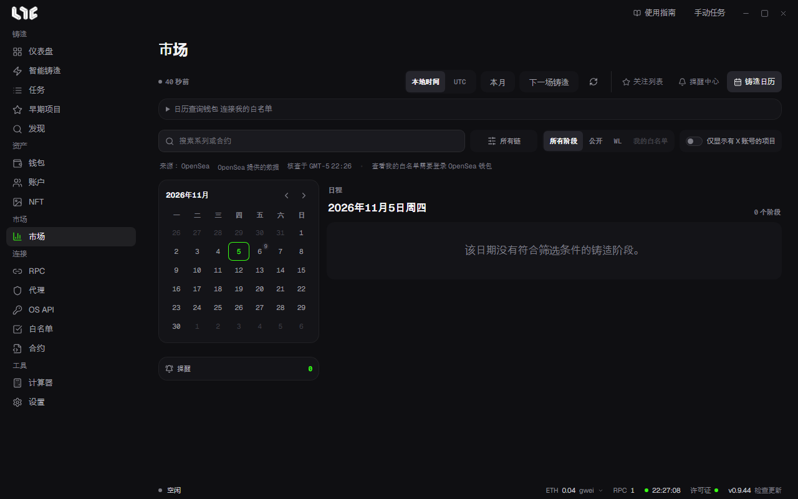

# 铸造日历

**市场 → 铸造日历** 用日历显示即将开始的铸造。目前使用 OpenSea 提供的日程。

## 看懂页面

- 左侧日历：日期旁的小数字是当天的铸造阶段数。点击日期，右侧 **日程** 会显示当天的阶段。用箭头翻月。
- 上方按钮：用 **本地时间** / **UTC** 切换时间显示，用 **本月** 和 **下一场铸造** 快速跳转。右侧箭头用于刷新。
- 来源一行：日程的来源和核查时间。

## 筛选

- 搜索栏：按系列名称或合约查找。
- **所有链**：按链筛选。
- 阶段：**所有阶段**、**公开**、**WL**、**我的白名单**
- **仅显示有 X 账号的项目**：只保留有 X 地址的项目。

## 查看 Drop 详情

点击日程中的条目，可以看到各阶段的开始和结束时间、价格、每钱包上限、供应量、合约，以及网站和 X 链接。也会显示数值是否经过链上核查。

点击 **设置提醒**，选择在阶段开放前多久提醒。提醒以 Windows 通知的形式到达。已设置的提醒数显示在日历下方的 **提醒** 栏。

## 查看自己的白名单

展开 **日历查询钱包 连接我的白名单** 并连接钱包后，**我的白名单** 只保留该钱包在白名单中的阶段。

- 连接就是签署一条 OpenSea 登录消息。不是交易，所以不产生 Gas。
- 连接即表示同意 OpenSea 的服务条款和隐私政策。
- 关闭应用会断开连接，登录一天后过期。

想一次查看多个钱包的资格，请使用 [白名单检查器](../tasks/whitelists.md)。
