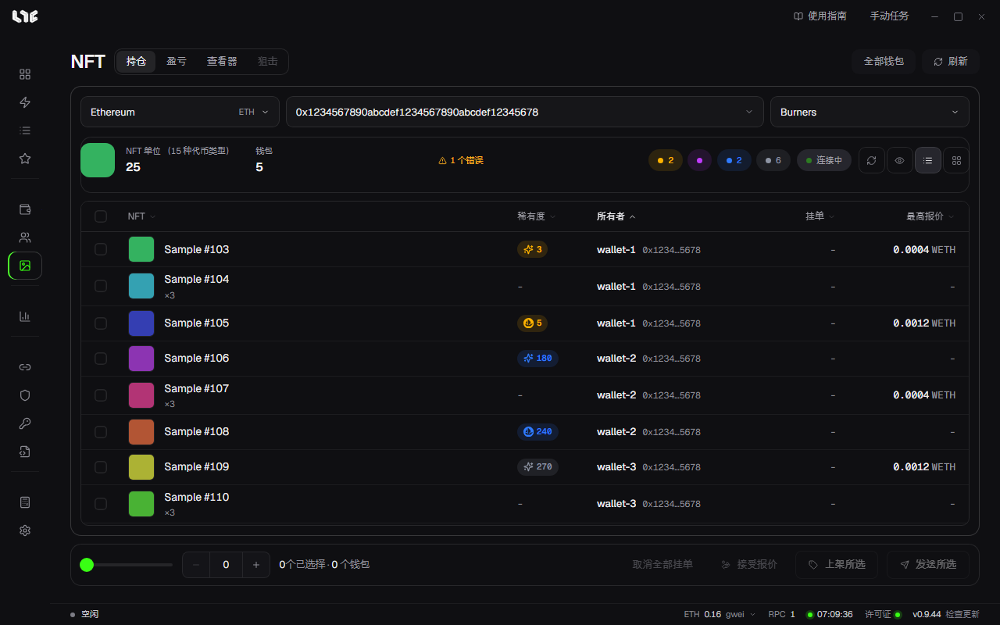
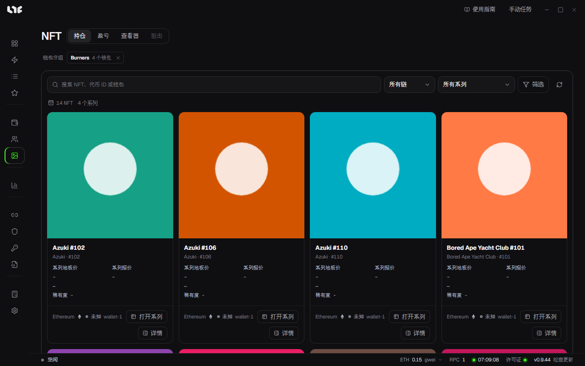
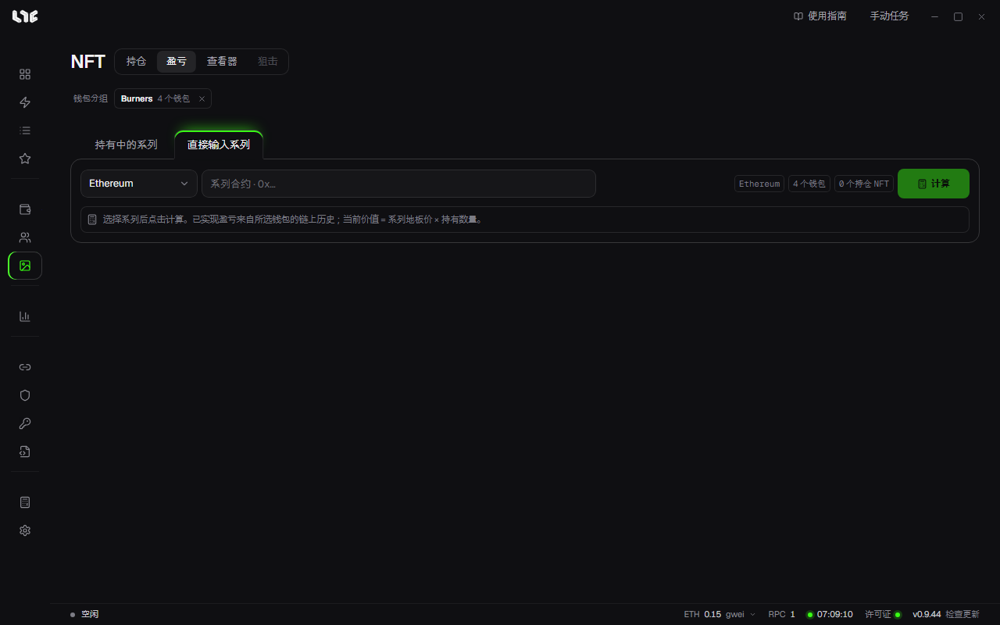
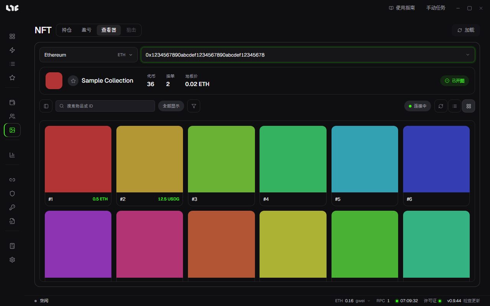

# NFT 菜单

**NFT** 是铸造之后使用的地方。上方的标签是 **持仓**、**盈亏**、**查看器** 和 **狙击**，狙击尚未开放（**即将**）。

## 持仓

铸造结束后，在这里出售或转移 NFT。填入系列后，表格会列出你的钱包持有的该系列全部 NFT，可以直接上架、下架、转出或接受报价。

1. 选择链。
2. 在 **0x… NFT 系列** 中填入系列合约。
3. 在 **选择钱包分组** 中选择分组。

表格上方显示 NFT 数量和代币类型数、钱包数、有钱包读取失败时显示 **N 个错误**，以及各稀有度等级的数量。**连接中** 表示正在实时接收挂单和报价的变化。

| 列 | 含义 |
|---|---|
| NFT | 名称和图片。ERC-1155 会同时显示持有数量（×3 等）。 |
| 稀有度 | 在系列中的排名。不同等级颜色不同。 |
| 所有者 | 持有它的钱包。 |
| 挂单 | 当前挂出的价格。 |
| 最高报价 | 当前可以接受的最高报价，按报价所用的币种（例如 WETH）显示。 |

OS API 中没有 OpenSea API 密钥时，**挂单** 和 **最高报价** 列会显示 **需要 OpenSea API 密钥**，不显示数值。

### 底部栏

勾选 NFT，或用左侧的滑块和 **−/+** 一次设定要选的数量，然后点击按钮。

| 按钮 | 作用 |
|---|---|
| 上架所选 | 把所选 NFT 上架到 OpenSea。设置价格和到期时间；开启 **按手续费调整** 后，会提高价格，使扣除创作者和平台费用后的到手金额等于你填写的数字。系列首次上架会先发送一笔授权交易。 |
| 发送所选 | 把所选 NFT 转到其他地址，可以集中到一个地址（**归集**），也可以分散到多个地址（**分发**）。每个 NFT 发送一笔交易。 |
| 接受报价 | 对每个所选 NFT 接受最高报价。每个钱包和系列第一次接受时会同时发送一次授权交易。没有报价或只有自己报价的 NFT 会跳过。 |
| 取消上架 (N) | 所选 NFT 中有已挂单的时候出现。取消这些 NFT 的 OpenSea 挂单。 |
| 取消全部挂单 | 一次停止持有所选 NFT 的钱包在这条链的 OpenSea 上发出的全部挂单和报价。不只是所选 NFT，而是这些钱包的全部订单。每个钱包发出一笔交易。 |

上架所选、接受报价和取消上架 (N) 需要 [OpenSea API 密钥](../prepare/opensea-keys.md)。没有密钥时按钮处于关闭状态，鼠标移上去会提示在 OS API 页面添加密钥。这些操作要上链，会消耗 Gas，发出后无法撤销。

取消全部挂单要等链上确认交易回执后才会提示已取消。短时间内没有确认时，会提示正在等待完成确认，并保留进度。

### 全部钱包

点击右上方的 **全部钱包**，会读取所有钱包在所有链上的 NFT 并以卡片显示。只在点击时读取。

在搜索栏中按 NFT 名称、代币 ID 或钱包查找，并用链、系列和 **筛选**（排序、属性、挂单状态）缩小范围。卡片上显示系列地板价、系列报价、稀有度、链、挂单状态和持有的钱包；**打开系列** 会进入市场中该系列的页面。

在一条链上持有超过 1 万个 NFT 的钱包只显示前 1 万个，卡片上方会说明这一点。

## 盈亏

计算你的钱包在某个系列上的盈亏。

1. 在上方的钱包分组按钮中选择要计算的分组。
2. 从 **持有中的系列** 中选择，或用 **直接输入系列** 填写链和合约。已经卖光的系列也可以直接填写来计算。
3. 点击 **计算**。

已实现盈亏来自所选钱包的链上历史，未实现盈亏是当前持有数量乘以最近的系列地板价。在 Alchemy 支持的链上，会通过 RPC 菜单或 **设置 → 集成 → PnL Alchemy URL** 中的 Alchemy 地址读取历史。

完整结果出来后，可以用 **分享卡片** 制作盈亏卡片。选择 **卡片样式**，需要的话用 **上传图片** 添加背景（PNG、JPG、WebP，最大 10MB），然后点击 **复制图片** 或 **保存 PNG**。只有部分结果时无法复制或保存。

计算过盈亏后，可以在市场的系列图表中开启 **我的均价** 线。

## 查看器

把整个系列铺在一个页面上查看。选择链，填入系列合约，点击 **加载**。点击星标加入收藏的系列，下次可以从列表中选择。

- 上方显示代币数、挂单数、地板价和开图状态（**已开图** 或未开图）。
- 方块上显示代币编号和挂单价格。在搜索栏中输入物品名称或 ID，用漏斗按属性筛选。右侧按钮切换列表视图和方块视图。
- 结合稀有度排名，可以找到地板价附近的稀有代币。

### 在查看器中购买

选中已挂单的代币，点击 **购买所选挂单**。应用会在每次购买前重新查一遍该挂单，然后为每个 NFT 单独发送一笔交易。需要在 **设置 → 发射引擎 → NFT 购买** 中设好 **购买钱包**，那里的 **购买最高费用** 是 Gas 上限。以非原生币计价的挂单暂时无法购买。

### 监控开图

对还没开图的系列，设好要监视的分钟数，点击 **监控开图**。应用会在这段时间内查看链上事件和元数据，确认开图后停止，并在状态中告知。
