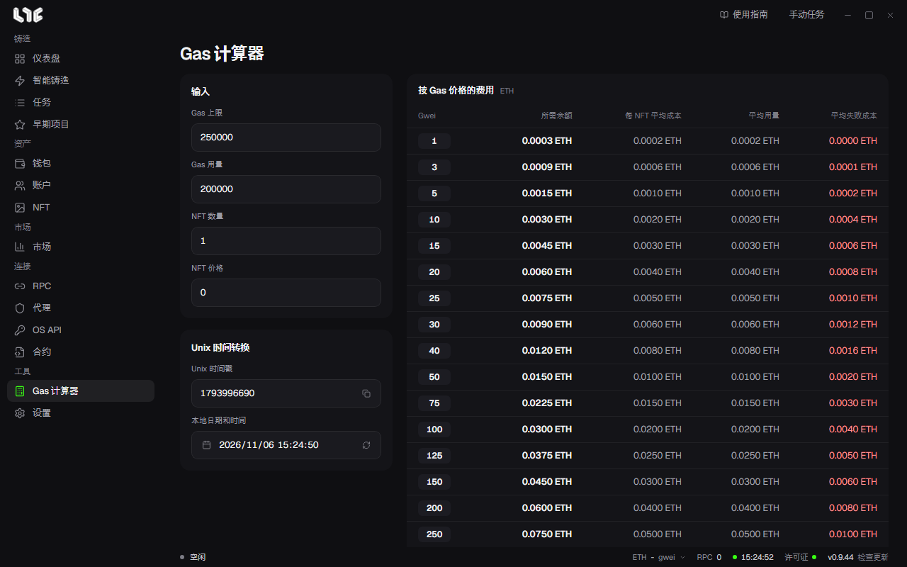

# Gas 计算器

**Gas 计算器** 左侧是 **输入** 和 **Unix 时间转换**，右侧是 **按 Gas 价格的费用** 表。两者都不会向链上发送任何东西。

## 按 Gas 价格的费用

填好 **输入** 的四个栏位，就会按 Gas 单价（gwei）列出费用表，单价从 1 到 1000 gwei 分行显示。

| 栏位 | 填写内容 |
|---|---|
| Gas 上限 | 任务中要设置的 Gas 上限。 |
| Gas 用量 | 铸造交易实际消耗的 Gas。在区块浏览器中打开同一个 Drop 的铸造交易就能看到。 |
| NFT 数量 | 一个钱包铸造的数量。 |
| NFT 价格 | 单个 NFT 的铸造价格。 |

表格各列这样计算：

| 列 | 计算方式 |
|---|---|
| 所需余额 | NFT 数量 × NFT 价格 + 1.2 × 单价 × Gas 上限。钱包里至少要有这么多，交易才能进去。 |
| 平均用量 | NFT 数量 × NFT 价格 + 单价 × Gas 用量。成功时实际花掉的金额。 |
| 每 NFT 平均成本 | 平均用量 ÷ NFT 数量 |
| 平均失败成本 | 单价 × 40,000 Gas。交易失败时损失的 Gas 费的估计值。 |

获取到 ETH 价格时，**输入** 标题旁会出现 **ETH / USD** 切换，也可以用美元查看。

决定每个钱包放多少钱时，看你要用的单价那一行的 **所需余额**，填到 [管理资金](../prepare/funding.md) 的 **每钱包目标余额** 即可。

## Unix 时间转换

任务的 **时间戳** 栏使用 Unix 时间。在左下方的转换器中选择 **本地日期和时间** 就会得到 **Unix 时间戳**，反过来填入数字也会得到日期。**设为现在** 填入当前时间，复制按钮复制数字。
