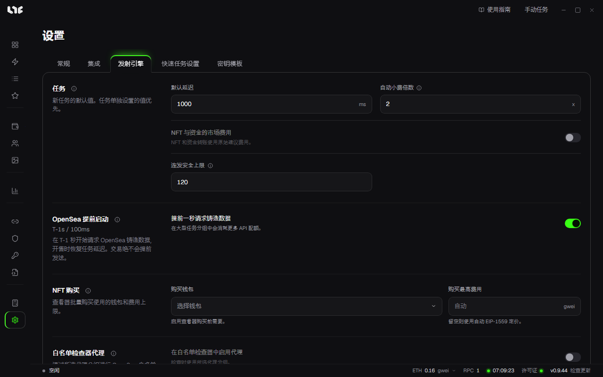
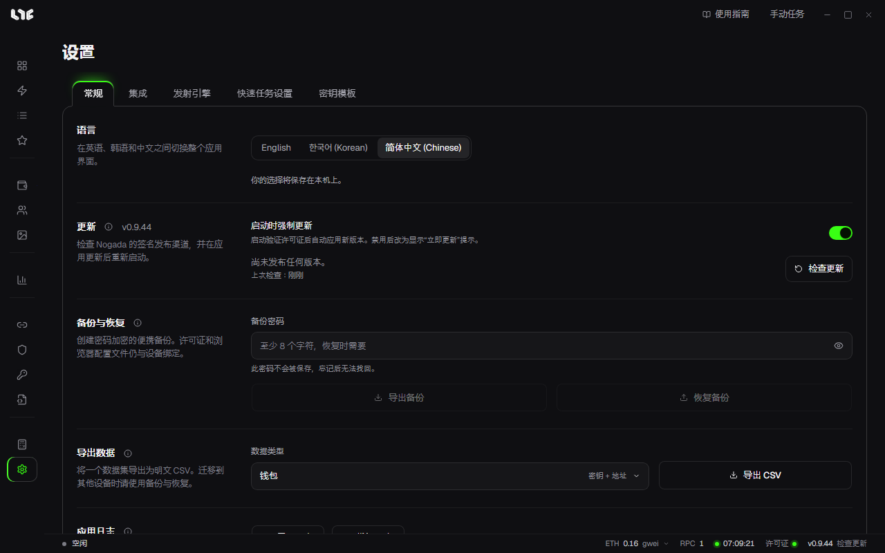

# 设置

**设置** 上方分为五个标签。

| 标签 | 包含内容 |
|---|---|
| 常规 | 语言、更新、备份与恢复、导出数据、应用日志、退出登录、清除所有数据 |
| 集成 | 验证码求解器密钥、市场中心、PnL Alchemy URL、Etherscan API 密钥、Discord Webhook、捕获浏览器扩展 |
| 发射引擎 | 任务默认值、OpenSea 提前启动、NFT 购买、广播、Flashbots、链 |
| 快速任务设置 | 快速任务钱包和按链设置的 RPC |
| 密钥模板 | 社交任务的答案模板 |

下面不按标签顺序，而是按你想改什么来分组。每个标题后面写着该设置所在的标签。

## 任务如何发射（发射引擎）

### 新任务的默认值

**任务** 卡片里是新任务一开始使用的值。任务中单独设置的值优先。

- **默认延迟**：新任务得到的延迟（ms）。
- **自动小费倍数**：在优先费为自动的任务中，用这个数乘以 RPC 建议的值。普通交易适合 1 倍，有竞争的铸造适合 3 到 5 倍，结果不会低于 0.1 gwei。
- **连发安全上限**：连发最长可以运行多少秒。留空表示没有这个上限。
- **NFT 与资金的市场费用**：开启后，NFT 转移和资金转账按 RPC 建议的费用原样支付。

### 发送到多个 RPC

**广播** 卡片中有 **多 RPC 广播** 和 **连发多 RPC 广播**。它们改变了什么，见 [RPC 与链](../prepare/rpc-and-chains.md)。

### Flashbots

对开启了 Flashbots 的以太坊任务全局生效的值。

- **捆绑窗口**：提前准备多少个连续区块（至少 10）。Flashbots 连发每出一个新区块就把末端往后推一格，保持这么多区块。
- **优先费**、**最高费用**：任务自己的费用为自动时使用。
- **信誉密钥**：只用来向构建者表明身份的密钥，构建者靠它记录你的捆绑被打包的情况。不存放资金，也不会出现在链上。**重置** 会生成新密钥，积累的信誉随之作废。
- **构建者**：接收捆绑的构建者。

### OpenSea 提前启动

开启后，任务从开始时间前 1 秒起向 OpenSea 请求铸造数据，到开始时间后恢复自己的延迟。交易不会提前发出。任务分组越大，消耗的 API 配额越多。

### 链

底部的链列表可以隐藏不用的链、更换公共备用 RPC、按链设置最低小费、添加自定义链。→ [RPC 与链](../prepare/rpc-and-chains.md)

## 快速任务（快速任务设置）

任务页面闪电按钮使用的值。

- **快速任务钱包**：快速任务使用的钱包。一个都不选，闪电按钮就保持不可用。
- **快速任务 RPC（按链）**：展开链的行，固定 RPC。没有固定任何 RPC 的链，快速任务会用该链保存的全部 RPC；一个都没保存时用公共默认值。

## 与其他服务的连接（集成）

- **市场中心**：显示应用是否连上了提供市场和 NFT 价格的 Nogada 服务器。不需要 OpenSea 密钥。上架、出价和接受报价不经过这个服务器，而是使用你自己的 OpenSea API 密钥。
- **Discord Webhook**：每次任务成功或失败，都向 Discord 频道发一条简短通知。粘贴在频道设置 → 整合 → Webhooks 中创建的 URL，测试按钮会发来一条成功样例和一条失败样例。
- **PnL Alchemy URL**：每条链一个 Alchemy URL。留空则使用 RPC 菜单中保存的 Alchemy 地址。**测试** 会检查你填写的 URL（留空则检查已保存的），但不保存。
- **Etherscan API 密钥**：用于读取合约 ABI 等。留空时用公共密钥也能运行；填入自己的密钥，在 Etherscan 系列链上限额更高。
- **验证码求解器 API 密钥**：CapMonster、CapSolver、2captcha、AnySolver，供遇到验证码的社交任务使用。
- **Nogada 捕获浏览器扩展**：单独装在 Chrome 或 Edge 上的扩展。它在支持的区块浏览器上抓取交易，并在应用中打开已填好内容的任务窗口。用 **下载扩展** 下载并解压，在 `chrome://extensions` 中开启开发者模式，再用 **加载已解压的扩展程序** 添加该文件夹。点击浏览器中的按钮而应用没有反应时，点击 **重新注册协议处理程序**。

## 查看器购买（发射引擎）

- **NFT 购买**：查看器批量购买使用的 **购买钱包** 和 **购买最高费用**。没有购买钱包，查看器就无法购买。→ [NFT 菜单](../after/nft-menu.md)

## 语言与更新（常规）

- **语言**：English、한국어、简体中文，保存在这台电脑上。
- **更新**：当前版本和 **检查更新**。有新版本时怎么做由 **启动时强制更新** 决定：开启时在启动时安装；关闭时显示 **立即更新** 提示，由你选择时机。只接受 Nogada 签名的发布版本。

常规标签的其余部分（**备份与恢复**、**导出数据**、**应用日志**、**退出登录**、**清除所有数据**）见 [备份与数据](backup-and-data.md)。

## 密钥模板

在社交任务文本栏中以 `{名称}` 形式填入的答案组。→ [账户与社交任务](../social/accounts-and-social.md)
