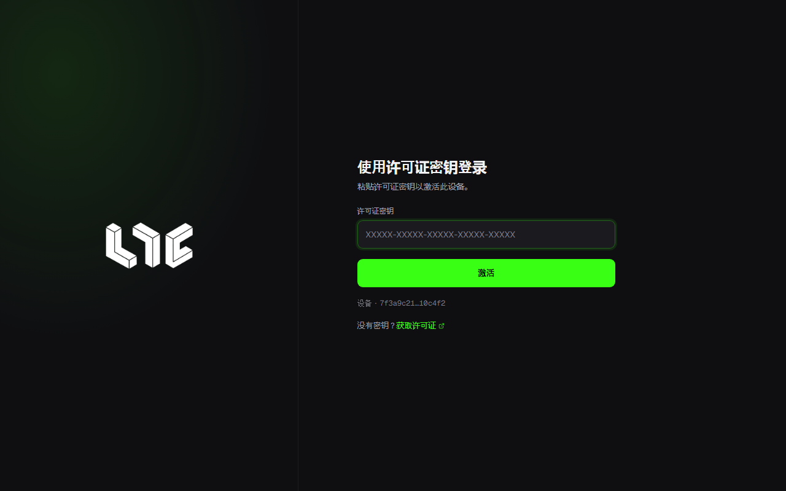

# 许可证

Nogada 需要许可证密钥才能打开。密钥在销售页面用加密货币购买，然后输入到应用的第一个页面。密钥的样子是 `NOGADA-XXXX-XXXX-XXXX-XXXX`。

## 时长与价格

目前是测试期价格。

| 时长 | 价格 |
|---|---|
| 一周 | $15 |
| 一个月 | $29 |

不会自动续费。用同一个 Telegram 账号再次购买，时长会累加到当前密钥的剩余时间上。

## 购买方法

在 [销售页面](https://nogada.app/buy) 购买。使用 Telegram 账号登录，无需密码。

1. 点击 **用 Telegram 登录**，在 Telegram 窗口中登录。
2. 选择时长、网络和币种，点击 **创建订单**。
3. 把页面上的 **转账金额** 转到 **收款地址**。订单页面会显示剩余时间，订单保持 30 分钟。
4. 网络确认到账后，密钥会显示在页面上，同时通过 Telegram 发送给你。可以关闭页面。

支持 Ethereum 和 Base 网络上的 ETH、USDC、USDT。用 ETH 支付时，金额按创建订单时的汇率计算，在该订单内不会变化。

### 金额要精确到最后一位

每个订单金额的最后几位都不同。销售服务器靠这几位把到账和订单对应起来，所以只有金额精确到最后一位，密钥才会自动发放。

- 从交易所提币时，先确认提币手续费是否会从金额中扣除。金额变少就无法自动确认。
- 只在订单中选择的网络上转所选的币种。转到其他网络将无法找到。
- 如果金额不同或没有自动确认，在订单页面下方的交易哈希栏中填入转账交易的哈希，点击 **确认**。运营者确认后发放密钥。
- 通过合约转出的 ETH（例如部分交易所的批量提币、智能钱包）无法自动确认。请联系运营者（见 [联系支持](../help/when-stuck.md#联系支持)）。

## 在应用中激活

1. 打开应用时会显示 **使用许可证密钥登录**。
2. 把密钥粘贴到 **许可证密钥**，点击 **激活**。
3. 主界面打开，并且底部状态栏 **许可证** 旁边的圆点变绿，就完成了。

激活状态保存在这台电脑上，下次不用再输入密钥。还没有密钥的话，点击这个页面上的 **获取许可证** 可以前往销售页面。

电脑的时钟必须准确。时钟偏差超过一小时时，应用不接受许可证服务器的应答，并提示“此电脑的时钟偏差超过一小时”。请在 Windows 中开启自动设置时间后重试。

## 一个密钥对应一台电脑

密钥会绑定到首次激活的电脑。页面下方的 **设备** 一行就是这台电脑的标识，即设备 ID，由 Windows 机器 ID 生成。

- **设备 ID 相同的其他地方。** 复制或克隆的 Windows、同一台电脑上的其他 Windows 用户，设备 ID 都相同。在那里启用密钥后，之前使用的一方会在下一次许可证检查时（每 15 分钟）停止，并显示“此密钥已在另一台电脑上启用，本电脑的使用已结束”。正在运行的任务也会停止。
- **新电脑。** 设备 ID 不同的电脑，在按下面的方法重置设备之前无法使用。
- **从其他电脑复制的数据。** 如果应用数据来自其他电脑或其他 Windows 账户，应用会提示“如需在此电脑上使用，请重新输入密钥”。输入后，原来使用该密钥的电脑就会停止使用。

换到另一台电脑时：

1. 在当前电脑上用 **设置 → 常规 → 备份与恢复** 做好备份。见 [备份与数据](../app/backup-and-data.md)。
2. 在 [我的许可证](https://nogada.app/dashboard) 点击 **重置设备**。每 24 小时可以操作一次。不是在销售页面购买的密钥，请联系运营者重置（见 [联系支持](../help/when-stuck.md#联系支持)）。
3. 在新电脑上输入密钥，然后恢复备份。

**设置 → 常规 → 退出登录** 只会删除这台电脑上保存的激活状态。它会停止正在运行的任务并回到许可证页面，但服务器上记录的电脑绑定不会解除。所以只退出登录，密钥仍然无法在另一台电脑上使用。

## 我的许可证页面

在 [我的许可证](https://nogada.app/dashboard) 可以看到：

- 密钥、到期时间和状态（使用中、即将到期、已到期、已停用）
- 绑定设备和 **重置设备**
- 付款记录和尚未付款的订单
- **延长时间**、**下载应用**

## 退款

数字商品，不支持退款。多付的部分也不予退还。铸造成功与否取决于 Gas、竞争和项目情况，不作保证。
