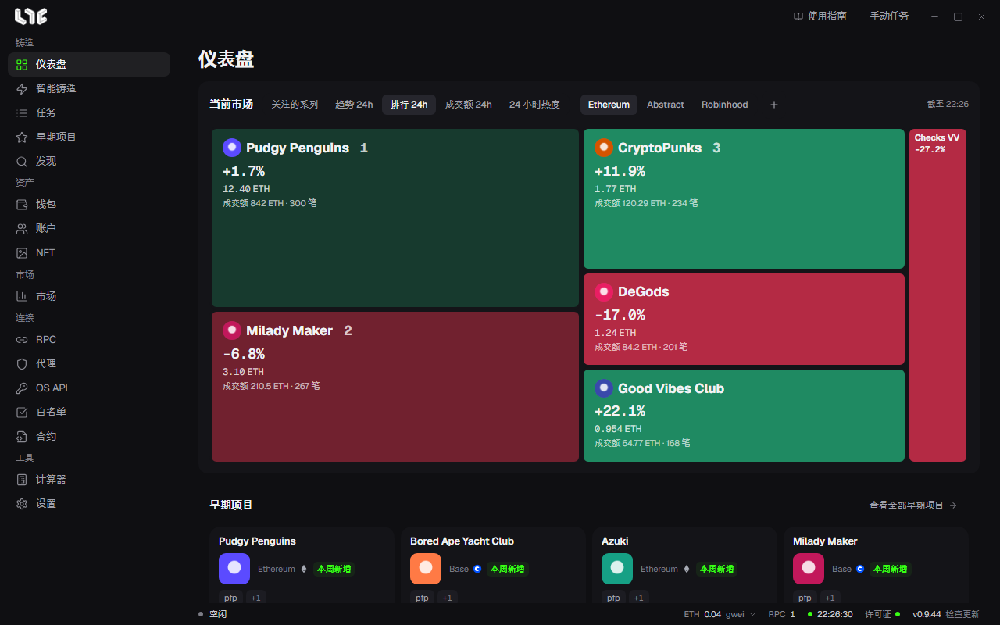

# 界面介绍

应用界面分为左侧菜单、顶部栏、中间的工作区和底部状态栏。

## 左侧菜单

菜单分为五组，大致按使用顺序排列。

| 分组 | 菜单 | 用途 |
|---|---|---|
| 铸造 | 仪表盘 | 一眼看到当前市场和早期项目。打开应用时首先显示的页面。 |
| | 智能铸造 | 用链接或地址创建铸造任务。 |
| | 任务 | 创建、启动、停止任务。有任务在运行时，菜单旁会显示数量。 |
| | 早期项目 | 运营者挑选的铸造前项目。 |
| | 发现 | 在链上查找新的 SeaDrop Drop 并收集起来。 |
| 资产 | 钱包 | 按分组管理铸造用的钱包。 |
| | 账户 | 社交任务使用的 Gmail、X、Discord 账号。 |
| | NFT | 持仓、盈亏和查看器。 |
| 市场 | 市场 | 系列排行、图表、提醒和铸造日历。 |
| 连接 | RPC | 应用发送交易所用的节点地址。 |
| | 代理 | 把网站请求分散到多个 IP。 |
| | OS API | OpenSea API 密钥。 |
| | 白名单 | 检查并整理钱包的白名单资格。 |
| | 合约 | 捆绑使用的 EIP-7702 合约。 |
| 工具 | 计算器 | Gas 费用计算和 Unix 时间转换。 |
| | 设置 | 语言、更新、备份、发射引擎等全局设置。 |

## 顶部栏

- **使用指南**：用浏览器打开本指南。
- **手动任务**：跳转到任务页面并直接打开 **创建任务** 窗口。在任何页面都可以点。
- 最右边的三个按钮是最小化、全屏和关闭。关闭会完全退出应用。

## 底部状态栏

从左往右这样看。

| 项 | 含义 |
|---|---|
| 第一项 | 应用里最近发生的事。没有动作时显示 **空闲**；任务运行时显示运行数量；上架或转出 NFT 进行中时显示进度。即使在其他页面也不会错过结果。 |
| Gas | 所选链当前的 Gas（gwei）。点击可以换链。 |
| RPC | 已保存的 RPC 数量。鼠标悬停可以看到每个的状态。 |
| 时钟 | 与互联网时间对齐的时间。圆点为绿色表示和电脑时钟基本一致；电脑时钟偏差超过 1.5 秒时，旁边会显示差值。点击可重新同步。任务按电脑时钟发射，差值大时请同步 Windows 时间。 |
| 许可证 | 圆点为绿色表示许可证有效。 |
| 版本 | 当前版本和 **检查更新**。 |

## 仪表盘

仪表盘上方的 **当前市场** 用方块展示系列。名称旁的数字是排名，绿色表示上涨，红色表示下跌。方块上显示地板价、24 小时变化、成交额和成交笔数，点击会打开市场中该系列的页面。

| 标签 | 选取标准 |
|---|---|
| 关注的系列 | 在市场中加星的系列 |
| 趋势 24h | 24 小时成交笔数最多 |
| 排行 24h | 24 小时成交额最多 |
| 成交额 24h | 24 小时成交额相对 7 日日均增长最多 |
| 24 小时热度 | 24 小时地板价涨幅最大（成交 3 笔以上） |

用标签右侧的链按钮切换链，用 **+** 添加其他链。

下方的 **早期项目** 显示运营者挑选的项目卡片。点击 **查看全部早期项目** 进入 [早期项目](../tasks/early-calls.md) 页面。

## 语言

在 **设置 → 常规 → 语言** 中选择 English、한국어 或 简体中文。立即生效，并保存在这台电脑上。
