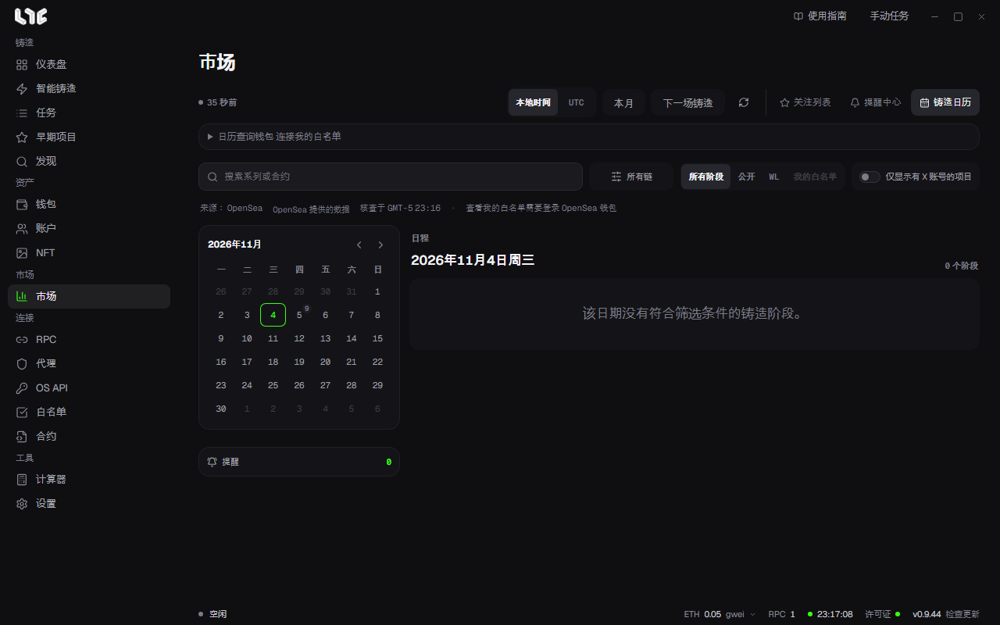

# 铸造日历

用日历查看即将到来的铸造日程，并在开始前收到提醒。从 **市场** 工具栏的 **铸造日历** 进入。

OpenSea 铸造日程通过你自己的 OpenSea API 密钥获取。必须先在 **OS API** 里填入密钥，才会出现日程。见 [OpenSea API 密钥](../setup/opensea-api.md)。

## 工具栏与筛选

- 切换 **本地时间** 和 **UTC**。
- **本月** 跳到今天，**下一场铸造** 跳到最近的阶段。
- **搜索系列或合约**，以及链选择。
- 阶段筛选：**所有阶段**、**公开**、**WL**、**我的白名单**。
- **仅显示有 X 账号的项目**。

## 我的白名单

只保留你的钱包有资格的阶段。

1. 展开 **日历查询钱包** 卡片，选择钱包。
2. 点击 **连接我的白名单**。

这是用于确认资格的 OpenSea 登录。没有交易，也没有 Gas 费用。连接时会对 OpenSea 登录消息签名，并同意服务条款和隐私政策。关闭应用后连接会断开，登录会在一天后过期。

## 日历与日程

- 左侧日历里，每个日期显示阶段数。点击日期，右侧的 **日程** 会随之变化。
- **日程** 显示开始时间和剩余时间、系列、链、阶段、价格、每个钱包的最大数量。
- 行尾的铃铛是 **设置提醒**。

## 提醒

选择开始前的提醒时间点（开始时、5 分钟、15 分钟、30 分钟、1 小时、3 小时、1 天前）和渠道（Windows、Telegram）。在左侧的 **提醒** 卡片里删除。

## Drop 详情

点击一行，会打开详情。

- 合约、总数量、类型、更新状态
- 各阶段的开始、结束、价格、每个钱包的上限
- **链上核查**：直接在合约上核对日程。失败时点击 **重试**
- 来源，以及 **网站**、**X**、**打开来源** 链接

看中的 Drop，用 **打开来源** 打开铸造页面，再把那个链接填入[智能铸造](../tasks/smart-mint.md)即可。
