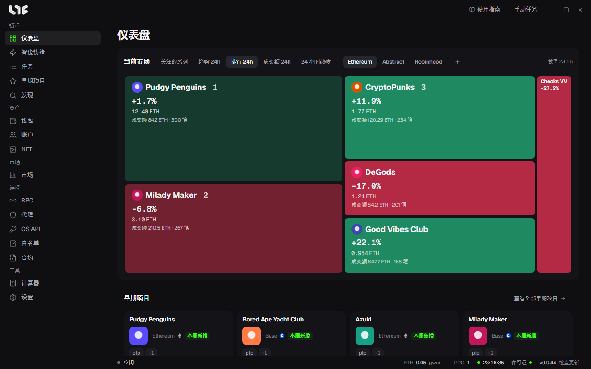

# 仪表盘

这是应用的首页。查看当前市场和早期项目。

## 当前市场

方块的大小表示交易规模。绿色表示上涨，红色表示下跌。点击方块，会进入市场里的系列详情。

| 标签页 | 显示的内容 |
| --- | --- |
| 关注的系列 | 在市场里加了星标的系列 |
| 趋势 24h | 24 小时成交笔数靠前 |
| 排行 24h | 24 小时成交额靠前 |
| 成交额 24h | 24 小时成交额，相对 7 日均值的增幅靠前 |
| 24 小时热度 | 24 小时地板价涨幅靠前（成交 3 笔以上） |

在右侧选择链。用 **+** 打开其他链。

## 早期项目

这里显示运营者作为仪表盘精选挑出的、尚未铸造的项目。用 **查看全部早期项目** 打开[早期项目](early-calls.md)。

## 顶部与底部

- 顶部 **使用指南**：打开这份指南。
- 顶部 **手动任务**：直接打开创建任务窗口。
- 底部状态栏：显示运行状态、Gas、RPC 数量、电脑时间、许可证状态和版本。把鼠标放在 Gas 或 RPC 上，会显示详细信息。
