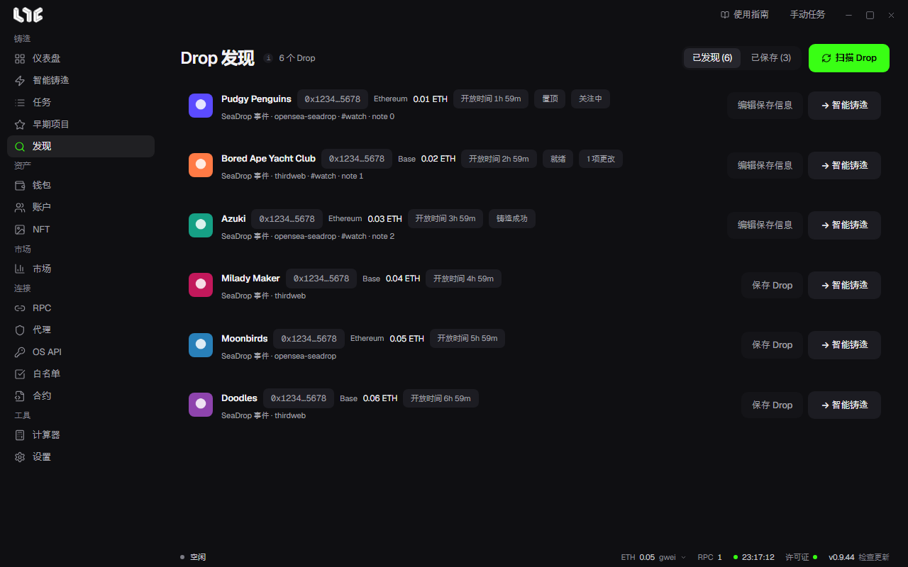

# Drop 发现

扫描支持的链上的 SeaDrop 配置事件和最近的 SeaDrop 部署，找出新的 Drop。按合约去除重复。在你点击 **扫描 Drop** 之前不会扫描，所以平时不占用 RPC。

## 使用方法

1. 点击 **扫描 Drop**。
2. 在列表里查看 Drop。会显示链、价格、距离开放的剩余时间和来源。
3. 点击 **→ 智能铸造**，该 Drop 就会填入[智能铸造](../tasks/smart-mint.md)。

可以在行里复制合约。

## 保存

用 **保存 Drop** 加入后，即使发现列表刷新过去，也会保留。在 **已保存** 里查看。

在 **编辑保存信息** 里设定下面这些。

- **置顶**
- 状态：**关注中**、**就绪**、**铸造成功** 等
- 标签（用逗号分隔）和个人备注

已保存的 Drop，如果价格、开始、结束、阶段、平台、名称发生变化，会显示变化数量。确认后标记就会消失。用 **取消保存** 把它移除。

通过扫描找到的 Drop 只是尚未验证的候选。请先确认它和官方链接一致，再使用。
