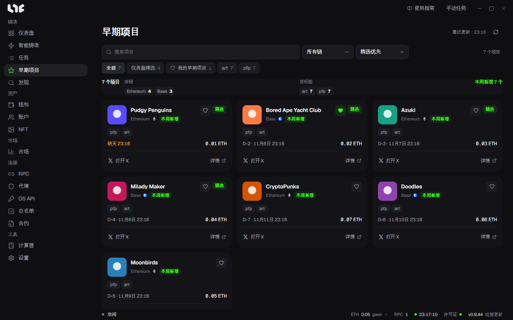

# 早期项目

这是运营者挑选的、尚未铸造的项目列表。从左侧菜单的 **早期项目** 进入。

## 浏览

- 用 **搜索项目**、链、标签筛选。
- 排序：精选优先、最新登记、最近铸造。
- 标签页：**全部**、**仪表盘精选**、**我的早期项目**。
- 顶部统计会按链、按标签，统计当前筛选出的项目。

## 卡片

卡片上显示项目名称、一句话介绍、链、标签、铸造安排和剩余天数（如 D-3）。点击 **详情**，会显示项目介绍、铸造价格、链接和运营者的更新记录。

点击星标，会加入 **我的早期项目**。它保存在这台电脑上。

## 标签

运营者会加上这类标签：新项目、热度上升、白名单招募中、即将铸造、团队公开、联名、免费铸造、热门。

查看早期项目不会启动任何任务。铸造开放后，请用[智能铸造](../tasks/smart-mint.md)创建任务。
