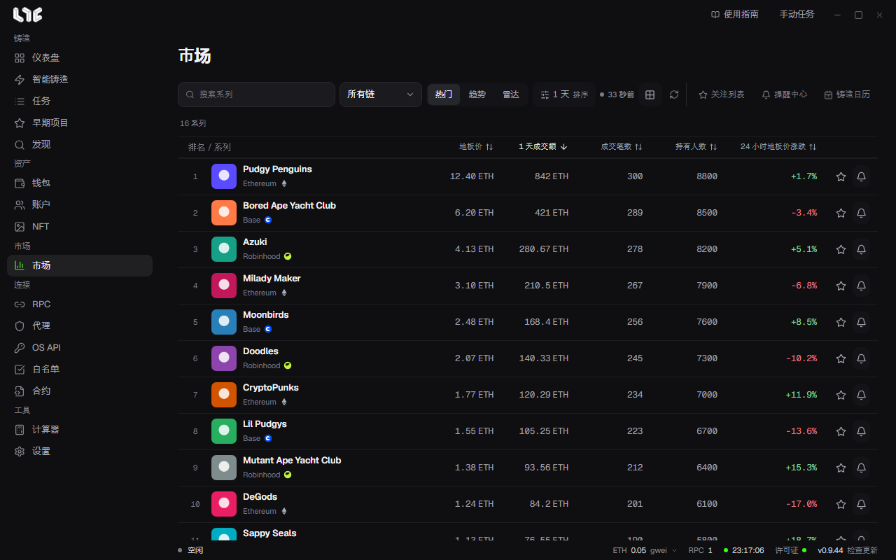

# 市场

这个页面用来实时查看系列行情、收集关注的系列，并设置提醒。

行情实时来自 Nogada 市场中心。没有 OpenSea API 密钥也能查看。连接状态显示在 **设置 → 集成 → 市场中心**。

用工具栏右侧的 **关注列表**、**提醒中心**、**铸造日历** 切换页面。

## 浏览

- **搜索系列**：按名称查找。
- **链**：只看某一条链。
- **热门**、**趋势**、**雷达**：查看排名的三种方式。趋势是在所选时间范围内走热的系列，雷达是两者的结合。
- **时间范围与排序**：选择探索标准和查询时间范围。排序标准一次只应用一个。
- 切换 **卡片视图**、**表格视图**。

表格显示排名、系列、地板价、成交额、成交笔数、持有人数、24 小时地板价涨跌。点击列标题可以排序。

行里的星标是 **关注**，铃铛是 **创建提醒**。点击名称，会进入系列详情。

## 系列详情

顶部显示行情摘要：地板价、最高报价、24 小时成交额和成交笔数、平均成交价、总量、持有人数、挂单、持有者比例、报价 / 地板价。

### 图表

- **时间范围**：1 小时、1 天、7 天、30 天。K 线周期可以单独选择。
- **图表指标**：地板价、订单簿、挂单、报价、成交额、SMA 20、EMA 50、布林带、RSI 14、我的均价。
- **稀有度筛选**：按传说+史诗、稀有及以上等条件筛选成交点。点击成交点，会打开该代币的卡片。如果有已保存的排名，不会消耗 OpenSea 上限，会先显示出来。
- **图表样式**：成交点、K 线图、收盘线。
- 绘图工具：十字线、趋势线、价格线、测量价格和时间。
- 支持滚轮缩放、拖动平移、双击或 Home 键重置、方向键和 +/−。
- 用 **复制图表图片** 复制图片。

第一次打开一个系列时，需要稍等，应用正在收集价格记录。会显示剩余时间。

### 右侧面板

- **动态**：用标签筛选成交、挂单、报价、转移、铸造。用 **查看历史记录** 查看更早的记录。
- **订单簿**：按价格区间显示累计的报价和挂单。
- **持有者**：持有人数、前 10 位持有占比、排名靠前的钱包。
- **属性**：按属性显示地板价、总量和 24 小时交易。部分链不支持。

## 关注列表

只收集加了星标的系列。和仪表盘的 **关注的系列** 是同一份列表。

## 提醒中心

有 **系列**、**钱包**、**历史** 三个标签页。

### 系列提醒

即使没有打开详情页，也会通知你变化。在 **新建提醒** 里设定下面这些。

- **系列标识** 和链
- **指标**：地板价、地板价变化 %、成交额变化 %、成交笔数变化 %、挂单数量变化 %、最高报价 / 地板价 %、前 10 位持有占比、RSI
- **条件** 和 **阈值**。如果是地板价，还要设置 **价格币种**
- **提醒间隔**，以及 **仅一次** 或 **重复**
- 渠道：**Windows**、**Telegram**

### 钱包提醒

在 **新建钱包提醒** 里，追踪某个 EVM 地址在 OpenSea 上的活动。可以在铸造、收到、买入、卖出中选择。

### Telegram 连接

想通过 Telegram 接收，请在提醒中心的 Telegram 连接卡片里生成连接码，然后向用同一个许可证登录的机器人聊天发送命令。连接码 5 分钟内有效。只连接市场提醒。

## 想查看用钱包买到的 NFT

你持有的 NFT 在[持仓 NFT](../tools/nfts.md)里查看，盈亏在[盈亏](../tools/pnl.md)里查看。
