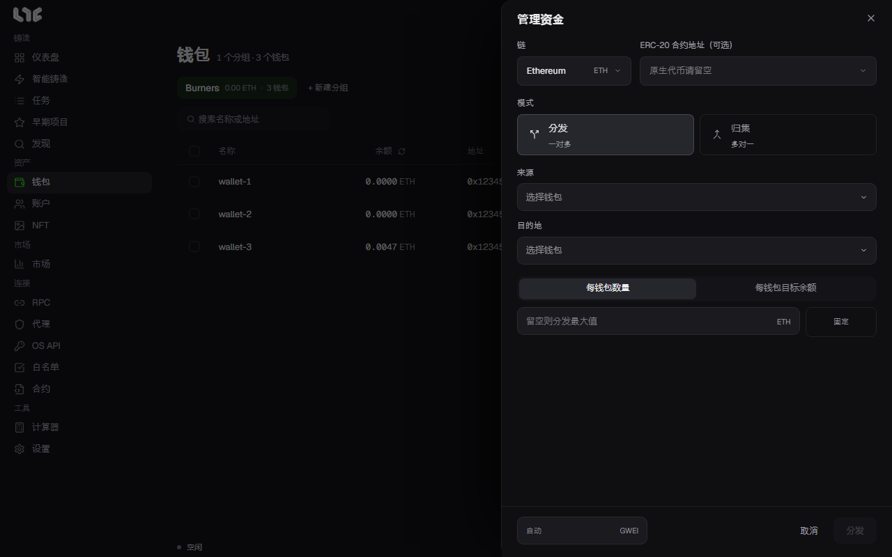

# 分发与归集资金

**钱包 → 管理资金** 用于在钱包之间批量转币。铸造前分发 Gas、铸造后把剩余资金归集到一个钱包时使用。

## 窗口中的栏位

| 栏位 | 填写内容 |
|---|---|
| 链 | 转账所在的链。 |
| ERC-20 合约地址（可选） | 只在转代币时填写代币合约。留空表示该链的原生币（ETH 等）。 |
| 模式 | **分发**（一对多）或 **归集**（多对一）。 |
| 来源 | 转出资金的钱包。 |
| 目的地 | 接收资金的钱包。列表中没有的地址也可以手动输入。 |
| 金额 | 用下面两种方式之一设置。 |
| 左下角 gwei | 这次转账使用的 Gas。留空为自动。只写一个数，例如 `30`，表示最高费用和优先费都是这个值；写成 `30/2` 时前者是最高费用，后者是优先费。 |

## 设置金额的两种方式

- **每钱包数量**：每个目的地收到相同金额。留空表示把来源能转出的全部分发出去。
- **每钱包目标余额**：把每个目的地的余额补足到这个值，只转差额。已经达到或超过的钱包会跳过。在归集模式下则相反，每个转出钱包保留这个值，其余全部转出。

点击金额旁的 **固定** 按钮，可以输入 `0.02 - 0.03` 这样的范围。这样每个钱包会收到该范围内的随机金额。

## 分发的实际做法

分发会先通过分发合约用一笔交易转给所有目的地。这笔交易失败时，应用会询问 **单独发送？**，同意后由同一个来源钱包给每个目的地各发一笔交易。

## 从一个钱包转到一个地址

只从一个钱包转到一个地址时，用钱包表格该行上的发送按钮更快。→ [钱包](wallet-groups.md)

## 发送前

- 再确认一次来源和目的地。上链的交易无法撤销。
- 来源钱包除了要转的金额，还需要留有 Gas。
- 每个钱包需要多少，可以参考 [计算器](../app/calculator.md) 中的 **所需余额**。
