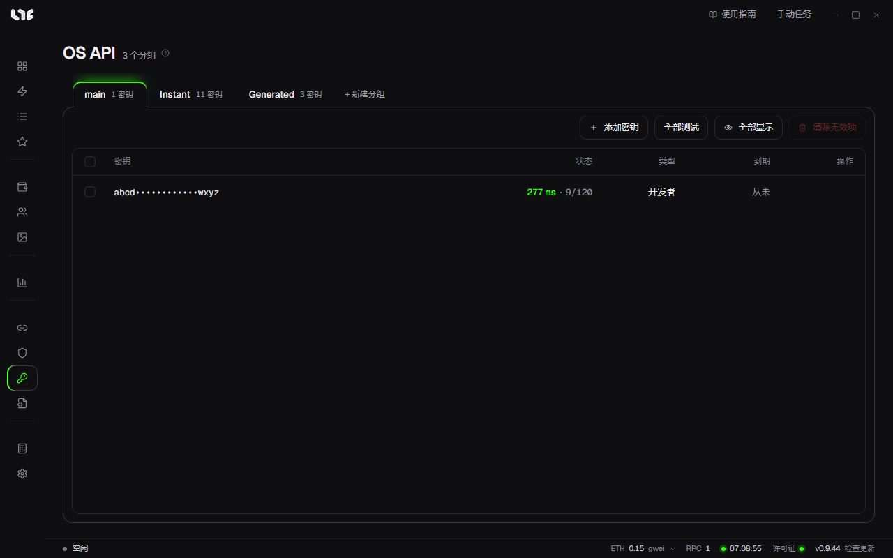

# OpenSea API 密钥

**OS API** 用来存放 OpenSea API 密钥。没有密钥也能铸造，但要在应用里通过 OpenSea 出售，就需要密钥。

## 添加密钥

1. 用 **+ 新建分组** 创建分组。任务中可以选择使用哪个分组的密钥。
2. 点击 **添加密钥**，每行粘贴一个密钥。
3. 点击添加按钮。应用会逐个向 OpenSea 确认，只保存被接受的密钥。

密钥加密保存在这台电脑上。

## 看懂表格

| 列 | 含义 |
|---|---|
| 密钥 | 只显示首尾几个字符。点击 **全部显示** 可以看到完整密钥。 |
| 状态 | 上次检查时的响应时间，以及 OpenSea 告知的剩余请求数 / 上限。 |
| 类型 | **开发者**、**Instant** 等密钥类型。 |
| 到期 | 密钥有到期时间时显示。 |

- **全部测试**：重新检查分组中的所有密钥。
- **清除无效项**：删除分组中已到期或被 OpenSea 拒绝的密钥。

**Instant** 分组存放由 Instant 密钥任务生成的短期密钥。生成密钥的任务在 [账户与社交任务](../social/accounts-and-social.md) 的模块中选择。

## 有密钥才能用的功能

| 功能 | 没有密钥时 |
|---|---|
| 持仓中的 **上架所选**、**取消上架**、**接受报价** | 无法使用。按钮处于关闭状态，鼠标移上去会提示在 OS API 页面添加密钥。 |
| 持仓表格的 **挂单**、**最高报价** 列 | 显示 **需要 OpenSea API 密钥**，不显示数值。 |
| 任务铸造后操作中的 **上架 NFT**、**接受报价** | 无法使用。栏位旁会显示 **需要 OpenSea API 密钥**。 |
| 智能铸造和任务的 OpenSea 模式中的 **OpenSea API**、**双模式** | 无法选择。栏位名称旁会显示 **需要 OpenSea API 密钥**。 |
| 市场的钱包提醒 | 提醒中心不显示 **钱包** 标签，钱包提醒也不运行。已建的钱包提醒不会被删除，重新添加密钥后会恢复。 |
| 铸造日历的连接我的白名单 | 无法使用。尝试连接时会提示先在 OS API 页面添加密钥。 |
| 签名 Drop 的 **普通模式**、**匿名模式** | 可以使用。 |
| 市场价格和图表 | 可以使用。数据来自 Nogada 服务器。 |

## 钱包多就多放几个密钥

**状态** 列显示 OpenSea 还允许这个密钥再发多少次请求。一个任务分组同时为很多钱包发请求时，一个密钥可能中途用完，所以钱包多时请多放几个密钥。智能铸造的提示也是这样建议的。
