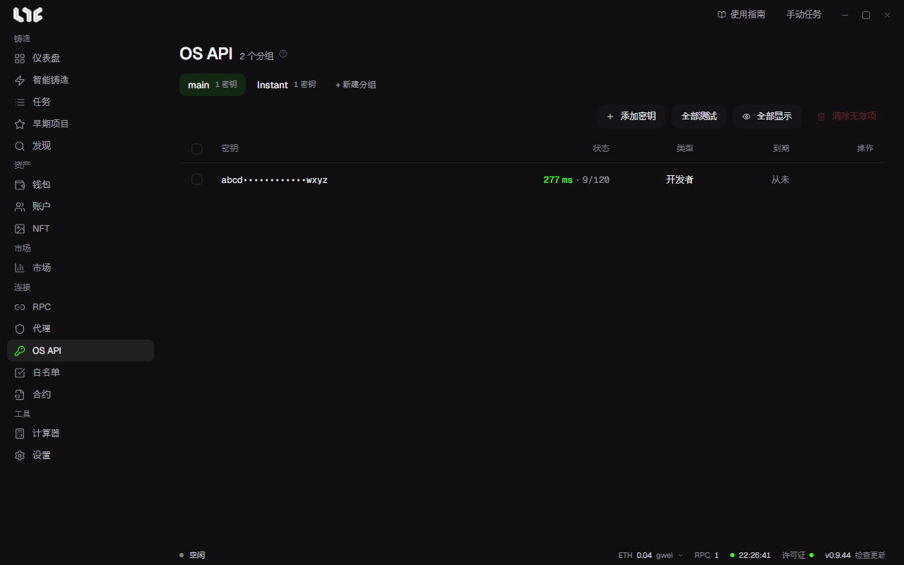

# OpenSea API 密钥

**OS API** 用来存放 OpenSea API 密钥。没有密钥也能铸造，但要在应用里通过 OpenSea 出售，就需要密钥。

## 获取密钥

有两种。

- **Developer 密钥**：在 OpenSea 免费获取。在 opensea.io 打开 **Settings → Developer**，验证邮箱，点击 **Get access**，填写简短的表单，再点 **Create key**。一个 OpenSea 账户最多可以建 3 个。它能处理的请求比 Instant 密钥多得多。
- **Instant 密钥**：用 [账户与社交任务](../social/accounts-and-social.md) 中的 Instant 密钥任务创建。有效期 7 天，能处理的请求很少。创建时一定经过代理（见 [代理](proxy-groups.md)）。

## 添加密钥

1. 用 **+ 新建分组** 创建分组。任务中可以选择使用哪个分组的密钥。
2. 点击 **添加密钥**，每行粘贴一个密钥。
3. 点击添加按钮。应用会逐个向 OpenSea 确认，只保存被接受的密钥。

密钥加密保存在这台电脑上。

## 看懂表格

| 列 | 含义 |
|---|---|
| 密钥 | 只显示首尾几个字符。点击 **全部显示** 可以看到完整密钥。 |
| 状态 | 上次检查时的响应时间，以及 OpenSea 告知的剩余请求数 / 上限。 |
| 类型 | **开发者**、**Instant** 等密钥类型。 |
| 到期 | 密钥有到期时间时显示。 |

- **全部测试**：重新检查分组中的所有密钥。
- **清除无效项**：删除分组中已到期或被 OpenSea 拒绝的密钥。

**Instant** 分组存放由 Instant 密钥任务生成的短期密钥。生成密钥的任务在 [账户与社交任务](../social/accounts-and-social.md) 的模块中选择。

## 有密钥才能用的功能

| 功能 | 没有密钥时 |
|---|---|
| 持仓中的 **上架所选**、**取消上架**、**接受报价** | 无法使用。按钮处于关闭状态，鼠标移上去会提示在 OS API 页面添加密钥。 |
| 持仓表格的 **挂单**、**最高报价** 列 | 显示 **需要 OpenSea API 密钥**，不显示数值。 |
| 任务铸造后操作中的 **上架 NFT**、**接受报价** | 无法使用。栏位旁会显示 **需要 OpenSea API 密钥**。 |
| 智能铸造和任务的 OpenSea 模式中的 **OpenSea API**、**双模式** | 无法选择。栏位名称旁会显示 **需要 OpenSea API 密钥**。 |
| 市场的钱包提醒 | 提醒中心不显示 **钱包** 标签，钱包提醒也不运行。已建的钱包提醒不会被删除，重新添加密钥后会恢复。 |
| 铸造日历的连接我的白名单 | 无法使用。尝试连接时会提示先在 OS API 页面添加密钥。 |
| 签名 Drop 的 **普通模式**、**匿名模式** | 可以使用。 |
| 市场价格和图表 | 可以使用。数据来自 Nogada 服务器。 |

## 钱包多就多放几个密钥

**状态** 列显示 OpenSea 还允许这个密钥再发多少次请求。一个任务分组同时为很多钱包发请求时，一个密钥可能中途用完，所以钱包多时请多放几个密钥。智能铸造的提示也是这样建议的。

每个密钥的限额是各自独立的。即使在同一个 IP 上使用，密钥之间也不共用限额，所以使用密钥时不需要代理。

## 我们测试中看到的数值

这是 2026 年 11 月我们自己测出的大致数值，供参考。OpenSea 会调整限额，不同的 Drop 和时间点结果也可能不同。

| 尝试内容 | 结果 |
|---|---|
| 用一个 Developer 密钥同时为 10 个钱包请求铸造数据 | 10 个都收到回复 |
| 同一个密钥同时请求 30 个钱包 | 26 个收到回复，4 个因请求太快被拒 |
| Developer 密钥恢复的速度 | 一次最多约 120 次，之后每秒恢复约 2 次 |
| 一个 Instant 密钥 | 约 5 次回复，之后每小时恢复 5 次左右 |

API 模式下每个钱包请求一次。按上面的数值算，100 个钱包大约需要 4 个 Developer 密钥。这是按上述数值算出来的，并没有在真实开售时试过，而且密钥测试针对的是尚未开放阶段的 Drop。铸造前打开 100 个钱包的 NFT 页面，也可能用完一个密钥的额度。
