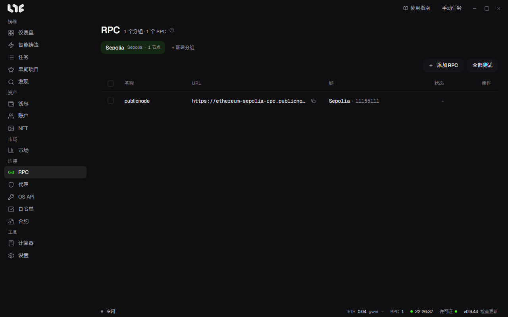

# RPC 与链

RPC 是应用读取链上状态、发送交易所用的节点地址。任务发出的每笔交易都要经过 RPC，RPC 慢或被限制，发送就会变晚或失败。



## 不添加 RPC 时

不添加也能用。如果某条链一个 RPC 都没有保存，应用会通过该链内置的公共 RPC 发送，并在任务窗口下方提示 **无 RPC，使用公共 RPC**。公共 RPC 由很多人共用，请求一多就会被限制或变慢。有竞争的铸造请添加付费 RPC。应用的帮助推荐 Alchemy、Ankr、DRPC、QuickNode。

## 添加 RPC

1. 在 **RPC** 中用 **+ 新建分组** 创建分组。
2. 点击 **添加 RPC**，每行粘贴一个。写 `名称,URL` 或只写 URL 都可以。

```
eth-alchemy,https://eth-mainnet.g.alchemy.com/v2/你的密钥
https://base-mainnet.example.com/abc
```

3. 添加后，应用会向每个地址询问它属于哪条链，并在 **链** 列填上名称和链 ID。
4. 点击 **全部测试** 检查分组里的所有 RPC。每行也有按钮可以单独检查。结果显示在 **状态** 列。

鼠标悬停在底部状态栏的 **RPC** 上，可以一次看到所有已保存 RPC 的状态。

## 任务如何使用 RPC

在任务窗口中选择多个钱包时，每个钱包会各生成一个任务。RPC 这样分配：

- 在 **RPC 节点** 中选了 RPC 就用所选的；留空则使用该链保存的全部 RPC。
- 通常每个任务轮流分到一个 RPC：钱包 1 用 RPC 1，钱包 2 用 RPC 2，依此类推。
- 开启 **设置 → 发射引擎 → 广播** 中的 **多 RPC 广播** 后，每个任务都会拿到全部 RPC。同一笔已签名的交易同时发给这些 RPC，nonce 不会冲突，传播更快。**连发多 RPC 广播** 对连发任务也这样做。
- 任务有多个 RPC 时，如果在发送前检查或准备中出现 RPC 错误，会换到下一个 RPC。所有 RPC 都提示余额或额度不足时，任务会以此原因停止。

保存在 RPC 中的 Alchemy 地址也会用于读取 NFT 盈亏和持仓。要按链单独设置，请填写 **设置 → 集成 → PnL Alchemy URL**。

## 链的设置

各条链的设置在 **设置 → 发射引擎** 最下方的链列表里。

- **开 / 关**：隐藏不用的链。
- **公共备用 RPC**：更换该链没有保存 RPC 时使用的公共 RPC。留空使用应用默认值。该链只要保存了任何 RPC，就完全不会用到这个公共 RPC。
- **最低小费**：该链自动 Gas 可以使用的最低优先费（gwei）。留空表示不另设下限。

### 添加自定义链

列表中没有的 EVM 链可以用 **添加自定义链** 加入。填写名称、RPC URL、符号（Gas 币名称）和区块浏览器（可选）；链 ID 可以手动填写，或点击 **检测** 从 RPC 读取。保存前请再看一眼链 ID：这是以后唯一不能修改的值，填错只能删除这条链再重新添加。应用按 18 位小数处理 Gas 币，小数位不是 18 的链，余额和金额可能显示不正确。

## 支持的链

| 链 | Gas 币 | 链 ID |
|---|---|---|
| Abstract | ETH | 2741 |
| Apechain | APE | 33139 |
| Arbitrum | ETH | 42161 |
| Arc | USDC | 5042 |
| Avalanche | AVAX | 43114 |
| Base | ETH | 8453 |
| Bittensor | TAO | 964 |
| BSC | BNB | 56 |
| Ethereum | ETH | 1 |
| HyperEVM | HYPE | 999 |
| Ink | ETH | 57073 |
| Linea | ETH | 59144 |
| MegaETH | ETH | 4326 |
| Monad | MON | 143 |
| opBNB | BNB | 204 |
| Optimism | ETH | 10 |
| Polygon | POL | 137 |
| Robinhood | ETH | 4663 |
| Ronin | RON | 2020 |
| Shape | ETH | 360 |
| Stable | USDT0 | 988 |
| Zora | ETH | 7777777 |
| Sepolia（测试网） | ETH | 11155111 |
