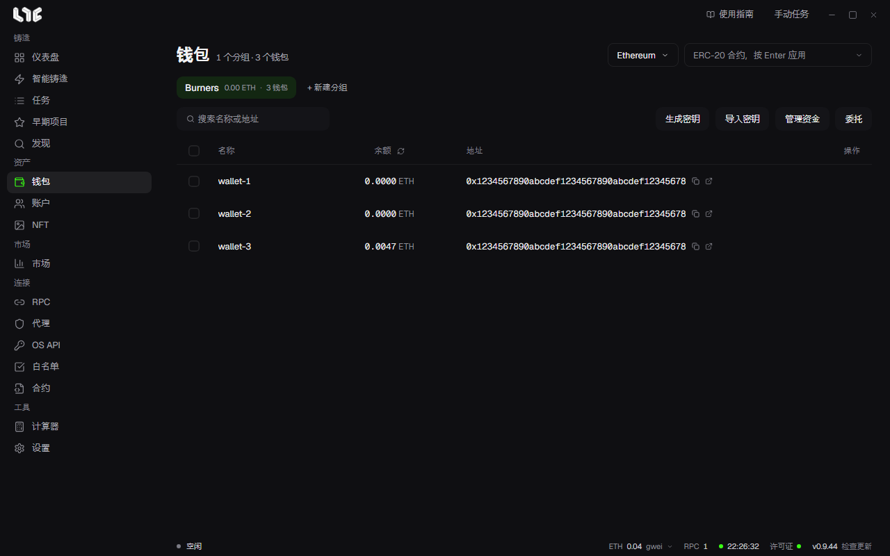

# 钱包

任务按钱包分组选择钱包，所以先创建分组，再把钱包放进去。



## 创建分组

1. 在 **钱包** 中点击 **+ 新建分组**。
2. 输入名称并点击 **创建**。按用途或链分组，之后创建任务时更容易选择。

分组按钮上显示该分组的余额合计和钱包数量。鼠标悬停在分组上会出现重命名和删除按钮。删除分组会同时删除其中的钱包。

## 添加钱包

用右上方的两个按钮添加。

**导入密钥**：添加已有的钱包。每行一个，写 `名称,私钥` 或只写私钥，名称可以省略。窗口上方会显示能识别的行数，点击导入按钮即可添加。

```
main-1,0x私钥...
main-2,0x私钥...
0x私钥...
```

**生成密钥**：生成新钱包。输入 **数量** 并确认，分组中会出现新的私钥和地址。生成后请务必另外保存私钥。

私钥用 Windows 账户加密保存在这台电脑上，不会发送到服务器。

## 看懂表格

| 列 | 含义 |
|---|---|
| 名称 | 钱包名称。没有名称时显示地址末尾。 |
| 余额 | 右上方所选链上的余额。列标题旁的图标用于刷新。 |
| 地址 | 带有复制按钮和在浏览器中打开的按钮。 |
| 操作 | 鼠标悬停在行上会出现编辑、发送、删除。 |

更换右上方的链，就会读取那条链上的余额。在旁边一栏输入 ERC-20 代币合约并按 Enter，会改为显示该代币的余额。

搜索栏可以输入名称或地址的一部分。

## 单个钱包

- **编辑**（铅笔）：修改名称，查看或复制地址和私钥。私钥要点击眼睛按钮才会显示。
- **发送**（纸飞机）：从这个钱包向一个地址转币。填写链、**接收方** 和数量。开启 **发送最大值** 会扣除 Gas 后全部发送。在左下角填入 gwei 就用该 Gas，留空则自动。
- **删除**（垃圾桶）：删除钱包。无法撤销，请先确认已另外保存私钥。

## 一次处理多个钱包

勾选钱包后，底部会出现操作栏。

- **批量重命名**
- **复制地址**：把所选钱包的地址每行一个复制下来。
- **复制私钥**：在确认窗口中选择 **复制密钥**（只有密钥）或 **复制 名称,密钥**（每行 `名称,密钥`）。剪贴板其他程序也能读取，粘贴后请清空剪贴板。
- **删除**

## 委托列

点击 **委托**，余额列会换成委托列。它显示每个钱包通过 EIP-7702 委托给了哪个合约，并附带筛选和重新检查按钮。使用捆绑铸造时会用到。→ [捆绑与合约](../tasks/bundles.md)

## 下一步

要给钱包准备 Gas，请看 [分发与归集资金](funding.md)。
