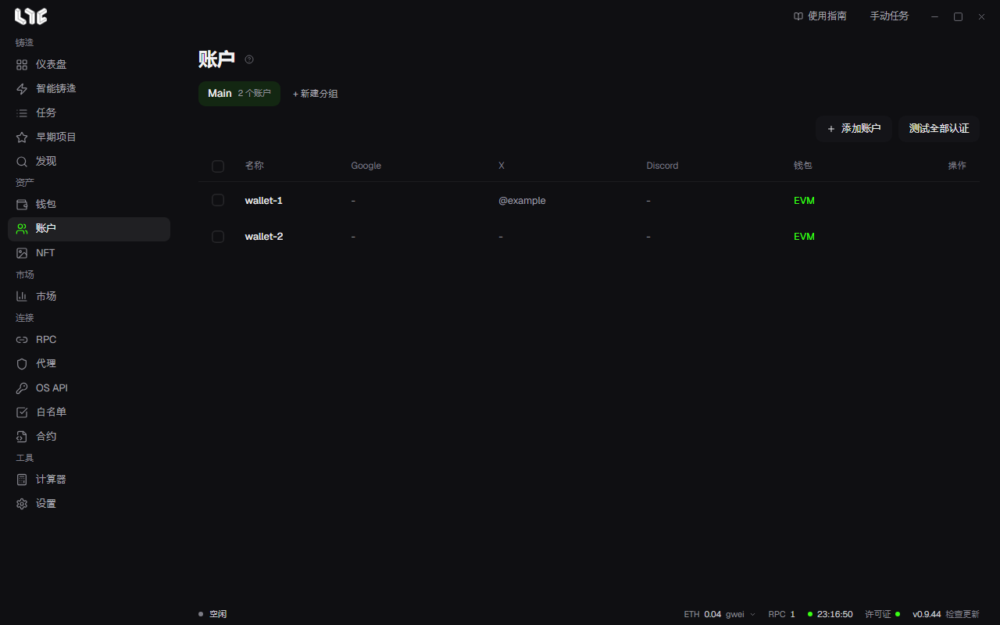

# 社交账户

这里集中保存社交任务使用的账户。通常给每个钱包配一个邮箱、一个 X、一个 Discord 和一个代理来管理。如果你只做链上铸造，就不需要这个页面。

## 账户保存的内容

| 字段 | 用途 |
| --- | --- |
| 显示名称 | 自由命名的标签 |
| 私钥 / EVM 钱包 | 提交地址和网站签名 |
| Gmail | 要提交的地址，Google 表单登录 |
| 应用专用密码 | 用于邮件验证，可选 |
| X Cookie(auth_token) | X 操作和 X 登录 |
| X 用户名 | 填入 `{xhandle}` 的位置。验证 Cookie 后会自动填写 |
| Discord 令牌 | Discord 操作 |
| Discord 用户名 | 填入 `{discord}` 的位置。验证令牌后会自动填写 |
| 代理 | 从代理菜单里选一个，可选 |

## 添加账户

1. 点击 **+ 新建分组**，再用 **从钱包导入** 选择钱包分组。每个钱包都会生成一个账户。
2. 点击行里的编辑，填入社交信息。
3. 想一次给多个账户填入，就选中这些账户，点击 **批量连接**。

也可以用 **添加账户** 逐个添加。

## 连接 Google

有些 Google 表单的创建者要求邮箱登录，这时就需要连接 Google。

1. 在账户编辑窗口里点击 **连接 Google**。
2. 弹出小浏览器后，像平常一样登录。
3. 登录成功后关闭窗口。验证完成后，Gmail 栏会自动填好。

## 获取 X auth_token

购买的账户通常会一起提供。想自己获取，请这样做。

1. 在浏览器里登录 X。
2. 按 F12 打开开发者工具。
3. 在 **Application**（应用）标签页中，选择 **Cookies → https://x.com**。
4. 复制 `auth_token` 行的值，填入账户的 X Cookie 栏。

## 获取 Discord 令牌

1. 在浏览器里登录 Discord 网页版。
2. 按 F12 打开开发者工具，选择 **Network**（网络）标签页。
3. 在筛选框里填入 `/api`，然后点击任意一个频道。
4. 点击其中一个请求，在 **Headers → Request Headers**（标头 → 请求标头）里复制 `authorization` 的值。
5. 填入账户的 Discord 令牌栏。

令牌是由点分隔的三段。请全部复制。修改密码，或在所有设备上退出登录，令牌就会改变。

## 认证测试

用行里的测试，或 **测试全部认证**，确认已保存的认证是否仍然有效。运行大任务之前，请先测试一次。

## 保存位置

账户会加密保存到 `%LOCALAPPDATA%\nogada\data\accounts.dat`。每个账户在 `%LOCALAPPDATA%\nogada\browser-profiles\` 下，都有一个单独的浏览器配置文件。浏览器配置文件里含有 Cookie，不包含在备份里。
