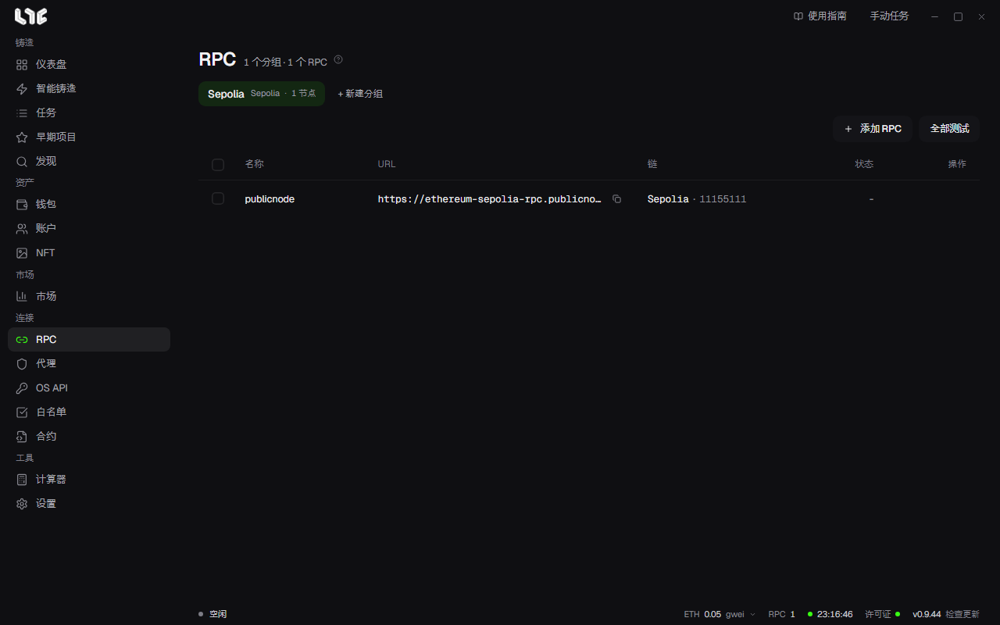

# RPC

所有链上任务都经过 RPC。一份好的 RPC 节点列表，对稳定性的影响最大。

## 添加 RPC

1. 用 **+ 新建分组** 创建分组。按链分组会更方便。
2. 点击 **添加 RPC**，每行粘贴一个。可以填 `名称,URL`，也可以只填 URL。
3. 应用会确认链并测量延迟，然后加入列表。

通过每行左侧的 ping 和 **全部测试**，随时可以重新测量。

付费 RPC 节点的 URL 里含有 API 密钥。应用会把 URL 加密后保存到 `%LOCALAPPDATA%\nogada\data\rpc.dat`。不要把它粘贴到 Discord 或聊天里。

## 任务会把交易发给哪个 RPC

如果任务里没有选择 RPC 节点，就会使用该链所有已保存的 RPC 节点；一个都没有，就使用内置的公共 RPC 节点。

**设置 → 发射引擎 → 多 RPC 广播** 决定具体行为。

- **已启用**：把同一笔已签名的交易同时发送到任务中选择的所有 RPC 节点。内容相同，所以不会有 nonce 冲突。
- **已禁用**：每个任务轮流分配一个 RPC 节点。

## 需要多少

| 用途 | 建议 |
| --- | --- |
| 用 3~5 个钱包轻量使用 | 免费或付费 1~2 个 |
| 20 个以上的钱包 | 付费 3~5 个，越多越好 |
| 连发 | 多家提供商的付费 RPC |

提供商见 [RPC 提供商](../resources/nodes.md)。

## 更改公共 RPC

在 **设置 → 发射引擎** 的链列表里，可以逐条链更改公共 RPC 地址。当内置的公共 RPC 变差，而你又不想填入自己的 RPC 时使用。任务中选择的已保存 RPC 始终优先。
