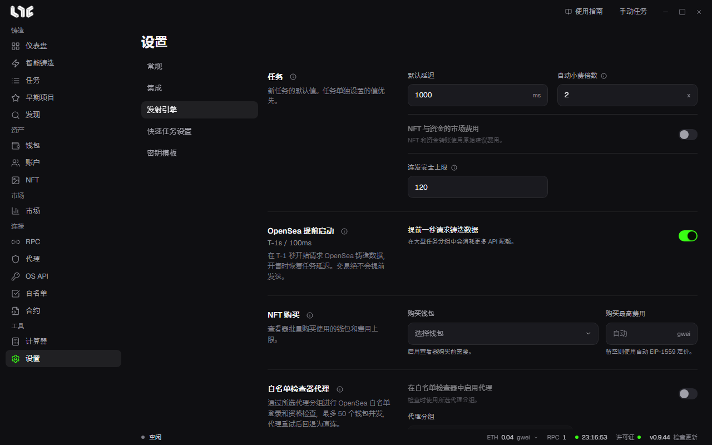

# 设置

设置分为 **常规**、**集成**、**发射引擎**、**快速任务设置**、**密钥模板** 五个标签页。

## 常规

- **语言**：从英语、韩语、简体中文中选择。
- **更新**：查看已安装的版本，并检查新版本。开启 **启动时强制更新** 后，许可证验证通过就立即应用新版本。关闭则只显示通知。见[应用更新](../reference/updates.md)。
- **备份与恢复**：创建并恢复用密码加密的备份。见[备份、恢复与迁移](../reference/backup-restore.md)。
- **导出数据**：把某一项数据导出为未加密的 CSV。见[本地数据与导出](../reference/data-storage.md)。
- **应用日志**：打开日志文件夹，或把已遮挡敏感值的日志包发送给支持团队。
- **退出登录**：停止正在运行的任务并回到许可证界面。见[许可证](../getting-started/license.md)。
- **清除所有数据**：永久删除这台电脑上的钱包、账户、RPC、代理、API 密钥、许可证激活、任务和浏览器配置文件。清空 VPS 时使用。删除 `.exe` 并不会删除这些数据。

## 集成

- **验证码求解器 API 密钥**：支持 CapMonster、CapSolver、2captcha、AnySolver。只有带验证码的社交模块才需要。
- **市场中心**：Nogada 服务器的连接状态。市场和 NFT 行情在这里实时获取，不需要 OpenSea 密钥。签名始终在这台电脑上完成。
- **PnL Alchemy URL**：每条链一个 Alchemy URL。留空则使用 RPC 菜单里的 Alchemy 地址。Stable 使用 Etherscan 密钥。**测试** 不会保存，只检查 URL。
- **Etherscan API 密钥**：可选。留空也能使用公用密钥。填入自己的密钥，可以提高 ABI 查询的上限。
- **Discord Webhook**：任务成功或失败时，向 Discord 发送简短通知。在 Discord 频道设置的 **整合 → Webhook** 里复制 URL 填入。
- **Nogada 捕获浏览器扩展**：见[捕获扩展](../tools/extension.md)。

## 发射引擎

**任务**

- **默认延迟**：新任务的重试间隔（ms）。任务里设定的值优先。
- **自动小费倍数**：优先费为自动时，乘在 RPC 建议值上。普通交易用 1 倍，竞争激烈的铸造用 3~5 倍。0.1 gwei 是下限。
- **NFT 与资金的市场费用**：NFT 和资金转移直接使用建议的费用。
- **连发安全上限**：连发运行的最长时间。防止你忘了关闭连发而无限运行。留空则没有上限。

**OpenSea 提前启动**：从 T-1 秒起请求铸造数据。见 [OpenSea API 密钥](opensea-api.md)。

**NFT 购买**：查看器批量购买所用的钱包和费用上限。见[查看器](../tools/viewer.md)。

**白名单检查器代理**：把 OpenSea 白名单登录和资格检查发送到某个代理分组。最多同时 50 个钱包。

**广播**

- **多 RPC 广播**：把同一笔已签名交易发送到任务中选择的所有 RPC 节点。见 [RPC](rpc.md)。
- **连发多 RPC 广播**：连发的交易也这样发送。

**Flashbots**：以太坊主网任务可选的私有通道的完整设置。

- **捆绑窗口**：捆绑包有效的区块数。
- **优先费**、**最高费用**：替换开启了 Flashbots 的任务的自动值。
- **信誉密钥**：构建者用来评估信誉的密钥。里面没有资金。重置会清除已积累的信誉。

**链**：隐藏不用的链，并设置公共 RPC 地址和每条链的最低小费。用 **添加自定义链** 添加 EVM 链。见[添加自定义链](../reference/custom-chains.md)。

## 快速任务设置

这是 **快速任务** 按钮使用的默认值。先设好钱包和每条链的 RPC，创建任务时就不用再选。如果没有选择钱包，快速任务按钮会被关闭。没有指定 RPC 的链，会使用该链所有已保存的 RPC 节点，其次使用公共默认值。

## 密钥模板

创建社交任务使用的答案池。见[答案模板与社交模块](../social/templates-modules.md)。
